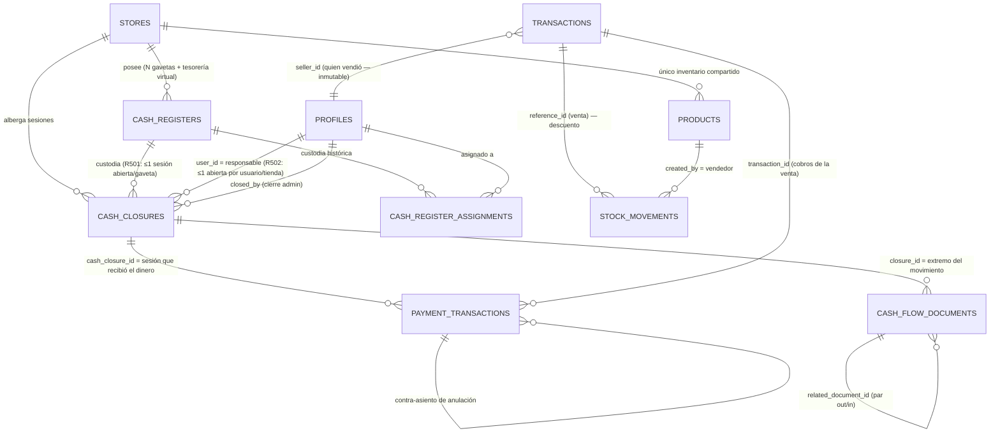

# COSTPRO_MULTICASHIER_DESIGN_002 — Diseño técnico definitivo del sistema multicajero

**Fecha:** 2026-11-07 · **Base:** `COSTPRO_MULTICASHIER_AUDIT_001.md` (PR #1563, hallazgos revalidados) · **Tipo:** diseño cerrado, sin implementación.
**Repo:** Nardian90/Costpro @ main `e778f8674` (sin cambios desde la auditoría; rama del PR `audit/multicashier-001` head `3a9ebe931`).
**Decisión del propietario:** cada vendedor tiene **terminal + gaveta propios**: UNA TIENDA + UN ALMACÉN COMPARTIDO + N CAJAS FÍSICAS + N TERMINALES + N SESIONES FINANCIERAS INDEPENDIENTES.
**Etiquetas:** [MEDIDO] catálogo vivo (prod agregado sin PII / E2E) · [EN CÓDIGO] archivo:línea · [DECISIÓN] decisión de diseño fundamentada · [NO VERIFICADO] pendiente de censo/prueba.

---

## D.0. Resumen del diseño

Tres entidades: `cash_registers` (gaveta física + terminal, **nueva**), `cash_closures` (sesión financiera, **reutilizada** con `cash_register_id`), y el libro de cobros `payment_transactions` (**reutilizado** con `cash_closure_id`). La sesión pertenece al **movimiento de dinero**, no al documento de venta: cada fila de cobro apunta a la sesión que recibió el dinero; `transactions.seller_id` conserva quién vendió. La tesorería central es un **registro virtual** (`cash_registers` con código `TESORERIA`), de modo que fondos, traspasos y retiros son el mismo mecanismo (documento doble `out`+`in` vinculado, dos fases con confirmación). El arqueo v3 se calcula **por sesión y por moneda desde filas atribuidas** (sin ventanas de tienda); el consolidado suma sesiones + tesorería y neutraliza traspasos internos por construcción (neto cero). El P1-02 (RLS sin jerarquía) se corrige **antes** de habilitar la multi-sesión.

## D.1. Fase I — Revisión de la auditoría y estado actual (revalidación)

- PR #1563: **abierto**, `mergeable_state=clean`, head `3a9ebe931` (1 commit, solo `docs/audits/…AUDIT_001.md`), base main `e778f8674`. Sin reviews humanas; comentarios solo de bots (Vercel deploy + Codex sin hallazgos ni por límite de uso). Es seguro actualizar la rama existente. [MEDIDO GitHub API]
- `main` **no ha avanzado**: `git log e778f8674..origin/main` vacío; cero commits tocando `supabase/migrations/`, `cash-service.ts`, `cash_closure/`, `useCashClosures.ts`, rutas API de caja. [MEDIDO]
- Revalidación de pilares en catálogo vivo: índice `one_pending_cash_closure_per_store` sigue activo; `cashService.createClosure/updateClosure` sigue escribiendo por tabla directa (`cash-service.ts:22-45`); políticas `Cash closures unified` (ALL) y `cash_closures_delete_rls` sin cambio → **P1-01, P1-02, P2-03, P2-05 vigentes tal cual**. [MEDIDO]
- Nuevos anclajes [MEDIDO] que refuerzan el diseño: `payment_transactions` con CHECKs `direction ∈ {in,out,refund}`, `payment_method ∈ {cash,transfer,zelle}`, `currency ∈ {CUP,USD,EUR,MLC}`, `ref_type` incluye `adjustment` y `cash_flow`; índice único `uniq_payment_txn_idempotency` (0 claves duplicadas en prod); FK `transaction_id → transactions` RESTRICT; CHECKs que amarran `sale → transaction_id` y `devolution → transaction_id+ref_id`.
- Correcciones/alarmas nuevas respecto a la auditoría original:
  1. **Cobertura del libro de cobros: 751/908 ventas completadas tienen filas `ref_type='sale'`** (prod, agregado) → 157 ventas históricas sin filas. El arqueo v3 sobre `payment_transactions` exige censo por RPC de origen + backfill idempotente ANTES de habilitar sesiones del modelo nuevo. [MEDIDO]
  2. `payment_transactions` también tiene políticas `UPDATE/DELETE` por tienda → mismo patrón de riesgo que P1-02 sobre el libro que alimenta el arqueo; entra en el diseño de seguridad (D.7).
  3. `create_sale_v2` ya inserta **una fila por componente de pago** (`ref_type='sale'`, `paid_by`=vendedor, idempotencia `'pay-{method}-{cur}-{txid}'` — `20261105140000…sql:1070-1091`) y blinda `seller_id` ("SELLER BINDING §4 Opción B: p_seller_id == actor autenticado, sin excepciones" — `…sql:170-171`) → la atribución por cobro es una adición de columna, no un rediseño.
  4. `create_sale_v2` **no** inserta filas de CAMBIO (`change_given_cup/usd`) en `payment_transactions` → el efectivo neto por gaveta debe restar el cambio entregado (D.5, término Δcambio). [EN CÓDIGO: columnas presentes, sin INSERT de fila negativa]

## D.2. Fase II — Modelo de entidades y relaciones

### D.2.A Tienda
Sin cambios: `stores` sigue siendo el agregado comercial (usuarios vía `user_store_memberships`, inventario propio, cajas físicas propias).

### D.2.B Almacén
Sin cambios y **intocable**: `products.store_id` NOT NULL es el único stock; ninguna caja física determina almacén (auditoría §9: `ERR_STORE_MISMATCH` fail-closed).

### D.2.C Caja física `cash_registers` (NUEVA)

**Justificación de tabla nueva:** [MEDIDO] no existe entidad de terminal/dispositivo — la única coincidencia `%register%` es la tabla legada `cash_register_sessions` (modelo de junio, sin terminal físico). Reutilizarla sería heredar su esclerosis (la creaba al vuelo el flujo de devoluciones).

```sql
CREATE TABLE IF NOT EXISTS public.cash_registers (
  id            uuid PRIMARY KEY DEFAULT gen_random_uuid(),
  store_id      uuid NOT NULL REFERENCES public.stores(id),
  code          text NOT NULL,                       -- 'A', 'B', 'C', 'TESORERIA'
  name          text NOT NULL,                       -- 'Gaveta A — Mostrador 1'
  terminal      text,                                -- identificador libre de terminal/dispositivo
  status        text NOT NULL DEFAULT 'active'       -- active | inactive | blocked
                CHECK (status IN ('active','inactive','blocked')),
  assigned_user_id uuid REFERENCES public.profiles(id),  -- asignación por defecto (opcional)
  is_treasury   boolean NOT NULL DEFAULT false,      -- registro virtual de tesorería central
  created_by    uuid REFERENCES public.profiles(id),
  created_at    timestamptz NOT NULL DEFAULT now(),
  updated_at    timestamptz NOT NULL DEFAULT now(),
  CONSTRAINT cash_registers_store_code_uq UNIQUE (store_id, code)
);
ALTER TABLE public.cash_registers ENABLE ROW LEVEL SECURITY;
-- Asignaciones auditables (histórico de custodia):
CREATE TABLE IF NOT EXISTS public.cash_register_assignments (
  id uuid PRIMARY KEY DEFAULT gen_random_uuid(),
  register_id uuid NOT NULL REFERENCES public.cash_registers(id),
  user_id uuid NOT NULL REFERENCES public.profiles(id),
  assigned_by uuid NOT NULL REFERENCES public.profiles(id),
  assigned_at timestamptz NOT NULL DEFAULT now(),
  unassigned_at timestamptz, unassigned_by uuid REFERENCES public.profiles(id),
  CONSTRAINT cra_open UNIQUE (register_id, unassigned_at)  -- una asignación vigente por gaveta
);
```

- Un `cash_registers` con `is_treasury=true` por tienda representa la **tesorería central virtual** (el dinero que no está en ninguna gaveta). [DECISIÓN: uniformiza fondos/traspasos/retiros en un solo mecanismo — D.4 — y hace el consolidado neto-cero por construcción.]
- Asignación: `assigned_user_id` es la gaveta "de cabecera" del cajero (usada por la UI); la **autoridad** de operación es la sesión, no la asignación. Los cambios de asignación se auditan en `cash_register_assignments` + `audit_logs`.
- No hay terminal registrado como dispositivo de hardware: `terminal` es un identificador informante; la seguridad NO confía en él (D.7).

### D.2.D Sesión de caja `cash_closures` (REUTILIZADA + extensión)

```sql
ALTER TABLE public.cash_closures
  ADD COLUMN IF NOT EXISTS cash_register_id uuid REFERENCES public.cash_registers(id),
  ADD COLUMN IF NOT EXISTS closure_kind text NOT NULL DEFAULT 'normal'
       CHECK (closure_kind IN ('normal','admin')),   -- cierre propio vs cierre administrativo
  ADD COLUMN IF NOT EXISTS closed_by uuid REFERENCES public.profiles(id),
  ADD COLUMN IF NOT EXISTS admin_reason text;        -- motivo obligatorio si closure_kind='admin'
-- R501 — una sola sesión abierta POR GAVETA (reemplaza one_pending_cash_closure_per_store,
--        que se elimina en la misma migración):
CREATE UNIQUE INDEX CONCURRENTLY IF NOT EXISTS one_pending_session_per_register
  ON public.cash_closures (cash_register_id) WHERE status='pendiente' AND cash_register_id IS NOT NULL;
-- R502 — política operativa: una sesión abierta por USUARIO y TIENDA (incluye tesorería):
CREATE UNIQUE INDEX CONCURRENTLY IF NOT EXISTS one_pending_session_per_user_store
  ON public.cash_closures (store_id, user_id) WHERE status='pendiente';
-- R503 — toda sesión del modelo nuevo DEBE declarar gaveta:
ALTER TABLE public.cash_closures
  ADD CONSTRAINT cash_closures_register_required
  CHECK (status <> 'pendiente' OR cash_register_id IS NOT NULL OR closed_at IS NOT NULL);
```

- `cash_register_id IS NULL` ⇒ sesión **histórica/legacy** (cierres por tienda anteriores). La restricción R503 permite filas antiguas (ya cerradas) y prohíbe nuevas sesiones abiertas sin gaveta. [DECISIÓN: no se reparte retrospectivamente el historial — D.9.]
- Las columnas existentes (`opening_balance_cup/usd`, `declared_*`, `system_expected_*`, `difference*`, `user_id`, `store_id`, `status`, triggers `prevent_cash_closure_edit` + `trg_audit_cash_closures`) se conservan tal cual.
- Apertura de una gaveta ya usada por otra sesión activa: **imposible** por R501 (el índice bloquea la fila duplicada aunque un RPC fallara). [DECISIÓN: restricciones por gaveta y por usuario son independientes y ambas necesarias — R501 impide dos custodios del mismo cajón; R502 impide que un usuario abra en dos gavetas a la vez; R503 impide sesiones huérfanas.]

### D.2.E Atribución de cobros `payment_transactions` (REUTILIZADA + extensión)

```sql
ALTER TABLE public.payment_transactions
  ADD COLUMN IF NOT EXISTS cash_closure_id uuid REFERENCES public.cash_closures(id);
CREATE INDEX IF NOT EXISTS idx_pt_closure ON public.payment_transactions (cash_closure_id)
  WHERE cash_closure_id IS NOT NULL;
```

- **No se añade `cash_register_id` al cobro.** [DECISIÓN] La gaveta se resuelve por `payment_transactions.cash_closure_id → cash_closures.cash_register_id`. Motivos: (1) una sola fuente de verdad (la sesión es la que arquea), (2) imposible contradicción cobro↔gaveta, (3) los cobros posteriores heredan la gaveta del cobrador automáticamente. El terminal nunca viaja en el request.
- **No se añade `transactions.cash_closure_id` como mecanismo general.** [DECISIÓN — el pliego lo prohíbe como solución única] El vínculo venta↔sesión queda prohibido por diseño; la venta solo lleva `seller_id`.

### D.2.F Tesorería `cash_flow_documents` (REUTILIZADA)

- `doc_type` es `text` [MEDIDO] → se documentan tres valores nuevos sin migración de tipo: `traspaso_cajas` (par out/in), `deposito_tesoreria` (gaveta→central), `entrega_tesoreria_caja` (central→gaveta). Los existentes (`constitucion_fondo`, `reposicion_fondo`, `devolucion_parcial/total_fondo`, `entrega_efectivo`, `otro_ingreso/egreso` — `src/lib/cash-flow/constants.ts`) se conservan.
- `closure_id` apunta a la **sesión del extremo** del movimiento; `related_document_id` enlaza el par; `responsible_user_id` identifica al emisor/receptor; `confirmed_at/confirmed_by` dan la segunda fase.

### Diagrama entidad-relación (Mermaid)



Cardinalidades y claves: `cash_registers.store_id → stores.id` (N:1); `cash_closures.cash_register_id → cash_registers.id` (N:1, **≤1 abierta por gaveta** R501); `cash_closures.user_id → profiles.id` (N:1, **≤1 abierta por usuario/tienda** R502); `payment_transactions.cash_closure_id → cash_closures.id` (N:1, solo sesiones); `payment_transactions.transaction_id → transactions.id` (RESTRICT, ya existente); `cash_flow_documents.closure_id → cash_closures.id` (N:1 por extremo).

## D.3. Fase III — Atribución real de los cobros

**Las cinco dimensiones del pliego se separan así:**

| Dimensión | Campo | Se fija en | Inmutable |
|---|---|---|---|
| Usuario que vende | `transactions.seller_id` | `create_sale_v2` (binding actor autenticado) | Sí |
| Usuario que recibe el dinero | `payment_transactions.paid_by` | RPC del cobro | Sí |
| Sesión financiera que responde | `payment_transactions.cash_closure_id` | RPC del cobro | Sí |
| Caja física | derivada: sesión → `cash_closures.cash_register_id` | — | por sesión |
| Terminal | `cash_registers.terminal` (informativo) | administración de cajas | editable |

**Escenario obligatorio (venta 10 000 CUP, 4 000 al día 1 con A, 6 000 al día 2 con B):**

1. Día 1: `create_sale_v2` crea `transactions` (`seller_id=A`, saldo pendiente 6 000 en `payment_incidents`/estado de la venta) + fila `payment_transactions` (`ref_type='sale'`, `direction='in'`, `amount=4000`, `payment_method='cash'`, `paid_by=A`, `cash_closure_id=SESIÓN_A`, idempotencia `pay-cash-CUP-{txid}`).
2. Día 2: el flujo de cobro posterior (mismo patrón de idempotencia `pay-late-…`) crea fila `payment_transactions` (`ref_type='sale'`, `direction='in'`, `amount=6000`, `paid_by=B`, `cash_closure_id=SESIÓN_B`).
3. Resultado: vendedor original A (inmutable), primer cobro responsable A/sesión A, segundo cobro responsable B/sesión B, saldo pendiente 0. **El arqueo de A no toca los 6 000 de B y viceversa.** El arqueo de B muestra el cobro como "cobro de venta ajena" (por `transactions.seller_id <> B`).

**Pagos soportados:** completo, parcial (múltiples filas `in` por venta — el modelo ya lo es), posteriores (nuevas filas con nueva sesión), mixto (una fila por componente — ya implementado en `create_sale_v2:1070-1091`), efectivo CUP/USD (el efectivo toca gaveta), transferencia/zelle (atribuidos al responsable que registra/verifica, `paid_by`+`cash_closure_id`, pero **no incrementan el efectivo físico** — conciliación separada, igual que hoy `close_cash_shift` los lleva al lado vouchers). EUR/MLC: el CHECK de moneda lo permite; el arqueo físico v3 queda acotado a CUP+USD como hoy, con filas por moneda conservadas. [DECISIÓN]

**Fuente de verdad y no-duplicación:** [DECISIÓN] `payment_transactions` es la fuente de verdad del importe cobrado (por cobro, por sesión). Los desgloses acumulados de `transactions` (`cash_amount/transfer_amount/zelle_amount`) quedan como resumen de venta para compatibilidad. Un solo escritor (`create_sale_v2` y el RPC de cobros posteriores) crea ambos en la misma transacción; la correspondencia se garantiza por: (a) CHECK `payment_transactions_sale_ref_check` existente, (b) `uniq_payment_txn_idempotency` existente (0 duplicados vivos [MEDIDO]), (c) **invariante de conciliación** `V_conciliacion_cobros`: por cada venta con `created_at > fecha_corte`, `SUM(payment_transactions where ref_type='sale' AND direction='in' AND transaction_id=X) == cash_amount+transfer_amount+zelle_amount de X`; desviación ≠ 0 ⇒ alarma en reporte y bloqueo de arqueo v3 de las sesiones implicadas. La regla del arqueo (D.5) cuenta cada término desde una sola tabla: cobros y traspasos desde `payment_transactions`, documentos como soporte informativo — jamás suma `transactions.cash_amount` y también las filas de cobro (doble conteo prohibido).

**El cambio entregado** (`change_given_cup/usd` de `create_sale_v2`) no genera fila hoy [EN CÓDIGO]; el arqueo v3 lo incorpora como término restador por sesión (Δcambio de las ventas atribuidas a la sesión — D.5), o alternativamente la implementación añade la fila `direction='out'` correspondiente (recomendado, deja el ledger completo). [DECISIÓN: fila de cambio como fila de pago `out` en Fase C; mientras tanto, término en fórmula.]

## D.4. Fase IV — Fondo inicial y tesorería entre cajas

**Regla general [DECISIÓN]: todo movimiento físico de dinero entre registros (gavetas ↔ tesorería) es un PAR de documentos `cash_flow_documents` (extremo origen `out` + extremo destino `in`, enlazados por `related_document_id`) con su fila en `payment_transactions` (`ref_type='cash_flow'`) por extremo, atribuido a la sesión del extremo.** Estado en dos fases: el extremo emisor nace `pendiente`, el receptor `pendiente`; la **confirmación de recepción** por el cajero receptor pasa AMBOS a `confirmado` en una sola transacción (RPC atómico con advisory lock por tienda, patrón de `open_cash_shift`). Solo las piernas `confirmado` entran en los arqueos: una pierna pendiente es **dinero en tránsito** visible en ambas sesiones (sección "en tránsito"), sin distorsionar ningún saldo.

| Operación | Origen | Destino | Documento(s) | Confirmación |
|---|---|---|---|---|
| 1. Entrega de tesorería a gaveta (fondo inicial/reposición) | TESORERÍA | Gaveta X (sesión) | `entrega_tesoreria_caja` out(TESORERÍA) + in(X) — o `constitucion_fondo/reposicion_fondo` si inyecta capital externo | cajero de X |
| 2. Recepción por el cajero | — | — | pasa par a `confirmado` (`confirmed_by`) | obligatoria |
| 3. Traspaso entre gavetas | Gaveta A | Gaveta B | `traspaso_cajas` out(A) + in(B) | cajero de B |
| 4. Retiro a tesorería | Gaveta X | TESORERÍA | `deposito_tesoreria` out(X) + in(TESORERÍA) | encargado/admin (o auto si la gaveta cierra con devolución de fondo) |
| 5. Devolución del fondo inicial | Gaveta X | TESORERÍA | `devolucion_total/parcial_fondo` out(X) + in(TESORERÍA) | encargado/admin |
| 6. Ajustes autorizados | — | — | RPC existente `register_cash_adjustment` (ext. con `p_cash_closure_id`), `ref_type='adjustment'`, justificación obligatoria | admin/encargado |
| 7. Retiro para depósito externo | Gaveta/TESORERÍA | fuera de la tienda | `otro_egreso`/`deposito_tesoreria` + comprobante (`src/lib/cash-flow/comprobante-pdf.ts`) | admin/encargado |

**Regla de consolidación del traspaso (pliego):** 2 000 CUP de A a B ⇒ fila `out` 2 000 en sesión A + fila `in` 2 000 en sesión B, un documento `traspaso_cajas` con `related_document_id` cruzado, **neto cero en el consolidado** (ambas piernas dentro de la tienda), jamás venta ni ingreso ni gasto. No hay "dinero que desaparece": si B no confirma (escenario 7), la pierna queda `pendiente` y los 2 000 aparecen como "en tránsito" en el panel de A (responsable: A hasta confirmación); la anulación (`reverse_cash_flow_document`, RPC existente) crea el contra-par y restaura el estado. **Idempotencia:** `idempotency_key` compartido del par (`traspaso-{fecha}-{A}-{B}-{seq}`) protegido por `uniq_payment_txn_idempotency`; la entrega/recepción y cada arqueo llevan su clave propia.

**Fondos iniciales (ejemplo del pliego, 30 000 → 3×10 000):** el fondo NO se declara: se **documenta**. Salida documentada de TESORERÍA (10 000×3, `out`) + recepción confirmada por cada cajero (`in` con `confirmed_by`) + apertura de sesión con `opening_balance_cup=10 000` y `opening_difference_note` si difiere del libro (mecanismo existente de `open_cash_shift` pasos 7-8). El fondo devuelto al cerrar es la operación 5. El balance de tesorería central = neto de las filas con `cash_closure_id` de la sesión TESORERÍA.

## D.5. Fase V — Arqueo y cierre individual (arqueo v3)

**Fórmula por sesión S y moneda M ∈ {CUP, USD} (físico):**

```
Esperado(S,M) = Apertura(S,M)
 + Σ cobros en efectivo confirmados        → payment_transactions: cash_closure_id=S, direction='in',
                                             payment_method='cash', currency=M, ref_type='sale'
 + Σ otros ingresos en efectivo            → idem ref_type ∈ {production_order, work}
 + Σ traspasos/entregas recibidos          → ref_type='cash_flow', direction='in', estado 'confirmado'
 − Σ reembolsos en efectivo                → direction='refund', payment_method='cash'
 − Σ egresos en efectivo                   → direction='out' (proveedores, comisiones, egresos documentados)
 − Σ traspasos/retiros enviados            → ref_type='cash_flow', direction='out', estado 'confirmado'
 − Σ cambio entregado (Δcambio)            → filas 'out' de cambio, o columnas change_given_* de las
                                             ventas atribuidas mientras no exista la fila
 + Σ ajustes autorizados                   → ref_type='adjustment' (±)
```

Sin ventanas temporales: cada fila lleva su sesión. Transferencia/zelle: **lado conciliación aparte** (por sesión: `Σ direction='in' payment_method IN ('transfer','zelle')` − `refund` de esos medios), nunca efectivo físico. Reembolsos de devolución por transferencia/zelle restan en el lado conciliación (paridad con v2.23.0). Los documentos anulados quedan neto cero por contra-asiento (el ledger manda — regla vigente de `close_cash_shift`).

**Contenido del cierre** (todos derivables de la fórmula y de `transactions`): fondo inicial CUP/USD · ventas del cajero (`transactions.seller_id = responsable` en la ventana de la sesión — informativo) · cobros propios y ajenos (cobro con `seller_id ≠ paid_by` · desglose por medio de pago · entradas/salidas · reembolsos · traspasos recibidos/enviados · retiros · **esperado/contado/diferencia CUP** · **esperado/contado/diferencia USD** · **justificación obligatoria** (nota ≥ 10 caracteres si |dif| > 0,01 en cualquier moneda — corrige P2-05) · responsable y fecha; si `closure_kind='admin'`: `closed_by` + `admin_reason`.

**Quién cierra:** el cajero cierra SU sesión (`close_cash_session`: condición `v_caller_uid = session.user_id`); encargado/admin cierran su propia o efectúan **cierre administrativo** de la de otro (`closure_kind='admin'`, motivo obligatorio, `closed_by` auditado). Un turno cerrado no se modifica (trigger `prevent_cash_closure_edit` vigente); las correcciones son movimientos de ajuste posteriores o reapertura RPC (`reopen_cash_shift`, admin/manager) que deja constancia.

**Escenario de verificación conceptual (aritmética verificada con código):**

| Gaveta | Fondo | Cobros | Egresos | Traspaso | Esperado |
|---|---:|---:|---:|---|---:|
| A | 10 000 | 15 000 | −2 000 | **−2 000 (enviado a B)** | **21 000** |
| B | 10 000 | 12 000 | — | **+2 000 (recibido de A)** | **24 000** |
| C | 10 000 | 8 000 | — | — | **18 000** |
| **Consolidado** | 30 000 | 35 000 | −2 000 | **neto 0** | **63 000** |

Verificación física: 30 000 (fondos) + 35 000 (cobros) − 2 000 (egresos) = **63 000 = suma de gavetas** ✔. El ejemplo literal del pliego (A sin restar el traspaso: 23 000) sumaría **65 000 → 2 000 de dinero fantasma**; el diseño lo impide: el traspaso enviado SIEMPRE descuenta al emisor en el momento de confirmación. Un cajón sin custodia declarada no puede existir (todo dinero físico pertenece a una sesión o a tesorería).

## D.6. Fase VI — Consolidado financiero de tienda

**Vista individual:** por gaveta y sesión (responsable, terminal, estado, saldo inicial, movimientos, cobros, arqueo, diferencias, cierre) — materializada de D.5.

**Vista consolidada (RPC `get_store_cash_consolidated`, SECURITY DEFINER, lectura):**

```
Por moneda M:
  Efectivo_total_esperado(M) = Σ Esperado(S,M) sobre TODAS las sesiones (abiertas y cerradas,
                               cada una en su propio alcance por atribución explícita)
                             + Saldo_TESORERÍA(M)      [neto de filas de la sesión virtual]
  Declarado_total(M)         = Σ Apertura+contado declarado de sesiones con estado conocido
  Diferencias                = Σ diferencias individuales + detalle por sesión
  Ventas (comercial)         = Σ transactions por tienda (por seller_id)        — informativo
  Cobrado_real(M)            = Σ payment_transactions (direction='in') por tienda — fuente D.3
  Pendientes                 = ventas con cobrado < total (estado de la venta)
  Medios_electrónicos        = Σ transfer/zelle (conciliación separada)
  En_tránsito(M)             = Σ piernas pendientes de confirmación
  Devoluciones               = Σ refunds por medio real
```

**Sin doble conteo:** no existen ventanas de tienda; cada fila de dinero pertenece a exactamente una sesión (o a tesorería), y la suma de sesiones + tesorería es una partición del ledger. La neutralización de traspasos es automática: la pierna `out` de A y la `in` de B son filas distintas que suman cero; no hay que "eliminar" nada.

**Cobros tardíos, devoluciones posteriores y sesiones larguivas [DECISIÓN]:**
- Cobro posterior a un cierre: se atribuye a la **sesión abierta del cobrador** en el momento del cobro (nunca a la sesión cerrada de la venta). Si el cobrador no tiene sesión abierta → fila con `cash_closure_id` de TESORERÍA (el dinero físico está en algún lugar; si nadie lo custodia, custodia la tienda).
- Devolución posterior: la fila `refund` se atribuye a la sesión abierta donde físicamente sale el dinero (realidad física manda); la venta conservará su historial completo de cobros/devoluciones por `transaction_id`.
- Sesión abierta varios días: válido (R502 solo exige unicidad); su arqueo crece con filas propias; los cierres de otras no la afectan.
- Operación registrada tras el cierre de su sesión "natural": **jamás** se retroactiva (trigger de inmutabilidad); entra en la sesión vigente. El consolidado de la tienda, por partición de filas, no puede contar dos veces: una fila tiene un único `cash_closure_id`.

## D.7. Fase VII — Seguridad y segregación (incluye corrección P1-02)

**Contexto PostgreSQL:** las políticas permisivas se combinan por OR; con `Cash closures unified` (ALL, `has_store_access`) activa, cualquier policy nueva restrictiva es decorativa. **Corrección P1-02 (condición previa):**

1. **REVOKE/DROP** de la política ALL `Cash closures unified` y de `cash_closures_delete_rls` sobre `cash_closures`.
2. Nuevas políticas (con `has_store_role_as`):
   - SELECT: `has_store_access(store_id)` (la tienda consulta; el reporte de tienda es legítimo).
   - INSERT: `user_id = auth.uid() AND has_store_role_as(auth.uid(), store_id, ['admin','manager','encargado','clerk'])` — cada uno abre solo SU sesión.
   - UPDATE: **ninguna por tabla** — todo cambio de estado por RPC (close/reopen), que audita.
   - DELETE: **ninguna** (ni pendiente; anular = cerrar administrativo con motivo).
3. Extensión equivalente para el libro que alimenta el arqueo: en `payment_transactions`, restringir `UPDATE/DELETE` (`payment_transactions_update_own_store` etc. [MEDIDO]) a RPCs; las filas de sesiones cerradas quedan congeladas por trigger (patrón `prevent_cash_closure_edit`).
4. Eliminar escritura directa de tabla en `cash-service.ts` (`createClosure/updateClosure` → RPCs; la UI de apertura pasa a `useOpenCashShift` que ya existe).
5. Rutas API `cash-closures/{open,close,reopen}` y nuevas (`cash-registers`, `cash-transfers`): token de usuario (RLS aplicable), nunca `service_role` desde el navegador; `service_role` solo server-side para flujos E2E.
6. RPC `SECURITY DEFINER` con `SET search_path` + actor explícito (patrón v2.26 vigente); auditoría atómica en `audit_logs` (ya existente en open/close; extender a traspasos/ajustes/asignaciones).

**Matriz de permisos:**

| Operación | Cajero propio | Otro cajero | Encargado | Administrador |
|---|---|---|---|---|
| Abrir sesión | Sí (su gaveta) | No | Según autorización | Sí |
| Recibir cobros | Su caja | No | Según autorización | Según autorización |
| Consultar su sesión | Sí | No | Sí | Sí |
| Consultar otra caja | No | No | Sí | Sí |
| Cerrar su sesión | Sí | No | Sí | Sí |
| Cierre administrativo de otra | No | No | Sí (motivo) | Sí (motivo) |
| Modificar sesión cerrada | No | No | No (solo ajuste/reapertura RPC) | No (solo ajuste/reapertura RPC) |
| Traspasar entre gavetas | Emitir desde la suya | No | Sí | Sí |
| Confirmar recepción de traspaso | A su caja | No | Sí | Sí |
| Autorizar ajustes | No | No | Según permisos | Sí |
| Administrar `cash_registers` | No | No | Sí | Sí |

**Asignación de terminales y cajas:** `cash_registers`/`assignments` administradas por encargado/admin vía RPC `manage_cash_register` (alta/baja/bloqueo/asignación auditados). **El backend nunca confía en un `register_id` del navegador:** la sesión de un cobro se resuelve server-side por el `cash_closure_id` validado contra (`status='pendiente'` AND `user_id = actor`); el `terminal` es informante. Validaciones fail-closed: la gaveta debe pertenecer a la tienda del actor (`cash_registers.store_id = actor's store`) y estar `active` (bloqueada/inactiva rechaza aperturas y cobros).

## D.8. Fase VIII — Inventario compartido (sin cambios)

Verificado en la auditoría §9 y revalidado [EN CÓDIGO, main sin cambios]: stock único por tienda (`products.store_id`), descuento atómico (`SELECT … FOR UPDATE` + `ERR_INSUFFICIENT_STOCK`), atribución (`created_by`=vendedor, `reference_id`=venta), costo server-side, reversiones por devolución. **El diseño no introduce ninguna modificación de inventario.** La caja física no participa en el stock ni en la valoración; ninguna tabla nueva la referencia.

## D.9. Fase IX — Históricos y migración

**Principios:** solo DDL aditivo e idempotente (`IF NOT EXISTS`, `CONCURRENTLY`); cero UPDATE de datos históricos; cero DROP destructivo; reversibilidad técnica (columnas nuevas nullable; índices eliminados por nombre); controles previos/posteriores.

1. **Distinción de modelos sin backdating:** sesión histórica ⇔ `cash_register_id IS NULL` (ya cerrada — R503 la admite); sesión nueva ⇔ `cash_register_id NOT NULL`. Ninguna fila antigua se asigna a caja alguna; los cierres históricos siguen siendo cierres por tienda con su fórmula v2.24 intacta (`close_cash_shift` no se reescribe: se añade `close_cash_session` para sesiones con gaveta, dejando el antiguo para las NULL — compatibilidad total de reportes).
2. **Controles pre-migración (censo):** (a) ventas sin filas de cobro por rango de fechas/RPC de origen (751/908 hoy [MEDIDO] — identificar el origen de las 157); (b) ventas con `created_at` dentro de turnos cerrados (no se reparten); (c) filas de `payment_transactions` sin `cash_closure_id` tras el corte (esperado: todas las históricas).
3. **Backfill (solo si el censo lo justifica, Fase C):** script idempotente que INSERTA filas de cobro faltantes para ventas posteriores a una fecha de corte, con `idempotency_key` derivada determinista (protegida por índice único), `cash_closure_id = NULL` (histórico), marcadas `ref_type='adjustment'` de conciliación o `ref_type='sale'` según política; **nunca** inventa sesiones. En prod se ejecuta como migración revisada, con verificación previa/posterior de invariantes y rollback por diseño aditivo.
4. **Corte de vigencia:** columna/setting de tienda `multicashier_enabled_at timestamptz` (en `stores` o tabla de settings): las sesiones abiertas desde entonces exigen gaveta; los reportes separan «modelo tienda» y «modelo gaveta» por ese corte.
5. **Retirada progresiva del legado (sin borrar datos):** migrar el contra-asiento de devoluciones de `cash_register_sessions/cash_movements` a `payment_transactions/cash_flow_documents` (corrige P2-03) → `REVOKE INSERT/UPDATE/DELETE` sobre las tres tablas legadas a todos los roles salvo owner → marcar `deprecated` en catálogo/docs → eliminación física solo en un proyecto futuro, nunca en esta implementación.

## D.10. Fase X — Plan de implementación por fases (hoja de ruta)

### Fase A — Seguridad y modelo de datos (PRECONDICIÓN: corrige P1-02)
- **Archivos:** nueva migración `supabase/migrations/<fecha>_multicashier_faseA_model_security.sql`; `src/services/cash-service.ts` (quitar escritura directa); `src/hooks/api/useCashClosures.ts`; RLS en migración.
- **Tablas/columnas:** `cash_registers`, `cash_register_assignments` (nuevas); `cash_closures.cash_register_id/closure_kind/closed_by/admin_reason`; índices R501/R502/R503 (drop `one_pending_cash_closure_per_store`); políticas RLS nuevas.
- **RPC/APIs:** `manage_cash_register` (CRUD+asignación); abrir sesión extiende `open_cash_shift` con `p_cash_register_id` (validación server-side de pertenencia/estado/roles); mantener `close_cash_shift` para históricas.
- **Dependencias:** ninguna (primera fase). **Pruebas:** unitarias de RLS (clerk no inserta sesión ajena ni DELETE), índices R501/R502 bajo concurrencia (dos aperturas simultáneas → una falla), apertura con gaveta ajena → `ERR_*`. **Riesgos:** romper la apertura actual de una sola caja (mitigación: la tienda sin gavetas definidas usa la sesión NULL-compat hasta el switch). **Aceptación:** todos los caminos de escritura directa bloqueados; apertura/cierre actuales sin regresión en E2E. **Rollback:** drop de índices/columnas/tablas nuevas (aditivo).

### Fase B — Tesorería inicial y traspasos
- **Archivos:** migración de doc_types + RPC `deliver_cash_to_register`, `transfer_cash_between_registers`, `confirm_cash_transfer`, `withdraw_cash_to_treasury`, `return_fund_to_treasury`; UI `CashFlowCreateModal` ext + panel "en tránsito" (`IngresosEgresosView`, `CashLedgerPanel`).
- **Tablas:** `cash_flow_documents` (par out/in, `related_document_id`, estados), `payment_transactions` (`ref_type='cash_flow'` con `cash_closure_id`).
- **RPC:** los listados; anulación con `reverse_cash_flow_document` existente. **Dependencias:** Fase A. **Pruebas:** traspaso idempotente (reintentos → una sola pierna), confirmación única, neto cero en consolidado, escenarios 6-7 del pliego. **Riesgos:** piernas huérfanas (mitigación: RPC atómico por par + vista de pendientes con edad). **Aceptación:** 30 000 → 3×10 000 documentado y conciliable; traspasos neto cero. **Rollback:** RPCs nuevos sin uso, sin DDL destructivo.

### Fase C — Atribución de cobros
- **Archivos:** migración (columna + índice + censo); `create_sale_v2` (INSERT con `cash_closure_id` + fila de cambio `out`); RPC `register_sale_payment` (cobros posteriores); censo/backfill.
- **Tablas/columnas:** `payment_transactions.cash_closure_id`; invariantes de conciliación (vista `v_conciliacion_cobros`).
- **Dependencias:** A y B. **Pruebas:** escenarios 1-5, 12, 15 del pliego; invariante de conciliación = 0 desviaciones en E2E; backfill idempotente (doble ejecución → cero filas nuevas). **Riesgos:** ventas por rutas que no escriben filas de cobro (censo D.1.1 obligatorio antes de activar `require_open_session_for_sales`); idempotencia de cobros posteriores (claves deterministas). **Aceptación:** toda venta nueva con cobros 100% atribuidos; mismo cobro dos veces → rechazo por `uniq_payment_txn_idempotency`. **Rollback:** columna queda nullable sin uso.

### Fase D — Arqueos y cierres
- **Archivos:** RPC `close_cash_session` (fórmula v3 bimoneda por gaveta, nota obligatoria de diferencia, cierre propio vs admin), `get_my_cash_shift`, `get_store_cash_consolidated`; `CashClosureView` (cierre individual).
- **Dependencias:** C. **Pruebas:** escenario de verificación D.5 (63 000 vs 65 000 fantasma); cierre con faltante/sobrante + justificación obligatoria; cierre administrativo auditado; inmutabilidad post-cierre; consolidado con mezcla abiertas/cerradas (escenario 13). **Riesgos:** fórmula v3 con doble conteo (mitigación: cada término de una sola tabla + batería de arqueo en E2E con montos exactos). **Aceptación:** arqueos individuales exactos, consolidado = partición del ledger. **Rollback:** RPC nuevo; el flujo antiguo sigue operativo para sesiones NULL.

### Fase E — Interfaz y reportes
- **Archivos:** `CashClosureView` (pestañas por gaveta, "mis cajas"), admin de `cash_registers` (nueva vista en OPERACIÓN), `CashReportView` + `cash-report-pdf/excel/docx` (reporte individual y consolidado), `CajaStatusStrip`/`CashStatusWidget` (estado por gaveta), navegación `navigation-definition.ts` (roles).
- **Dependencias:** A-D. **Pruebas:** integración UI↔RPC, reportes con sesiones históricas vs nuevas (separación por corte). **Riesgos:** regresión del flujo de una caja (mitigación: feature flag por tienda). **Aceptación:** cajero ve solo lo suyo (RLS+UI), encargado ve todo, reportes individuales y consolidados correctos. **Rollback:** UI tras flags.

### Fase F — Certificación (CostproE2E `lguovmvrozxgssupkwpf`, verificada por ref real)
- Batería: 3 gavetas + 3 sesiones simultáneas; concurrencia real de aperturas/cobros/ventas; arqueos exactos bimoneda; traspasos con confirmación y anulación; consolidado; conciliación cobros; **regresión completa del modelo de una sola caja** (tiendas sin multicaja); permisos negativos (matriz D.7); escenarios 1-18 del pliego como specs E2E (patrón de los flujos `e2e/flows/cash-*` existentes).
- **Aceptación final:** los 18 escenarios verdes + invariante de partición (Σ sesiones + tesorería = ledger) + P1-02 cerrado + censo de cobros sin desviaciones.

## D.11. Fase de validación — los 18 escenarios obligatorios

| # | Escenario | Entidades | Comportamiento esperado | Invariantes |
|---|---|---|---|---|
| 1 | Tres cajeros abren simultáneamente | `cash_closures`, R501/R502, `open_cash_shift` ext. | Tres sesiones (gaveta A/B/C), advisory lock serializa; cada una con su fondo | ≤1 abierta por gaveta y por usuario/tienda; aperturas documentadas |
| 2 | Cuarto cajero intenta abrir gaveta asignada | R501, roles, `cash_registers` | Rechazo (`ERR_SHIFT_ALREADY_OPEN` por gaveta); si su política lo permite, usa gaveta libre | La gaveta nunca tiene dos custodios |
| 3 | Dos cajeros cobran la misma venta parcialmente | `payment_transactions` (2 filas `in` parciales), idempotencia | Dos filas distintas (montos distintos), cada una con su sesión; saldo de venta se reduce por fila | Σ cobros ≤ total de la venta (validación RPC); sin fila duplicada (`uniq_payment_txn_idempotency`) |
| 4 | A vende, B recibe pago posterior | `transactions.seller_id=A`; fila de B con `cash_closure_id=B` | Vendedor A inmutable; cobro en sesión de B; arqueo de B "cobro de venta ajena" | seller_id jamás muta; el dinero es de la sesión que lo recibió |
| 5 | A efectivo, B transferencia de la misma venta | 2 filas (cash en S_A, transfer en S_B) | Efectivo entra al físico de A; transferencia a conciliación de B | El efectivo esperado de B no incluye la transferencia |
| 6 | A traspasa 2 000 a B | Par `cash_flow_documents` + 2 filas pt, confirmación | Tras confirmación: −2 000 en A, +2 000 en B, neto 0 tienda | Documento único relacionado; jamás venta/gasto |
| 7 | B no confirma la recepción | Piernas `pendiente` | 2 000 "en tránsito" visible en panel de A; sin efecto en arqueos; anulación posible | Ningún arqueo cuenta tránsito; dinero jamás "desaparece" |
| 8 | Cobro en sesión cerrada | RPC valida `status='pendiente'` | Rechazo fail-closed; el cobro exige sesión abierta del cobrador | Sesión cerrada sin mutación (`prevent_cash_closure_edit`) |
| 9 | Cajero modifica sesión ajena | RLS (D.7), RPC por dueño | Rechazo: UPDATE sin policy; RPC exige dueño o rol admin (con motivo) | Escritura solo por RPC; auditoría completa |
| 10 | Cierre con faltante | `close_cash_session` | Diferencia negativa registrada tal cual; **nota obligatoria**; arqueo guardado | Jamás autoajuste del saldo; responsable = cajero (o `closed_by` admin) |
| 11 | Cierre con sobrante | idem | Diferencia positiva registrada + justificación | idem |
| 12 | Devolución en sesión distinta de la venta | Fila `refund` con `cash_closure_id` de la sesión que paga | Inventario repuesto (flujo existente); dinero sale de la gaveta que devuelve; venta conserva historial | seller/venta intactos; refund por medio real |
| 13 | Sesión abierta mientras otras cierran | Consolidado por partición de filas | Cada sesión arquea lo suyo; el consolidado suma abiertas+cerradas sin solapamiento | Sin ventanas de tienda; fila pertenece a 1 sesión |
| 14 | Venta concurrente con stock insuficiente | `create_sale_v2` `FOR UPDATE` | El 3.º vendedor recibe `ERR_INSUFFICIENT_STOCK` bajo lock | Stock nunca negativo; sin doble venta de existencias |
| 15 | Cobro procesado dos veces | `uniq_payment_txn_idempotency` | Segundo intento rechazado (violación única o idempotencia de RPC) | Σ cobros == saldo efectivamente cobrado |
| 16 | Sesión interrumpida durante operación | Transacción SQL única | Todo-o-nada (fila pt + documento + audit en la MISMA transacción) | Sin estados parciales; reintento idempotente |
| 17 | Ajuste excepcional del administrador | `register_cash_adjustment` ext. con sesión | Fila ± con justificación, rol admin/encargado, audit log | Ajuste visible en el arqueo como término propio |
| 18 | Consolidado con las tres cajas operando | `get_store_cash_consolidated` | Suma sesiones + tesorería; traspasos internos neto 0; "en tránsito" separado | Partición del ledger: sesiones + tesorería = total |

## D.12. Criterios de aceptación del diseño

1. Todo dinero físico pertenece a exactamente una sesión (gaveta) o a tesorería — partición completa del ledger, verificable por consulta.
2. Un cobro tiene un solo responsable (`paid_by`), una sola sesión (`cash_closure_id`) y una gaveta derivada; el vendedor original es inmutable.
3. Los traspasos son pares documentados en dos fases, neto cero en consolidado, con tránsito explícito.
4. El arqueo individual reproduce el escenario D.5 con exactitud (63 000, sin dinero fantasma), en CUP y USD.
5. El consolidado no usa ventanas temporales y es insensible a mezcla de sesiones abiertas/cerradas.
6. La corrección P1-02 precede a la habilitación; la matriz D.7 es exigible en backend (RLS + RPC), no en UI.
7. El inventario compartido no cambia (cero migraciones de stock).
8. El histórico permanece intacto, distinguible por `cash_register_id IS NULL` y separado por fecha de corte.
9. Los 18 escenarios son specs E2E ejecutables en CostproE2E.
10. Censo de cobertura de cobros (751/908 [MEDIDO]) resuelto antes de activar el arqueo v3.

## D.13. Veredicto final

1. **¿Puede implementarse el modelo de tres cajas físicas sin reescribir toda la aplicación?** Sí. Es un diseño aditivo sobre entidades existentes (`cash_closures`, `payment_transactions`, `cash_flow_documents`): una tabla nueva de gavetas, tres columnas, índices nuevos y RPCs nuevos; el inventario, el POS y las ventas quedan intactos.
2. **¿Qué partes se reutilizan?** `cash_closures` (sesión, apertura, cierre, bimoneda, triggers de inmutabilidad), `payment_transactions` (libro de cobros con idempotencia y CHECKs), `cash_flow_documents` (documentos con confirmación/anulación), `open_cash_shift`/`close_cash_shift` (patrones de lock, idempotencia, auditoría y actor explícito), `reverse_cash_flow_document`, `register_cash_adjustment`, todo el flujo de ventas/inventario, y las rutas/hooks de UI existentes.
3. **¿Qué debe rediseñarse obligatoriamente?** (a) la RLS de `cash_closures` y `payment_transactions` (P1-02) y la escritura directa de `cash-service.ts`; (b) la fórmula del arqueo: de ventana de tienda a sesión (v3) — `close_cash_shift` se conserva para históricos y nace `close_cash_session`; (c) la UI de una sola caja pendiente → N sesiones; (d) el modelo de índices únicos (R501/R502 reemplazan `one_pending_cash_closure_per_store`).
4. **¿Cómo se garantiza que cada cajero responda por su gaveta?** Sesión abierta única por gaveta (R501) y por usuario/tienda (R502); toda fila de dinero lleva `cash_closure_id`; el arqueo v3 suma solo su sesión; cierre propio con justificación o cierre administrativo auditado (`closed_by`, motivo); inmutabilidad post-cierre por trigger; ajustes solo autorizados.
5. **¿Cómo se garantiza que los traspasos no alteren el consolidado comercial?** El traspaso es un par out/in de documentos `cash_flow` enlazados, en dos fases con confirmación; ambas piernas viven dentro de la tienda y suman cero; el consolidado los neutraliza por construcción (partición de filas), y jamás se registran como venta/ingreso/gasto.
6. **¿Cómo se impide la duplicación de cobros y arqueos?** Cobros: `uniq_payment_txn_idempotency` [MEDIDO] + claves deterministas por componente + validación de saldo pendiente por RPC. Arqueos: índices R501/R502 (un arqueo por gaveta/usuario), `FOR UPDATE` + advisory lock, y una sesión cerrada es inmutable (trigger) con reapertura solo por RPC de admin.
7. **¿Cómo se conserva el inventario compartido?** Intacto: stock por tienda, descuento atómico bajo lock, atribución al vendedor; ninguna entidad de caja interviene en el stock ni en la valoración (auditoría §9, revalidada).
8. **¿Qué riesgo contable sería inaceptable dejar pendiente?** Dos: (a) activar el arqueo v3 sin resolver la cobertura de filas de cobro (751/908 [MEDIDO] — doble conteo o subconteo silencioso) y (b) habilitar la multi-sesión sin cerrar P1-02 (manipulación de sesiones por API directa). Ambos son precondiciones de Fase A/C.
9. **¿Cuál es el orden seguro de implementación?** A (seguridad+modelo) → B (tesorería/traspasos) → C (atribución+censo/backfill) → D (arqueo v3/cierres) → E (UI/reportes) → F (certificación E2E con los 18 escenarios y regresión del modelo actual). Cada fase es desplegable y reversible por separado.
10. **¿Qué condiciones deben cumplirse antes de desplegar?** P1-02 corregido; censo de cobros sin desviaciones y backfill ejecutado; gavetas y tesorería virtual definidas por tienda; feature flag por tienda (`multicashier_enabled_at`); batería E2E verde (18 escenarios + regresión); plan de contingencia de reactivación del modelo de caja única por tienda.

### Resultado del veredicto

**DISEÑO APROBABLE PARA IMPLEMENTACIÓN** — modelo coherente y completo: entidades resueltas con evidencia, atribución de cobros por movimiento de dinero, tesorería entre gavetas con neto cero demostrado aritméticamente, arqueo individual bimoneda sin doble conteo, consolidado por partición del ledger, seguridad con corrección previa del P1-02, históricos preservados y hoja de ruta reversible. Los dos riesgos señalados (cobertura de cobros y P1-02) están integrados como precondiciones de las fases A y C, no como deuda abierta.
