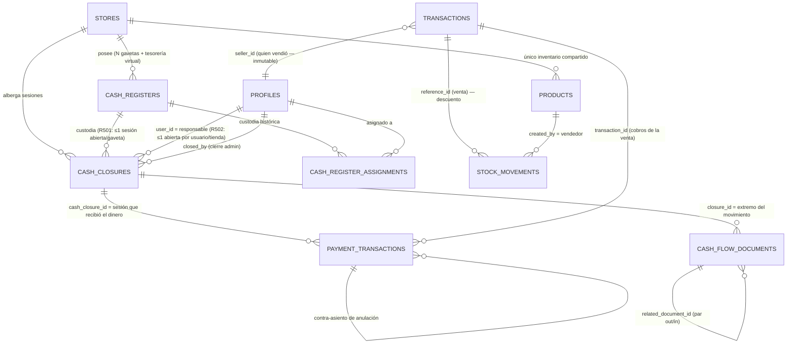
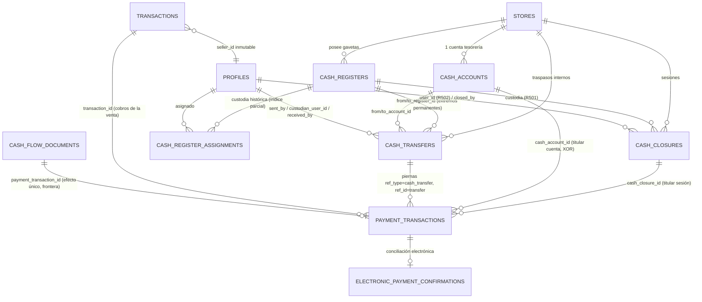

# COSTPRO_MULTICASHIER_DESIGN_002 — Diseño técnico definitivo del sistema multicajero

**Fecha:** 2026-11-07 (v1/v2) · **v3: 2026-11-08** · **Base:** `COSTPRO_MULTICASHIER_AUDIT_001.md` (PR #1563) · **Tipo:** diseño cerrado, sin implementación.
**Repo:** Nardian90/Costpro · `origin/main` = `119fab841` (verificado 2026-11-08: avanza desde `e778f8674` con catálogo-maestro/UI, **sin cambios en el módulo Caja** [MEDIDO: diff de migraciones y rutas de caja vacío]) · rama del PR `audit/multicashier-001` (commits `3a9ebe931` auditoría · `f7c5ef690` diseño 002 · `d8cf1e925` revisión 003 · cierre 004 = este commit).
**Revisiones:** v1 (misión 002, §D.2-D.13 — **OBSOLETA en parte**, ver AVISO) → v2 (misión 003, §D.14-D.15 — **OBSOLETA en parte**) → **v3 (misión 004, misión en curso): §D.16-D.17 es la especificación VIGENTE.**
**Decisión del propietario:** cada vendedor tiene **terminal + gaveta propios**: UNA TIENDA + UN ALMACÉN COMPARTIDO + N CAJAS FÍSICAS + N TERMINALES + N SESIONES FINANCIERAS INDEPENDIENTES.
**Etiquetas:** [MEDIDO] catálogo vivo (prod agregado sin PII / E2E) · [EN CÓDIGO] archivo:línea · [DECISIÓN] decisión de diseño fundamentada · [NO VERIFICADO] pendiente de censo/prueba.

---

## ⚠️ AVISO DE VIGENCIA — qué especificación es válida

Este documento acumula tres revisiones. **La especificación VIGENTE es §D.16 (cierre definitivo, misión 004) y su veredicto §D.17.** Las secciones anteriores se conservan como antecedente y evidencia; donde quedaron sustituidas llevan el banner `OBSOLETO — NO IMPLEMENTAR`. Un implementador debe seguir SOLO §D.16-D.17 y, para los conceptos no redefinidos allí (seguridad D.7, históricos D.9, escenarios E2E D.11), las secciones v1 señaladas como vigentes en la tabla:

| Sección | Estado | Especificación vigente |
|---|---|---|
| D.0 (resumen) | OBSOLETO (tesorería virtual, arqueo v3, Δcambio) | §D.16 intro + §D.16.4 |
| D.1 (revalidación) | Vigente como evidencia | — |
| D.2.C/D.2.D (SQL v1: `assigned_user_id`, `is_treasury`, R503, `CONCURRENTLY`) | **OBSOLETO — NO IMPLEMENTAR** | §D.16.3 (DDL definitivo) + §D.16.7 |
| D.2.E/D.2.F | Parcialmente obsoleto (D.2.F afirmaba CHECKs abiertos) | §D.14.2 (comparativa) + §D.16.3 |
| D.3 (atribución) | Vigente EXCEPTO el párrafo Δcambio (marcado) | §D.16.4 |
| D.4 (fondo/traspasos vía `cash_flow_documents`) | **OBSOLETO — NO IMPLEMENTAR** | §D.16.3 + §D.16.5 |
| D.5 (arqueo v3 con Apertura y Δcambio) | **OBSOLETO — NO IMPLEMENTAR** | §D.16.4 (fórmula **v5**) |
| D.6 (consolidado v1) | Concepto vigente, fórmula obsoleta | §D.16.4 + §D.16.7 |
| D.7 (seguridad/P1-02), D.8 (inventario), D.9 (históricos), D.11 (18 escenarios) | Vigentes (con ajustes anotados en §D.16.9) | — |
| D.10 (hoja de ruta) | Sustituida | §D.16.9 (v3) |
| D.12/D.13 (criterios/veredicto v1) | Histórico | §D.17 |
| D.14.1-D.14.2 (ciclo/traspasos v2) | **OBSOLETO — NO IMPLEMENTAR** (pierna de retorno `refund`, cierre, estados) | §D.16.1-D.16.3 |
| D.14.3-D.14.8 | Vigentes (idempotencia, asignaciones, tesorería/cuenta, migración, censo, cambio) | — |
| D.14.9 (arqueo v4) | **OBSOLETO — NO IMPLEMENTAR** | §D.16.4 (fórmula **v5**) |
| D.14.10 | Histórico (correcciones v1→v2) | — |
| D.15 (veredicto v2) | Histórico | §D.17 (v3) |

---

## D.0. Resumen del diseño

Tres entidades: `cash_registers` (gaveta física + terminal, **nueva**), `cash_closures` (sesión financiera, **reutilizada** con `cash_register_id`), y el libro de cobros `payment_transactions` (**reutilizado** con `cash_closure_id`). La sesión pertenece al **movimiento de dinero**, no al documento de venta: cada fila de cobro apunta a la sesión que recibió el dinero; `transactions.seller_id` conserva quién vendió. La tesorería central es un **registro virtual** (`cash_registers` con código `TESORERIA`), de modo que fondos, traspasos y retiros son el mismo mecanismo (documento doble `out`+`in` vinculado, dos fases con confirmación). El arqueo v3 se calcula **por sesión y por moneda desde filas atribuidas** (sin ventanas de tienda); el consolidado suma sesiones + tesorería y neutraliza traspasos internos por construcción (neto cero). El P1-02 (RLS sin jerarquía) se corrige **antes** de habilitar la multi-sesión.

## D.1. Fase I — Revisión de la auditoría y estado actual (revalidación)

- PR #1563: **abierto**, `mergeable_state=clean`, head `3a9ebe931` (1 commit, solo `docs/audits/…AUDIT_001.md`), base main `e778f8674`. Sin reviews humanas; comentarios solo de bots (Vercel deploy + Codex sin hallazgos ni por límite de uso). Es seguro actualizar la rama existente. [MEDIDO GitHub API]
- `main` **no ha avanzado**: `git log e778f8674..origin/main` vacío; cero commits tocando `supabase/migrations/`, `cash-service.ts`, `cash_closure/`, `useCashClosures.ts`, rutas API de caja. [MEDIDO]
- Revalidación de pilares en catálogo vivo: índice `one_pending_cash_closure_per_store` sigue activo; `cashService.createClosure/updateClosure` sigue escribiendo por tabla directa (`cash-service.ts:22-45`); políticas `Cash closures unified` (ALL) y `cash_closures_delete_rls` sin cambio → **P1-01, P1-02, P2-03, P2-05 vigentes tal cual**. [MEDIDO]
- Nuevos anclajes [MEDIDO] que refuerzan el diseño: `payment_transactions` con CHECKs `direction ∈ {in,out,refund}`, `payment_method ∈ {cash,transfer,zelle}`, `currency ∈ {CUP,USD,EUR,MLC}`, `ref_type` incluye `adjustment` y `cash_flow`; índice único `uniq_payment_txn_idempotency` (0 claves duplicadas en prod); FK `transaction_id → transactions` RESTRICT; CHECKs que amarran `sale → transaction_id` y `devolution → transaction_id+ref_id`.
- Correcciones/alarmas nuevas respecto a la auditoría original:
  1. **Cobertura del libro de cobros: 751/908 ventas completadas tienen filas `ref_type='sale'`** (prod, agregado) → 157 ventas históricas sin filas. El arqueo v3 sobre `payment_transactions` exige censo por RPC de origen + backfill idempotente ANTES de habilitar sesiones del modelo nuevo. [MEDIDO]
  2. `payment_transactions` también tiene políticas `UPDATE/DELETE` por tienda → mismo patrón de riesgo que P1-02 sobre el libro que alimenta el arqueo; entra en el diseño de seguridad (D.7).
  3. `create_sale_v2` ya inserta **una fila por componente de pago** (`ref_type='sale'`, `paid_by`=vendedor, idempotencia `'pay-{method}-{cur}-{txid}'` — `20261105140000…sql:1070-1091`) y blinda `seller_id` ("SELLER BINDING §4 Opción B: p_seller_id == actor autenticado, sin excepciones" — `…sql:170-171`) → la atribución por cobro es una adición de columna, no un rediseño.
  4. `create_sale_v2` **no** inserta filas de CAMBIO (`change_given_cup/usd`) en `payment_transactions` → el efectivo neto por gaveta debe restar el cambio entregado (D.5, término Δcambio). [EN CÓDIGO: columnas presentes, sin INSERT de fila negativa]

## D.2. Fase II — Modelo de entidades y relaciones

### D.2.A Tienda
Sin cambios: `stores` sigue siendo el agregado comercial (usuarios vía `user_store_memberships`, inventario propio, cajas físicas propias).

### D.2.B Almacén
Sin cambios y **intocable**: `products.store_id` NOT NULL es el único stock; ninguna caja física determina almacén (auditoría §9: `ERR_STORE_MISMATCH` fail-closed).

### D.2.C Caja física `cash_registers` (NUEVA)

> **⚠️ OBSOLETO — NO IMPLEMENTAR (revocado por misión 004).** Este SQL v1 contiene `assigned_user_id` (tercera fuente de autoridad, eliminado en D.14.4), `is_treasury` (tesorería como registro virtual, sustituida por `cash_accounts` en D.14.5) y la restricción defectuosa `UNIQUE(register_id, unassigned_at)`. **DDL vigente: §D.16.3.** La justificación de tabla nueva y el diagnóstico siguen siendo válidos.

**Justificación de tabla nueva:** [MEDIDO] no existe entidad de terminal/dispositivo — la única coincidencia `%register%` es la tabla legada `cash_register_sessions` (modelo de junio, sin terminal físico). Reutilizarla sería heredar su esclerosis (la creaba al vuelo el flujo de devoluciones).

```sql
CREATE TABLE IF NOT EXISTS public.cash_registers (
  id            uuid PRIMARY KEY DEFAULT gen_random_uuid(),
  store_id      uuid NOT NULL REFERENCES public.stores(id),
  code          text NOT NULL,                       -- 'A', 'B', 'C', 'TESORERIA'
  name          text NOT NULL,                       -- 'Gaveta A — Mostrador 1'
  terminal      text,                                -- identificador libre de terminal/dispositivo
  status        text NOT NULL DEFAULT 'active'       -- active | inactive | blocked
                CHECK (status IN ('active','inactive','blocked')),
  assigned_user_id uuid REFERENCES public.profiles(id),  -- asignación por defecto (opcional)
  is_treasury   boolean NOT NULL DEFAULT false,      -- registro virtual de tesorería central
  created_by    uuid REFERENCES public.profiles(id),
  created_at    timestamptz NOT NULL DEFAULT now(),
  updated_at    timestamptz NOT NULL DEFAULT now(),
  CONSTRAINT cash_registers_store_code_uq UNIQUE (store_id, code)
);
ALTER TABLE public.cash_registers ENABLE ROW LEVEL SECURITY;
-- Asignaciones auditables (histórico de custodia):
CREATE TABLE IF NOT EXISTS public.cash_register_assignments (
  id uuid PRIMARY KEY DEFAULT gen_random_uuid(),
  register_id uuid NOT NULL REFERENCES public.cash_registers(id),
  user_id uuid NOT NULL REFERENCES public.profiles(id),
  assigned_by uuid NOT NULL REFERENCES public.profiles(id),
  assigned_at timestamptz NOT NULL DEFAULT now(),
  unassigned_at timestamptz, unassigned_by uuid REFERENCES public.profiles(id),
  CONSTRAINT cra_open UNIQUE (register_id, unassigned_at)  -- una asignación vigente por gaveta
);
```

- Un `cash_registers` con `is_treasury=true` por tienda representa la **tesorería central virtual** (el dinero que no está en ninguna gaveta). [DECISIÓN: uniformiza fondos/traspasos/retiros en un solo mecanismo — D.4 — y hace el consolidado neto-cero por construcción.]
- Asignación: `assigned_user_id` es la gaveta "de cabecera" del cajero (usada por la UI); la **autoridad** de operación es la sesión, no la asignación. Los cambios de asignación se auditan en `cash_register_assignments` + `audit_logs`.
- No hay terminal registrado como dispositivo de hardware: `terminal` es un identificador informante; la seguridad NO confía en él (D.7).

### D.2.D Sesión de caja `cash_closures` (REUTILIZADA + extensión)

> **⚠️ OBSOLETO — NO IMPLEMENTAR (revocado por misión 004).** El SQL v1 usa `CREATE INDEX CONCURRENTLY` (imposible dentro del migrador transaccional de Supabase — D.14.6) y la CHECK R503 (fallaría la migración y bloquearía el despliegue escalonado — D.14.6, sustituida por trigger guard). **DDL vigente: §D.16.3.**

```sql
ALTER TABLE public.cash_closures
  ADD COLUMN IF NOT EXISTS cash_register_id uuid REFERENCES public.cash_registers(id),
  ADD COLUMN IF NOT EXISTS closure_kind text NOT NULL DEFAULT 'normal'
       CHECK (closure_kind IN ('normal','admin')),   -- cierre propio vs cierre administrativo
  ADD COLUMN IF NOT EXISTS closed_by uuid REFERENCES public.profiles(id),
  ADD COLUMN IF NOT EXISTS admin_reason text;        -- motivo obligatorio si closure_kind='admin'
-- R501 — una sola sesión abierta POR GAVETA (reemplaza one_pending_cash_closure_per_store,
--        que se elimina en la misma migración):
CREATE UNIQUE INDEX CONCURRENTLY IF NOT EXISTS one_pending_session_per_register
  ON public.cash_closures (cash_register_id) WHERE status='pendiente' AND cash_register_id IS NOT NULL;
-- R502 — política operativa: una sesión abierta por USUARIO y TIENDA (incluye tesorería):
CREATE UNIQUE INDEX CONCURRENTLY IF NOT EXISTS one_pending_session_per_user_store
  ON public.cash_closures (store_id, user_id) WHERE status='pendiente';
-- R503 — toda sesión del modelo nuevo DEBE declarar gaveta:
ALTER TABLE public.cash_closures
  ADD CONSTRAINT cash_closures_register_required
  CHECK (status <> 'pendiente' OR cash_register_id IS NOT NULL OR closed_at IS NOT NULL);
```

- `cash_register_id IS NULL` ⇒ sesión **histórica/legacy** (cierres por tienda anteriores). La restricción R503 permite filas antiguas (ya cerradas) y prohíbe nuevas sesiones abiertas sin gaveta. [DECISIÓN: no se reparte retrospectivamente el historial — D.9.]
- Las columnas existentes (`opening_balance_cup/usd`, `declared_*`, `system_expected_*`, `difference*`, `user_id`, `store_id`, `status`, triggers `prevent_cash_closure_edit` + `trg_audit_cash_closures`) se conservan tal cual.
- Apertura de una gaveta ya usada por otra sesión activa: **imposible** por R501 (el índice bloquea la fila duplicada aunque un RPC fallara). [DECISIÓN: restricciones por gaveta y por usuario son independientes y ambas necesarias — R501 impide dos custodios del mismo cajón; R502 impide que un usuario abra en dos gavetas a la vez; R503 impide sesiones huérfanas.]

### D.2.E Atribución de cobros `payment_transactions` (REUTILIZADA + extensión)

```sql
ALTER TABLE public.payment_transactions
  ADD COLUMN IF NOT EXISTS cash_closure_id uuid REFERENCES public.cash_closures(id);
CREATE INDEX IF NOT EXISTS idx_pt_closure ON public.payment_transactions (cash_closure_id)
  WHERE cash_closure_id IS NOT NULL;
```

- **No se añade `cash_register_id` al cobro.** [DECISIÓN] La gaveta se resuelve por `payment_transactions.cash_closure_id → cash_closures.cash_register_id`. Motivos: (1) una sola fuente de verdad (la sesión es la que arquea), (2) imposible contradicción cobro↔gaveta, (3) los cobros posteriores heredan la gaveta del cobrador automáticamente. El terminal nunca viaja en el request.
- **No se añade `transactions.cash_closure_id` como mecanismo general.** [DECISIÓN — el pliego lo prohíbe como solución única] El vínculo venta↔sesión queda prohibido por diseño; la venta solo lleva `seller_id`.

### D.2.F Tesorería `cash_flow_documents` (REUTILIZADA)

- `doc_type` es `text` [MEDIDO] → se documentan tres valores nuevos sin migración de tipo: `traspaso_cajas` (par out/in), `deposito_tesoreria` (gaveta→central), `entrega_tesoreria_caja` (central→gaveta). Los existentes (`constitucion_fondo`, `reposicion_fondo`, `devolucion_parcial/total_fondo`, `entrega_efectivo`, `otro_ingreso/egreso` — `src/lib/cash-flow/constants.ts`) se conservan.
- `closure_id` apunta a la **sesión del extremo** del movimiento; `related_document_id` enlaza el par; `responsible_user_id` identifica al emisor/receptor; `confirmed_at/confirmed_by` dan la segunda fase.

### Diagrama entidad-relación (Mermaid)



Cardinalidades y claves: `cash_registers.store_id → stores.id` (N:1); `cash_closures.cash_register_id → cash_registers.id` (N:1, **≤1 abierta por gaveta** R501); `cash_closures.user_id → profiles.id` (N:1, **≤1 abierta por usuario/tienda** R502); `payment_transactions.cash_closure_id → cash_closures.id` (N:1, solo sesiones); `payment_transactions.transaction_id → transactions.id` (RESTRICT, ya existente); `cash_flow_documents.closure_id → cash_closures.id` (N:1 por extremo).

## D.3. Fase III — Atribución real de los cobros

**Las cinco dimensiones del pliego se separan así:**

| Dimensión | Campo | Se fija en | Inmutable |
|---|---|---|---|
| Usuario que vende | `transactions.seller_id` | `create_sale_v2` (binding actor autenticado) | Sí |
| Usuario que recibe el dinero | `payment_transactions.paid_by` | RPC del cobro | Sí |
| Sesión financiera que responde | `payment_transactions.cash_closure_id` | RPC del cobro | Sí |
| Caja física | derivada: sesión → `cash_closures.cash_register_id` | — | por sesión |
| Terminal | `cash_registers.terminal` (informativo) | administración de cajas | editable |

**Escenario obligatorio (venta 10 000 CUP, 4 000 al día 1 con A, 6 000 al día 2 con B):**

1. Día 1: `create_sale_v2` crea `transactions` (`seller_id=A`, saldo pendiente 6 000 en `payment_incidents`/estado de la venta) + fila `payment_transactions` (`ref_type='sale'`, `direction='in'`, `amount=4000`, `payment_method='cash'`, `paid_by=A`, `cash_closure_id=SESIÓN_A`, idempotencia `pay-cash-CUP-{txid}`).
2. Día 2: el flujo de cobro posterior (mismo patrón de idempotencia `pay-late-…`) crea fila `payment_transactions` (`ref_type='sale'`, `direction='in'`, `amount=6000`, `paid_by=B`, `cash_closure_id=SESIÓN_B`).
3. Resultado: vendedor original A (inmutable), primer cobro responsable A/sesión A, segundo cobro responsable B/sesión B, saldo pendiente 0. **El arqueo de A no toca los 6 000 de B y viceversa.** El arqueo de B muestra el cobro como "cobro de venta ajena" (por `transactions.seller_id <> B`).

**Pagos soportados:** completo, parcial (múltiples filas `in` por venta — el modelo ya lo es), posteriores (nuevas filas con nueva sesión), mixto (una fila por componente — ya implementado en `create_sale_v2:1070-1091`), efectivo CUP/USD (el efectivo toca gaveta), transferencia/zelle (atribuidos al responsable que registra/verifica, `paid_by`+`cash_closure_id`, pero **no incrementan el efectivo físico** — conciliación separada, igual que hoy `close_cash_shift` los lleva al lado vouchers). EUR/MLC: el CHECK de moneda lo permite; el arqueo físico v3 queda acotado a CUP+USD como hoy, con filas por moneda conservadas. [DECISIÓN]

**Fuente de verdad y no-duplicación:** [DECISIÓN] `payment_transactions` es la fuente de verdad del importe cobrado (por cobro, por sesión). Los desgloses acumulados de `transactions` (`cash_amount/transfer_amount/zelle_amount`) quedan como resumen de venta para compatibilidad. Un solo escritor (`create_sale_v2` y el RPC de cobros posteriores) crea ambos en la misma transacción; la correspondencia se garantiza por: (a) CHECK `payment_transactions_sale_ref_check` existente, (b) `uniq_payment_txn_idempotency` existente (0 duplicados vivos [MEDIDO]), (c) **invariante de conciliación** `V_conciliacion_cobros`: por cada venta con `created_at > fecha_corte`, `SUM(payment_transactions where ref_type='sale' AND direction='in' AND transaction_id=X) == cash_amount+transfer_amount+zelle_amount de X`; desviación ≠ 0 ⇒ alarma en reporte y bloqueo de arqueo v3 de las sesiones implicadas. La regla del arqueo (D.5) cuenta cada término desde una sola tabla: cobros y traspasos desde `payment_transactions`, documentos como soporte informativo — jamás suma `transactions.cash_amount` y también las filas de cobro (doble conteo prohibido).

> **⚠️ OBSOLETO (párrafo revocado por D.14.8 y misión 004).** El Δcambio era doble conteo: la fila de cobro ya guarda el neto (`recibido − vuelto` validado en `create_sale_v2:880-903`). No existen filas de cambio en el ledger y no se introducen.

**El cambio entregado** (`change_given_cup/usd` de `create_sale_v2`) no genera fila hoy [EN CÓDIGO]; el arqueo v3 lo incorpora como término restador por sesión (Δcambio de las ventas atribuidas a la sesión — D.5), o alternativamente la implementación añade la fila `direction='out'` correspondiente (recomendado, deja el ledger completo). [DECISIÓN: fila de cambio como fila de pago `out` en Fase C; mientras tanto, término en fórmula.]

## D.4. Fase IV — Fondo inicial y tesorería entre cajas

> **⚠️ OBSOLETO — NO IMPLEMENTAR (revocado por misiones 003 y 004).** Los pares de `cash_flow_documents` con estado `pendiente` son imposibles: sus CHECKs están cerrados en la BD viva (`status ∈ {confirmado, anulado}` [MEDIDO]) y la "clave idempotencia compartida" colisiona con los índices únicos. Los traspasos internos viven en `cash_transfers` (§D.16.3) y el fondo inicial sigue la política §D.16.5. Esta sección se conserva como antecedente del análisis.

**Regla general [DECISIÓN]: todo movimiento físico de dinero entre registros (gavetas ↔ tesorería) es un PAR de documentos `cash_flow_documents` (extremo origen `out` + extremo destino `in`, enlazados por `related_document_id`) con su fila en `payment_transactions` (`ref_type='cash_flow'`) por extremo, atribuido a la sesión del extremo.** Estado en dos fases: el extremo emisor nace `pendiente`, el receptor `pendiente`; la **confirmación de recepción** por el cajero receptor pasa AMBOS a `confirmado` en una sola transacción (RPC atómico con advisory lock por tienda, patrón de `open_cash_shift`). Solo las piernas `confirmado` entran en los arqueos: una pierna pendiente es **dinero en tránsito** visible en ambas sesiones (sección "en tránsito"), sin distorsionar ningún saldo.

| Operación | Origen | Destino | Documento(s) | Confirmación |
|---|---|---|---|---|
| 1. Entrega de tesorería a gaveta (fondo inicial/reposición) | TESORERÍA | Gaveta X (sesión) | `entrega_tesoreria_caja` out(TESORERÍA) + in(X) — o `constitucion_fondo/reposicion_fondo` si inyecta capital externo | cajero de X |
| 2. Recepción por el cajero | — | — | pasa par a `confirmado` (`confirmed_by`) | obligatoria |
| 3. Traspaso entre gavetas | Gaveta A | Gaveta B | `traspaso_cajas` out(A) + in(B) | cajero de B |
| 4. Retiro a tesorería | Gaveta X | TESORERÍA | `deposito_tesoreria` out(X) + in(TESORERÍA) | encargado/admin (o auto si la gaveta cierra con devolución de fondo) |
| 5. Devolución del fondo inicial | Gaveta X | TESORERÍA | `devolucion_total/parcial_fondo` out(X) + in(TESORERÍA) | encargado/admin |
| 6. Ajustes autorizados | — | — | RPC existente `register_cash_adjustment` (ext. con `p_cash_closure_id`), `ref_type='adjustment'`, justificación obligatoria | admin/encargado |
| 7. Retiro para depósito externo | Gaveta/TESORERÍA | fuera de la tienda | `otro_egreso`/`deposito_tesoreria` + comprobante (`src/lib/cash-flow/comprobante-pdf.ts`) | admin/encargado |

**Regla de consolidación del traspaso (pliego):** 2 000 CUP de A a B ⇒ fila `out` 2 000 en sesión A + fila `in` 2 000 en sesión B, un documento `traspaso_cajas` con `related_document_id` cruzado, **neto cero en el consolidado** (ambas piernas dentro de la tienda), jamás venta ni ingreso ni gasto. No hay "dinero que desaparece": si B no confirma (escenario 7), la pierna queda `pendiente` y los 2 000 aparecen como "en tránsito" en el panel de A (responsable: A hasta confirmación); la anulación (`reverse_cash_flow_document`, RPC existente) crea el contra-par y restaura el estado. **Idempotencia:** `idempotency_key` compartido del par (`traspaso-{fecha}-{A}-{B}-{seq}`) protegido por `uniq_payment_txn_idempotency`; la entrega/recepción y cada arqueo llevan su clave propia.

**Fondos iniciales (ejemplo del pliego, 30 000 → 3×10 000):** el fondo NO se declara: se **documenta**. Salida documentada de TESORERÍA (10 000×3, `out`) + recepción confirmada por cada cajero (`in` con `confirmed_by`) + apertura de sesión con `opening_balance_cup=10 000` y `opening_difference_note` si difiere del libro (mecanismo existente de `open_cash_shift` pasos 7-8). El fondo devuelto al cerrar es la operación 5. El balance de tesorería central = neto de las filas con `cash_closure_id` de la sesión TESORERÍA.

## D.5. Fase V — Arqueo y cierre individual (arqueo v3)

> **⚠️ OBSOLETO — NO IMPLEMENTAR (revocado por misiones 003 y 004).** La fórmula v3 tiene dos defectos contables corregidos en §D.16.4 (fórmula **v5**): el término Δcambio (doble conteo — la fila de cobro ya es el neto, D.14.8) y el término `Apertura(S,M)` como sumando (duplicaría el fondo entregado — política §D.16.5). El contenido del cierre, la matriz de permisos y el escenario 63 000 vs 65 000 siguen siendo material de referencia; la fórmula autoritativa es la v5.

**Fórmula por sesión S y moneda M ∈ {CUP, USD} (físico):**

```
Esperado(S,M) = Apertura(S,M)
 + Σ cobros en efectivo confirmados        → payment_transactions: cash_closure_id=S, direction='in',
                                             payment_method='cash', currency=M, ref_type='sale'
 + Σ otros ingresos en efectivo            → idem ref_type ∈ {production_order, work}
 + Σ traspasos/entregas recibidos          → ref_type='cash_flow', direction='in', estado 'confirmado'
 − Σ reembolsos en efectivo                → direction='refund', payment_method='cash'
 − Σ egresos en efectivo                   → direction='out' (proveedores, comisiones, egresos documentados)
 − Σ traspasos/retiros enviados            → ref_type='cash_flow', direction='out', estado 'confirmado'
 − Σ cambio entregado (Δcambio)            → filas 'out' de cambio, o columnas change_given_* de las
                                             ventas atribuidas mientras no exista la fila
 + Σ ajustes autorizados                   → ref_type='adjustment' (±)
```

Sin ventanas temporales: cada fila lleva su sesión. Transferencia/zelle: **lado conciliación aparte** (por sesión: `Σ direction='in' payment_method IN ('transfer','zelle')` − `refund` de esos medios), nunca efectivo físico. Reembolsos de devolución por transferencia/zelle restan en el lado conciliación (paridad con v2.23.0). Los documentos anulados quedan neto cero por contra-asiento (el ledger manda — regla vigente de `close_cash_shift`).

**Contenido del cierre** (todos derivables de la fórmula y de `transactions`): fondo inicial CUP/USD · ventas del cajero (`transactions.seller_id = responsable` en la ventana de la sesión — informativo) · cobros propios y ajenos (cobro con `seller_id ≠ paid_by` · desglose por medio de pago · entradas/salidas · reembolsos · traspasos recibidos/enviados · retiros · **esperado/contado/diferencia CUP** · **esperado/contado/diferencia USD** · **justificación obligatoria** (nota ≥ 10 caracteres si |dif| > 0,01 en cualquier moneda — corrige P2-05) · responsable y fecha; si `closure_kind='admin'`: `closed_by` + `admin_reason`.

**Quién cierra:** el cajero cierra SU sesión (`close_cash_session`: condición `v_caller_uid = session.user_id`); encargado/admin cierran su propia o efectúan **cierre administrativo** de la de otro (`closure_kind='admin'`, motivo obligatorio, `closed_by` auditado). Un turno cerrado no se modifica (trigger `prevent_cash_closure_edit` vigente); las correcciones son movimientos de ajuste posteriores o reapertura RPC (`reopen_cash_shift`, admin/manager) que deja constancia.

**Escenario de verificación conceptual (aritmética verificada con código):**

| Gaveta | Fondo | Cobros | Egresos | Traspaso | Esperado |
|---|---:|---:|---:|---|---:|
| A | 10 000 | 15 000 | −2 000 | **−2 000 (enviado a B)** | **21 000** |
| B | 10 000 | 12 000 | — | **+2 000 (recibido de A)** | **24 000** |
| C | 10 000 | 8 000 | — | — | **18 000** |
| **Consolidado** | 30 000 | 35 000 | −2 000 | **neto 0** | **63 000** |

Verificación física: 30 000 (fondos) + 35 000 (cobros) − 2 000 (egresos) = **63 000 = suma de gavetas** ✔. El ejemplo literal del pliego (A sin restar el traspaso: 23 000) sumaría **65 000 → 2 000 de dinero fantasma**; el diseño lo impide: el traspaso enviado SIEMPRE descuenta al emisor en el momento de confirmación. Un cajón sin custodia declarada no puede existir (todo dinero físico pertenece a una sesión o a tesorería).

## D.6. Fase VI — Consolidado financiero de tienda

> **⚠️ OBSOLETO (fórmula v1 revocada por misión 004).** El concepto de consolidado por partición del ledger sigue vigente, pero la fórmula de esta sección referencia el arqueo v3 y la tesorería virtual. **Fórmula y vista vigentes: §D.16.4 (clasificación única + arqueo v5) y §D.16.7.**

**Vista individual:** por gaveta y sesión (responsable, terminal, estado, saldo inicial, movimientos, cobros, arqueo, diferencias, cierre) — materializada de D.5.

**Vista consolidada (RPC `get_store_cash_consolidated`, SECURITY DEFINER, lectura):**

```
Por moneda M:
  Efectivo_total_esperado(M) = Σ Esperado(S,M) sobre TODAS las sesiones (abiertas y cerradas,
                               cada una en su propio alcance por atribución explícita)
                             + Saldo_TESORERÍA(M)      [neto de filas de la sesión virtual]
  Declarado_total(M)         = Σ Apertura+contado declarado de sesiones con estado conocido
  Diferencias                = Σ diferencias individuales + detalle por sesión
  Ventas (comercial)         = Σ transactions por tienda (por seller_id)        — informativo
  Cobrado_real(M)            = Σ payment_transactions (direction='in') por tienda — fuente D.3
  Pendientes                 = ventas con cobrado < total (estado de la venta)
  Medios_electrónicos        = Σ transfer/zelle (conciliación separada)
  En_tránsito(M)             = Σ piernas pendientes de confirmación
  Devoluciones               = Σ refunds por medio real
```

**Sin doble conteo:** no existen ventanas de tienda; cada fila de dinero pertenece a exactamente una sesión (o a tesorería), y la suma de sesiones + tesorería es una partición del ledger. La neutralización de traspasos es automática: la pierna `out` de A y la `in` de B son filas distintas que suman cero; no hay que "eliminar" nada.

**Cobros tardíos, devoluciones posteriores y sesiones larguivas [DECISIÓN]:**
- Cobro posterior a un cierre: se atribuye a la **sesión abierta del cobrador** en el momento del cobro (nunca a la sesión cerrada de la venta). Si el cobrador no tiene sesión abierta → fila con `cash_closure_id` de TESORERÍA (el dinero físico está en algún lugar; si nadie lo custodia, custodia la tienda).
- Devolución posterior: la fila `refund` se atribuye a la sesión abierta donde físicamente sale el dinero (realidad física manda); la venta conservará su historial completo de cobros/devoluciones por `transaction_id`.
- Sesión abierta varios días: válido (R502 solo exige unicidad); su arqueo crece con filas propias; los cierres de otras no la afectan.
- Operación registrada tras el cierre de su sesión "natural": **jamás** se retroactiva (trigger de inmutabilidad); entra en la sesión vigente. El consolidado de la tienda, por partición de filas, no puede contar dos veces: una fila tiene un único `cash_closure_id`.

## D.7. Fase VII — Seguridad y segregación (incluye corrección P1-02)

**Contexto PostgreSQL:** las políticas permisivas se combinan por OR; con `Cash closures unified` (ALL, `has_store_access`) activa, cualquier policy nueva restrictiva es decorativa. **Corrección P1-02 (condición previa):**

1. **REVOKE/DROP** de la política ALL `Cash closures unified` y de `cash_closures_delete_rls` sobre `cash_closures`.
2. Nuevas políticas (con `has_store_role_as`):
   - SELECT: `has_store_access(store_id)` (la tienda consulta; el reporte de tienda es legítimo).
   - INSERT: `user_id = auth.uid() AND has_store_role_as(auth.uid(), store_id, ['admin','manager','encargado','clerk'])` — cada uno abre solo SU sesión.
   - UPDATE: **ninguna por tabla** — todo cambio de estado por RPC (close/reopen), que audita.
   - DELETE: **ninguna** (ni pendiente; anular = cerrar administrativo con motivo).
3. Extensión equivalente para el libro que alimenta el arqueo: en `payment_transactions`, restringir `UPDATE/DELETE` (`payment_transactions_update_own_store` etc. [MEDIDO]) a RPCs; las filas de sesiones cerradas quedan congeladas por trigger (patrón `prevent_cash_closure_edit`).
4. Eliminar escritura directa de tabla en `cash-service.ts` (`createClosure/updateClosure` → RPCs; la UI de apertura pasa a `useOpenCashShift` que ya existe).
5. Rutas API `cash-closures/{open,close,reopen}` y nuevas (`cash-registers`, `cash-transfers`): token de usuario (RLS aplicable), nunca `service_role` desde el navegador; `service_role` solo server-side para flujos E2E.
6. RPC `SECURITY DEFINER` con `SET search_path` + actor explícito (patrón v2.26 vigente); auditoría atómica en `audit_logs` (ya existente en open/close; extender a traspasos/ajustes/asignaciones).

**Matriz de permisos:**

| Operación | Cajero propio | Otro cajero | Encargado | Administrador |
|---|---|---|---|---|
| Abrir sesión | Sí (su gaveta) | No | Según autorización | Sí |
| Recibir cobros | Su caja | No | Según autorización | Según autorización |
| Consultar su sesión | Sí | No | Sí | Sí |
| Consultar otra caja | No | No | Sí | Sí |
| Cerrar su sesión | Sí | No | Sí | Sí |
| Cierre administrativo de otra | No | No | Sí (motivo) | Sí (motivo) |
| Modificar sesión cerrada | No | No | No (solo ajuste/reapertura RPC) | No (solo ajuste/reapertura RPC) |
| Traspasar entre gavetas | Emitir desde la suya | No | Sí | Sí |
| Confirmar recepción de traspaso | A su caja | No | Sí | Sí |
| Autorizar ajustes | No | No | Según permisos | Sí |
| Administrar `cash_registers` | No | No | Sí | Sí |

**Asignación de terminales y cajas:** `cash_registers`/`assignments` administradas por encargado/admin vía RPC `manage_cash_register` (alta/baja/bloqueo/asignación auditados). **El backend nunca confía en un `register_id` del navegador:** la sesión de un cobro se resuelve server-side por el `cash_closure_id` validado contra (`status='pendiente'` AND `user_id = actor`); el `terminal` es informante. Validaciones fail-closed: la gaveta debe pertenecer a la tienda del actor (`cash_registers.store_id = actor's store`) y estar `active` (bloqueada/inactiva rechaza aperturas y cobros).

## D.8. Fase VIII — Inventario compartido (sin cambios)

Verificado en la auditoría §9 y revalidado [EN CÓDIGO, main sin cambios]: stock único por tienda (`products.store_id`), descuento atómico (`SELECT … FOR UPDATE` + `ERR_INSUFFICIENT_STOCK`), atribución (`created_by`=vendedor, `reference_id`=venta), costo server-side, reversiones por devolución. **El diseño no introduce ninguna modificación de inventario.** La caja física no participa en el stock ni en la valoración; ninguna tabla nueva la referencia.

## D.9. Fase IX — Históricos y migración

> **⚠️ CORREGIDO (misión 004).** Los principios de esta sección siguen vigentes EXCEPTO `CONCURRENTLY` (imposible en el migrador transaccional de Supabase — ver D.14.6): los índices únicos se crean normales dentro de la migración (tablas minúsculas [MEDIDO]). La numeración "backfill (solo si el censo lo justifica)" quedó resuelta en D.14.7: NO hay backfill (corte 2026-08-11).

**Principios:** solo DDL aditivo e idempotente (`IF NOT EXISTS`, índices normales — jamás `CONCURRENTLY` dentro del migrador); cero UPDATE de datos históricos; cero DROP destructivo; reversibilidad técnica (columnas nuevas nullable; índices eliminados por nombre); controles previos/posteriores.

1. **Distinción de modelos sin backdating:** sesión histórica ⇔ `cash_register_id IS NULL` (ya cerrada — R503 la admite); sesión nueva ⇔ `cash_register_id NOT NULL`. Ninguna fila antigua se asigna a caja alguna; los cierres históricos siguen siendo cierres por tienda con su fórmula v2.24 intacta (`close_cash_shift` no se reescribe: se añade `close_cash_session` para sesiones con gaveta, dejando el antiguo para las NULL — compatibilidad total de reportes).
2. **Controles pre-migración (censo):** (a) ventas sin filas de cobro por rango de fechas/RPC de origen (751/908 hoy [MEDIDO] — identificar el origen de las 157); (b) ventas con `created_at` dentro de turnos cerrados (no se reparten); (c) filas de `payment_transactions` sin `cash_closure_id` tras el corte (esperado: todas las históricas).
3. **Backfill (solo si el censo lo justifica, Fase C):** script idempotente que INSERTA filas de cobro faltantes para ventas posteriores a una fecha de corte, con `idempotency_key` derivada determinista (protegida por índice único), `cash_closure_id = NULL` (histórico), marcadas `ref_type='adjustment'` de conciliación o `ref_type='sale'` según política; **nunca** inventa sesiones. En prod se ejecuta como migración revisada, con verificación previa/posterior de invariantes y rollback por diseño aditivo.
4. **Corte de vigencia:** columna/setting de tienda `multicashier_enabled_at timestamptz` (en `stores` o tabla de settings): las sesiones abiertas desde entonces exigen gaveta; los reportes separan «modelo tienda» y «modelo gaveta» por ese corte.
5. **Retirada progresiva del legado (sin borrar datos):** migrar el contra-asiento de devoluciones de `cash_register_sessions/cash_movements` a `payment_transactions/cash_flow_documents` (corrige P2-03) → `REVOKE INSERT/UPDATE/DELETE` sobre las tres tablas legadas a todos los roles salvo owner → marcar `deprecated` en catálogo/docs → eliminación física solo en un proyecto futuro, nunca en esta implementación.

## D.10. Fase X — Plan de implementación por fases (hoja de ruta)

### Fase A — Seguridad y modelo de datos (PRECONDICIÓN: corrige P1-02)
- **Archivos:** nueva migración `supabase/migrations/<fecha>_multicashier_faseA_model_security.sql`; `src/services/cash-service.ts` (quitar escritura directa); `src/hooks/api/useCashClosures.ts`; RLS en migración.
- **Tablas/columnas:** `cash_registers`, `cash_register_assignments` (nuevas); `cash_closures.cash_register_id/closure_kind/closed_by/admin_reason`; índices R501/R502/R503 (drop `one_pending_cash_closure_per_store`); políticas RLS nuevas.
- **RPC/APIs:** `manage_cash_register` (CRUD+asignación); abrir sesión extiende `open_cash_shift` con `p_cash_register_id` (validación server-side de pertenencia/estado/roles); mantener `close_cash_shift` para históricas.
- **Dependencias:** ninguna (primera fase). **Pruebas:** unitarias de RLS (clerk no inserta sesión ajena ni DELETE), índices R501/R502 bajo concurrencia (dos aperturas simultáneas → una falla), apertura con gaveta ajena → `ERR_*`. **Riesgos:** romper la apertura actual de una sola caja (mitigación: la tienda sin gavetas definidas usa la sesión NULL-compat hasta el switch). **Aceptación:** todos los caminos de escritura directa bloqueados; apertura/cierre actuales sin regresión en E2E. **Rollback:** drop de índices/columnas/tablas nuevas (aditivo).

### Fase B — Tesorería inicial y traspasos
- **Archivos:** migración de doc_types + RPC `deliver_cash_to_register`, `transfer_cash_between_registers`, `confirm_cash_transfer`, `withdraw_cash_to_treasury`, `return_fund_to_treasury`; UI `CashFlowCreateModal` ext + panel "en tránsito" (`IngresosEgresosView`, `CashLedgerPanel`).
- **Tablas:** `cash_flow_documents` (par out/in, `related_document_id`, estados), `payment_transactions` (`ref_type='cash_flow'` con `cash_closure_id`).
- **RPC:** los listados; anulación con `reverse_cash_flow_document` existente. **Dependencias:** Fase A. **Pruebas:** traspaso idempotente (reintentos → una sola pierna), confirmación única, neto cero en consolidado, escenarios 6-7 del pliego. **Riesgos:** piernas huérfanas (mitigación: RPC atómico por par + vista de pendientes con edad). **Aceptación:** 30 000 → 3×10 000 documentado y conciliable; traspasos neto cero. **Rollback:** RPCs nuevos sin uso, sin DDL destructivo.

### Fase C — Atribución de cobros
- **Archivos:** migración (columna + índice + censo); `create_sale_v2` (INSERT con `cash_closure_id` + fila de cambio `out`); RPC `register_sale_payment` (cobros posteriores); censo/backfill.
- **Tablas/columnas:** `payment_transactions.cash_closure_id`; invariantes de conciliación (vista `v_conciliacion_cobros`).
- **Dependencias:** A y B. **Pruebas:** escenarios 1-5, 12, 15 del pliego; invariante de conciliación = 0 desviaciones en E2E; backfill idempotente (doble ejecución → cero filas nuevas). **Riesgos:** ventas por rutas que no escriben filas de cobro (censo D.1.1 obligatorio antes de activar `require_open_session_for_sales`); idempotencia de cobros posteriores (claves deterministas). **Aceptación:** toda venta nueva con cobros 100% atribuidos; mismo cobro dos veces → rechazo por `uniq_payment_txn_idempotency`. **Rollback:** columna queda nullable sin uso.

### Fase D — Arqueos y cierres
- **Archivos:** RPC `close_cash_session` (fórmula v3 bimoneda por gaveta, nota obligatoria de diferencia, cierre propio vs admin), `get_my_cash_shift`, `get_store_cash_consolidated`; `CashClosureView` (cierre individual).
- **Dependencias:** C. **Pruebas:** escenario de verificación D.5 (63 000 vs 65 000 fantasma); cierre con faltante/sobrante + justificación obligatoria; cierre administrativo auditado; inmutabilidad post-cierre; consolidado con mezcla abiertas/cerradas (escenario 13). **Riesgos:** fórmula v3 con doble conteo (mitigación: cada término de una sola tabla + batería de arqueo en E2E con montos exactos). **Aceptación:** arqueos individuales exactos, consolidado = partición del ledger. **Rollback:** RPC nuevo; el flujo antiguo sigue operativo para sesiones NULL.

### Fase E — Interfaz y reportes
- **Archivos:** `CashClosureView` (pestañas por gaveta, "mis cajas"), admin de `cash_registers` (nueva vista en OPERACIÓN), `CashReportView` + `cash-report-pdf/excel/docx` (reporte individual y consolidado), `CajaStatusStrip`/`CashStatusWidget` (estado por gaveta), navegación `navigation-definition.ts` (roles).
- **Dependencias:** A-D. **Pruebas:** integración UI↔RPC, reportes con sesiones históricas vs nuevas (separación por corte). **Riesgos:** regresión del flujo de una caja (mitigación: feature flag por tienda). **Aceptación:** cajero ve solo lo suyo (RLS+UI), encargado ve todo, reportes individuales y consolidados correctos. **Rollback:** UI tras flags.

### Fase F — Certificación (CostproE2E `lguovmvrozxgssupkwpf`, verificada por ref real)
- Batería: 3 gavetas + 3 sesiones simultáneas; concurrencia real de aperturas/cobros/ventas; arqueos exactos bimoneda; traspasos con confirmación y anulación; consolidado; conciliación cobros; **regresión completa del modelo de una sola caja** (tiendas sin multicaja); permisos negativos (matriz D.7); escenarios 1-18 del pliego como specs E2E (patrón de los flujos `e2e/flows/cash-*` existentes).
- **Aceptación final:** los 18 escenarios verdes + invariante de partición (Σ sesiones + tesorería = ledger) + P1-02 cerrado + censo de cobros sin desviaciones.

## D.11. Fase de validación — los 18 escenarios obligatorios

| # | Escenario | Entidades | Comportamiento esperado | Invariantes |
|---|---|---|---|---|
| 1 | Tres cajeros abren simultáneamente | `cash_closures`, R501/R502, `open_cash_shift` ext. | Tres sesiones (gaveta A/B/C), advisory lock serializa; cada una con su fondo | ≤1 abierta por gaveta y por usuario/tienda; aperturas documentadas |
| 2 | Cuarto cajero intenta abrir gaveta asignada | R501, roles, `cash_registers` | Rechazo (`ERR_SHIFT_ALREADY_OPEN` por gaveta); si su política lo permite, usa gaveta libre | La gaveta nunca tiene dos custodios |
| 3 | Dos cajeros cobran la misma venta parcialmente | `payment_transactions` (2 filas `in` parciales), idempotencia | Dos filas distintas (montos distintos), cada una con su sesión; saldo de venta se reduce por fila | Σ cobros ≤ total de la venta (validación RPC); sin fila duplicada (`uniq_payment_txn_idempotency`) |
| 4 | A vende, B recibe pago posterior | `transactions.seller_id=A`; fila de B con `cash_closure_id=B` | Vendedor A inmutable; cobro en sesión de B; arqueo de B "cobro de venta ajena" | seller_id jamás muta; el dinero es de la sesión que lo recibió |
| 5 | A efectivo, B transferencia de la misma venta | 2 filas (cash en S_A, transfer en S_B) | Efectivo entra al físico de A; transferencia a conciliación de B | El efectivo esperado de B no incluye la transferencia |
| 6 | A traspasa 2 000 a B | Par `cash_flow_documents` + 2 filas pt, confirmación | Tras confirmación: −2 000 en A, +2 000 en B, neto 0 tienda | Documento único relacionado; jamás venta/gasto |
| 7 | B no confirma la recepción | Piernas `pendiente` | 2 000 "en tránsito" visible en panel de A; sin efecto en arqueos; anulación posible | Ningún arqueo cuenta tránsito; dinero jamás "desaparece" |
| 8 | Cobro en sesión cerrada | RPC valida `status='pendiente'` | Rechazo fail-closed; el cobro exige sesión abierta del cobrador | Sesión cerrada sin mutación (`prevent_cash_closure_edit`) |
| 9 | Cajero modifica sesión ajena | RLS (D.7), RPC por dueño | Rechazo: UPDATE sin policy; RPC exige dueño o rol admin (con motivo) | Escritura solo por RPC; auditoría completa |
| 10 | Cierre con faltante | `close_cash_session` | Diferencia negativa registrada tal cual; **nota obligatoria**; arqueo guardado | Jamás autoajuste del saldo; responsable = cajero (o `closed_by` admin) |
| 11 | Cierre con sobrante | idem | Diferencia positiva registrada + justificación | idem |
| 12 | Devolución en sesión distinta de la venta | Fila `refund` con `cash_closure_id` de la sesión que paga | Inventario repuesto (flujo existente); dinero sale de la gaveta que devuelve; venta conserva historial | seller/venta intactos; refund por medio real |
| 13 | Sesión abierta mientras otras cierran | Consolidado por partición de filas | Cada sesión arquea lo suyo; el consolidado suma abiertas+cerradas sin solapamiento | Sin ventanas de tienda; fila pertenece a 1 sesión |
| 14 | Venta concurrente con stock insuficiente | `create_sale_v2` `FOR UPDATE` | El 3.º vendedor recibe `ERR_INSUFFICIENT_STOCK` bajo lock | Stock nunca negativo; sin doble venta de existencias |
| 15 | Cobro procesado dos veces | `uniq_payment_txn_idempotency` | Segundo intento rechazado (violación única o idempotencia de RPC) | Σ cobros == saldo efectivamente cobrado |
| 16 | Sesión interrumpida durante operación | Transacción SQL única | Todo-o-nada (fila pt + documento + audit en la MISMA transacción) | Sin estados parciales; reintento idempotente |
| 17 | Ajuste excepcional del administrador | `register_cash_adjustment` ext. con sesión | Fila ± con justificación, rol admin/encargado, audit log | Ajuste visible en el arqueo como término propio |
| 18 | Consolidado con las tres cajas operando | `get_store_cash_consolidated` | Suma sesiones + tesorería; traspasos internos neto 0; "en tránsito" separado | Partición del ledger: sesiones + tesorería = total |

## D.12. Criterios de aceptación del diseño

1. Todo dinero físico pertenece a exactamente una sesión (gaveta) o a tesorería — partición completa del ledger, verificable por consulta.
2. Un cobro tiene un solo responsable (`paid_by`), una sola sesión (`cash_closure_id`) y una gaveta derivada; el vendedor original es inmutable.
3. Los traspasos son pares documentados en dos fases, neto cero en consolidado, con tránsito explícito.
4. El arqueo individual reproduce el escenario D.5 con exactitud (63 000, sin dinero fantasma), en CUP y USD.
5. El consolidado no usa ventanas temporales y es insensible a mezcla de sesiones abiertas/cerradas.
6. La corrección P1-02 precede a la habilitación; la matriz D.7 es exigible en backend (RLS + RPC), no en UI.
7. El inventario compartido no cambia (cero migraciones de stock).
8. El histórico permanece intacto, distinguible por `cash_register_id IS NULL` y separado por fecha de corte.
9. Los 18 escenarios son specs E2E ejecutables en CostproE2E.
10. Censo de cobertura de cobros (751/908 [MEDIDO]) resuelto antes de activar el arqueo v3.

## D.13. Veredicto final

1. **¿Puede implementarse el modelo de tres cajas físicas sin reescribir toda la aplicación?** Sí. Es un diseño aditivo sobre entidades existentes (`cash_closures`, `payment_transactions`, `cash_flow_documents`): una tabla nueva de gavetas, tres columnas, índices nuevos y RPCs nuevos; el inventario, el POS y las ventas quedan intactos.
2. **¿Qué partes se reutilizan?** `cash_closures` (sesión, apertura, cierre, bimoneda, triggers de inmutabilidad), `payment_transactions` (libro de cobros con idempotencia y CHECKs), `cash_flow_documents` (documentos con confirmación/anulación), `open_cash_shift`/`close_cash_shift` (patrones de lock, idempotencia, auditoría y actor explícito), `reverse_cash_flow_document`, `register_cash_adjustment`, todo el flujo de ventas/inventario, y las rutas/hooks de UI existentes.
3. **¿Qué debe rediseñarse obligatoriamente?** (a) la RLS de `cash_closures` y `payment_transactions` (P1-02) y la escritura directa de `cash-service.ts`; (b) la fórmula del arqueo: de ventana de tienda a sesión (v3) — `close_cash_shift` se conserva para históricos y nace `close_cash_session`; (c) la UI de una sola caja pendiente → N sesiones; (d) el modelo de índices únicos (R501/R502 reemplazan `one_pending_cash_closure_per_store`).
4. **¿Cómo se garantiza que cada cajero responda por su gaveta?** Sesión abierta única por gaveta (R501) y por usuario/tienda (R502); toda fila de dinero lleva `cash_closure_id`; el arqueo v3 suma solo su sesión; cierre propio con justificación o cierre administrativo auditado (`closed_by`, motivo); inmutabilidad post-cierre por trigger; ajustes solo autorizados.
5. **¿Cómo se garantiza que los traspasos no alteren el consolidado comercial?** El traspaso es un par out/in de documentos `cash_flow` enlazados, en dos fases con confirmación; ambas piernas viven dentro de la tienda y suman cero; el consolidado los neutraliza por construcción (partición de filas), y jamás se registran como venta/ingreso/gasto.
6. **¿Cómo se impide la duplicación de cobros y arqueos?** Cobros: `uniq_payment_txn_idempotency` [MEDIDO] + claves deterministas por componente + validación de saldo pendiente por RPC. Arqueos: índices R501/R502 (un arqueo por gaveta/usuario), `FOR UPDATE` + advisory lock, y una sesión cerrada es inmutable (trigger) con reapertura solo por RPC de admin.
7. **¿Cómo se conserva el inventario compartido?** Intacto: stock por tienda, descuento atómico bajo lock, atribución al vendedor; ninguna entidad de caja interviene en el stock ni en la valoración (auditoría §9, revalidada).
8. **¿Qué riesgo contable sería inaceptable dejar pendiente?** Dos: (a) activar el arqueo v3 sin resolver la cobertura de filas de cobro (751/908 [MEDIDO] — doble conteo o subconteo silencioso) y (b) habilitar la multi-sesión sin cerrar P1-02 (manipulación de sesiones por API directa). Ambos son precondiciones de Fase A/C.
9. **¿Cuál es el orden seguro de implementación?** A (seguridad+modelo) → B (tesorería/traspasos) → C (atribución+censo/backfill) → D (arqueo v3/cierres) → E (UI/reportes) → F (certificación E2E con los 18 escenarios y regresión del modelo actual). Cada fase es desplegable y reversible por separado.
10. **¿Qué condiciones deben cumplirse antes de desplegar?** P1-02 corregido; censo de cobros sin desviaciones y backfill ejecutado; gavetas y tesorería virtual definidas por tienda; feature flag por tienda (`multicashier_enabled_at`); batería E2E verde (18 escenarios + regresión); plan de contingencia de reactivación del modelo de caja única por tienda.

### Resultado del veredicto (v1, misión 002)

**DISEÑO APROBABLE PARA IMPLEMENTACIÓN** — modelo coherente y completo: entidades resueltas con evidencia, atribución de cobros por movimiento de dinero, tesorería entre gavetas con neto cero demostrado aritméticamente, arqueo individual bimoneda sin doble conteo, consolidado por partición del ledger, seguridad con corrección previa del P1-02, históricos preservados y hoja de ruta reversible. Los dos riesgos señalados (cobertura de cobros y P1-02) están integrados como precondiciones de las fases A y C, no como deuda abierta.

> **REVOCADO por la revisión crítica de la misión 003 (2026-11-07).** El veredicto v1 se emite aquí solo como registro histórico. La revisión detectó errores reales en D.4/D.5 (CHECKs cerrados de `cash_flow_documents` no verificados, idempotencia de clave compartida, tesorería como sesión artificial, unicidad de asignaciones defectuosa, `CONCURRENTLY` incompatible con el migrador). El veredicto vigente es el de la sección **D.15**, emitido tras las correcciones de **D.14**.

---

## D.14. Resolución de observaciones (misión COSTPRO-MULTICASHIER-DESIGN-003)

Revisión crítica del propio diseño sobre el esquema real. Cada observación: problema → evidencia del esquema actual → solución adoptada → cambios estructurales → invariante → escenario E2E. Las secciones D.2-D.13 quedan **modificadas** por lo que sigue; los cambios estructurales se resumen en D.14.9.

### D.14.1 — P0-A · Traspasos y dinero en tránsito

> **⚠️ PARCIALMENTE OBSOLETO (revocado por misión 004, P0-1/P0-2/P0-3).** Tres defectos de esta resolución v2: (1) la pierna de retorno usa `direction='refund'` — INCORRECTO: `refund` es el contra-asiento de devoluciones comerciales, invisible a las fórmulas de caja [EN CÓDIGO]; el retorno físico es `direction='in'` (§D.16.2); (2) los extremos se anclan a SESIONES (`from_session_id`/`to_session_id`), que pueden cerrarse durante la vida del traspaso — ahora los extremos permanentes son las GAVETAS (§D.16.1); (3) el estado genérico `anulado` mezcla cancelación previa a la entrega (sin piernas) con reversión posterior (con retorno) — máquina de estados definitiva en §D.16.3. La idea central (salida contable desde la entrega + custodio en tránsito + identidad I-1) se conserva.

**Problema.** D.4/D.5 v1 declaraban que las piernas `pendiente` "no afectan los arqueos" y a la vez que el dinero sigue siendo custodia del emisor: el dinero de la gaveta A quedaba contado como disponible mientras físicamente ya no estaba, y el consolidado no cuadraba con la custodia real.

**Evidencia del esquema actual.** [MEDIDO prod] `cash_flow_documents.status CHECK IN ('confirmado','anulado')` — sin estado intermedio; `confirmed_at/confirmed_by NOT NULL DEFAULT now()`; `closure_id` apunta a UNA sola sesión (no puede representar dos extremos); el patrón de anulación vigente es "insertar fila contraria y congelar la histórica" (comentario de tabla, `20261021000001_cash_flow_documents.sql:175`).

**Solución adoptada.** Ciclo de vida explícito del traspaso (entidad nueva `cash_transfers`, ver D.14.2) con **la salida física contable desde el momento de la entrega**:

1. **Solicitud** (`solicitada`): documento interno sin efecto contable (ninguna fila del ledger). Cancelable libremente por el emisor o tesorería (`anulada` sin filas).
2. **Entrega física** (`entregado`): A saca el dinero y lo entrega. RPC `send_cash_transfer` en UNA transacción: fila `payment_transactions` pierna OUT (`direction='out'`, `ref_type='cash_flow'`, `ref_id=transfer.id`, atribuida a la sesión de A) + estado `entregado` + auditoría. **El saldo de A baja aquí** — reflejo exacto de la física.
3. **Tránsito**: el dinero ya no está en A y aún no está en B. Campo `custodian_user_id` (= emisor por defecto; transportista tercero si lo hay) identifica la custodia mientras dura el tránsito. Visible como "en tránsito" en los paneles de A, de B y del consolidado.
4. **Recepción física + confirmación** (`recibido`): RPC `confirm_cash_transfer` (una transacción): el receptor cuenta, confirma; fila pierna IN (`direction='in'`, atribuida a la sesión de B); `received_by/received_at`. Transición atómica de estado (`UPDATE … SET status='recibido' WHERE id=$1 AND status='entregado' RETURNING` — el lock de fila serializa confirmaciones simultáneas).
5. **Rechazo** (`rechazado`, final): B no recibe o el conteo no cuadra: pierna IN en `direction='refund'` atribuida a la **sesión de A** (el dinero vuelve físicamente a A) + motivo obligatorio. El traspaso queda congelado como histórico.
6. **Anulación tras entrega** (`anulado`, final): misma contabilidad que el rechazo (devolución a A) iniciada por emisor/tesorería; motivo obligatorio. Tras `recibido` no hay anulación: la corrección es un traspaso inverso nuevo (doctrina de contra-movimientos, no mutaciones).

**Custodia y saldos — la identidad obligatoria del consolidado:**

```
Efectivo en gavetas + efectivo en tesorería + efectivo en tránsito = efectivo total bajo custodia de la tienda
```

Categorías del pliego: disponible en gaveta (sesión) · en tránsito (`cash_transfers` en `entregado`, con `custodian_user_id`) · custodia del emisor (tránsito con custodio=emisor) · custodia del transportista (tránsito con custodio tercero) · recibido por el destinatario (`recibido`) · total de la tienda (la suma). Los traspasos internos jamás son ingreso/gasto comercial: ambas piernas son `ref_type='cash_flow'` y su suma neta dentro de la tienda es cero.

**Ejemplo numérico** (A=20 000, B=10 000, tesorería=5 000; traspaso de 2 000 CUP de A a B; verificado con código):

| Estado | Gaveta A | Gaveta B | Tesorería | Tránsito | **Total custodia** | Ledger |
|---|---:|---:|---:|---:|---:|---|
| Solicitada (sin entrega) | 20 000 | 10 000 | 5 000 | 0 | **35 000** | sin filas |
| Entregada (custodia: emisor) | 18 000 | 10 000 | 5 000 | 2 000 | **35 000** | OUT en A −2 000 |
| Recibida y confirmada | 18 000 | 12 000 | 5 000 | 0 | **35 000** | IN en B +2 000 |
| Rechazada (vuelve a A) | 20 000 | 10 000 | 5 000 | 0 | **35 000** | IN refund→A +2 000 |
| Anulada tras entrega | 20 000 | 10 000 | 5 000 | 0 | **35 000** | IN refund→A +2 000 |
| Anulada antes de entrega | 20 000 | 10 000 | 5 000 | 0 | **35 000** | sin filas |

**Cierre con traspasos pendientes [regla]:** una sesión NO puede cerrarse mientras sea **origen** de traspasos en `entregado` (su dinero estaría fuera de la gaveta sin destino confirmado) — `close_cash_session` lo rechaza y exige resolver primero (confirmación del receptor, anulación o rechazo). Sí puede cerrar siendo **destino** pendiente (el dinero no es suyo hasta confirmar; el panel lo advierte). En todos los casos el tránsito conserva `custodian_user_id` — jamás queda dinero sin responsable identificado. Vista operativa `v_cash_transit_alerts` señala tránsitos con edad > 24 h.

**Cambios estructurales:** tabla `cash_transfers` (D.14.2), RPCs `send/confirm/reject/annul_cash_transfer`, columna `custodian_user_id`, vista de alertas. **Invariante I-1:** `Σ sesiones + tesorería + tránsito = custodia total` en todo estado (demostrado en la tabla). **E2E:** escenario 6 y 7 del pliego + los seis estados de la tabla como specs (`e2e/flows/cash-transfers.spec.ts`).

### D.14.2 — P0-B · Compatibilidad con el esquema real de `cash_flow_documents` (Alternativa A vs B)

**Problema.** D.4 v1 afirmaba que "doc_type es text → se documentan tres valores nuevos sin migración de tipo". **Era falso**: el campo tiene CHECK cerrados, y el diseño proponía estados (`pendiente`) y conceptos (`traspaso_cajas`) que la tabla REAL rechaza.

**Evidencia del esquema actual.** [MEDIDO prod, `pg_constraint` en vivo — no solo el archivo de migración]: `cash_flow_documents_doc_type_check ∈ {ingreso, egreso}` · `cash_flow_documents_concept_check ∈ {constitucion_fondo, reposicion_fondo, devolucion_total_fondo, devolucion_parcial_fondo, otro_ingreso, otro_egreso, entrega_efectivo}` (el vivo tiene `entrega_efectivo`, solo egreso — divergencia real frente al replay del archivo) · `cash_flow_documents_type_concept_check` (matriz cerrada tipo↔concepto) · `cash_flow_documents_status_check ∈ {confirmado, anulado}` · `payment_method = 'cash'` · `currency ∈ {CUP, USD}` · `confirmed_at/confirmed_by NOT NULL DEFAULT now()` · `justification NOT NULL`. Además, la cabecera del archivo advierte que la superficie contractual está bajo CI-gate con allowlist (patrón PR #1422).

**Comparación de alternativas:**

| Criterio | A: ampliar `cash_flow_documents` | **B: modelo propio `cash_transfers`** ✅ |
|---|---|---|
| Integridad transaccional | Requiere relajar NOT NULL de `confirmed_*`, nuevo estado en CHECK, matriz de conceptos ampliada; riesgo de romper el patrón de anulación vigente | Estado propio con transiciones `WHERE status='entregado'`; sin tocar restricciones existentes |
| Claridad documental | `traspaso_cajas` colgaría de una matriz pensada para ingresos/egresos ordinarios | Entidad con extremos explícitos (sesión/cuenta origen-destino), custodio y etapas propias |
| Auditoría | Campos genéricos reutilizados | Campos dedicados: `sent_by`, `custodian_user_id`, `received_by`, `rejected_*`, `annulled_*` |
| Idempotencia | Clave única por documento; el par requeriría convenciones frágiles | `idempotency_key` propia + claves por pierna (D.14.3) |
| Reversibilidad | Revertir = restaurar CHECKs y NOT NULL con datos ya escritos (peligroso) | `DROP TABLE cash_transfers` sin tocar datos existentes (aditivo puro) |
| Complejidad de consultas | Cada consulta de traspaso filtra conceptos nuevos dentro del libro ordinario | Consultas directas a la entidad; el libro ordinario queda limpio |
| Compatibilidad con el libro actual | Contrato congelado modificado (CI-gate, reportes de Ingresos/Egresos contaminados) | `cash_flow_documents` intacto: queda para movimientos ordinarios de frontera |

**Decisión: Alternativa B.** `cash_flow_documents` conserva su doctrina sin una sola modificación de restricciones y se reserva a los **movimientos de frontera** (dinero que entra/sale de la tienda: constitución desde capital externo, otros ingresos/egresos, `entrega_efectivo`). Los **movimientos internos** (gaveta↔gaveta, gaveta↔tesorería) viven en la entidad nueva (la comparativa A/B y la decisión siguen vigentes; el DDL siguiente está revocado — ver §D.16.3):

> **⚠️ OBSOLETO — NO IMPLEMENTAR (DDL v2 revocado por misión 004).** Este DDL ancla los extremos a SESIONES (`from_session_id`/`to_session_id`), usa `ref_type='cash_flow'` para las piernas (ambiguo frente a los documentos ordinarios) y su CHECK `ctr_delivery_coherence` contradice la cancelación previa a la entrega. **DDL definitivo: §D.16.3.**

```sql
CREATE TABLE IF NOT EXISTS public.cash_transfers (
  id uuid PRIMARY KEY DEFAULT gen_random_uuid(),
  store_id uuid NOT NULL REFERENCES public.stores(id),
  transfer_number text NOT NULL,               -- numeración propia 'TR-000001-2026'
  from_session_id uuid REFERENCES public.cash_closures(id),   -- origen gaveta
  from_account_id uuid REFERENCES public.cash_accounts(id),   -- origen tesorería
  to_session_id   uuid REFERENCES public.cash_closures(id),   -- destino gaveta
  to_account_id   uuid REFERENCES public.cash_accounts(id),   -- destino tesorería
  amount numeric NOT NULL CHECK (amount > 0),
  currency text NOT NULL CHECK (currency IN ('CUP','USD')),
  status text NOT NULL DEFAULT 'solicitada'
    CHECK (status IN ('solicitada','entregado','recibido','rechazado','anulado')),
  sent_by uuid NOT NULL REFERENCES public.profiles(id),
  sent_at timestamptz,
  custodian_user_id uuid REFERENCES public.profiles(id),      -- custodia en tránsito
  received_by uuid REFERENCES public.profiles(id),
  received_at timestamptz,
  rejected_by uuid REFERENCES public.profiles(id), rejection_reason text,
  annulled_by uuid REFERENCES public.profiles(id), annulled_at timestamptz, annulment_reason text,
  leg_out_payment_id uuid UNIQUE REFERENCES public.payment_transactions(id),
  leg_in_payment_id  uuid UNIQUE REFERENCES public.payment_transactions(id),
  idempotency_key text UNIQUE,                                 -- clave de la OPERACIÓN
  created_by uuid NOT NULL REFERENCES public.profiles(id),
  created_at timestamptz NOT NULL DEFAULT now(),
  CONSTRAINT ctr_number_uq UNIQUE (store_id, transfer_number),
  CONSTRAINT ctr_one_origin CHECK (num_nonnulls(from_session_id, from_account_id) = 1),
  CONSTRAINT ctr_one_destination CHECK (num_nonnulls(to_session_id, to_account_id) = 1),
  CONSTRAINT ctr_delivery_coherence CHECK (
    (status = 'solicitada' AND sent_at IS NULL AND leg_out_payment_id IS NULL)
    OR (status IN ('entregado') AND sent_at IS NOT NULL AND leg_out_payment_id IS NOT NULL
        AND leg_in_payment_id IS NULL)
    OR (status IN ('recibido','rechazado','anulado') AND sent_at IS NOT NULL
        AND leg_out_payment_id IS NOT NULL AND leg_in_payment_id IS NOT NULL)
  )
);
```

Coherencia con la doctrina vigente: "el efecto financiero vive UNA vez en `payment_transactions`" se conserva — las piernas son filas del ledger con `ref_type='cash_flow'` y `ref_id = cash_transfers.id` (`ref_id` existe y ya se usa así [MEDIDO: 2/2 filas cash_flow con ref_id]); la numeración es propia (`UNIQUE(store_id, transfer_number)`) para no extender el CHECK de `document_sequences` (tipos vivos: cash_flow, credit_note, invoice, material_request, vale_salida [MEDIDO]).

### D.14.3 — P0-C · Idempotencia por transferencia

**Problema.** D.4 v1 proponía "clave idempotencia compartida del par" — con `uq_cash_flow_documents_idempotency` y `uniq_payment_txn_idempotency` siendo `UNIQUE(idempotency_key) WHERE key IS NOT NULL` [MEDIDO prod], la segunda pierna habría colisionado con la primera (23505): el traspaso era imposible tal como estaba escrito.

**Solución adoptada.** Esquema de claves separadas y verificables:

- Operación: `cash_transfers.idempotency_key` (p. ej. `xfer-{store}-{fecha}-{seq}`) — el reenvío del request de envío la busca primero y devuelve el traspaso existente.
- Pierna OUT: `xfer-out-{transfer_id}`; pierna IN: `xfer-in-{transfer_id}` — claves **distintas** por pierna, coherentes con las filas correspondientes de `payment_transactions`.
- Impedir duplicar una misma pierna: `UNIQUE` sobre `leg_out_payment_id`/`leg_in_payment_id` en `cash_transfers` (una sola pierna de cada tipo por traspaso) + la propia unicidad de clave en `payment_transactions`.
- RPC atómica de confirmación con transición de estado condicionada (`WHERE status='entregado'`) + `FOR UPDATE` del traspaso: protege frente a dos confirmaciones simultáneas (la segunda no encuentra fila elegible y devuelve el resultado existente).
- Reintentos tras interrupción: cada RPC es re-ejecutable — busca por `idempotency_key`/`transfer_id` y devuelve el estado actual sin efectos adicionales.

**Demostración (comportamiento definido):** mismo request de envío ×3 → 1 traspaso, 1 pierna OUT (2.º y 3.º devuelven el existente). Confirmación ×2 → 1 pierna IN (la 2.ª ve `status='recibido'`, idempotente). Envío + confirmación concurrentes → orden garantizado por el lock del traspaso. Ningún escenario duplica efectivo, documentos ni filas.

### D.14.4 — P1-D · Asignaciones de cajas

**Problema.** `UNIQUE(register_id, unassigned_at)` no garantiza una asignación vigente única: en PostgreSQL `NULL ≠ NULL`, así que filas con `unassigned_at IS NULL` ilimitadas satisfacen el índice. Además convivían tres fuentes de autoridad (`assigned_user_id`, `assignments`, `session.user_id`).

**Evidencia del esquema actual.** [EN CÓDIGO D.2.C v1] la restricción propuesta era defectuosa; no existe tabla previa de asignaciones (la entidad es nueva).

**Solución adoptada.**

- **Unicidad real de la asignación activa:** `CREATE UNIQUE INDEX cra_one_active_per_register ON cash_register_assignments(register_id) WHERE unassigned_at IS NULL;` (índice parcial — la técnica correcta para "una fila vigente").
- **Compatibilidad usuario↔tienda:** la asignación se realiza SOLO por RPC `assign_cash_register`, que valida membresía del usuario en la tienda de la gaveta (`user_store_memberships`) y rol del que asigna; trigger defensivo `cra_store_match` que exige el mismo `store_id` (resuelto vía la gaveta) en INSERT.
- **Varias gavetas por usuario:** permitido a nivel de datos (una persona puede custodiar más de una gaveta); el conflicto operativo lo previene R502 (una sesión abierta por usuario y tienda).
- **Cambio de custodio:** RPC cierra la asignación vigente (`unassigned_at=now(), unassigned_by`) y abre la nueva en la misma transacción; **bloqueado si la gaveta tiene sesión abierta** (primero cerrar la sesión o transferirla).
- **Revocación:** cierre de asignación sin reemplazo (gaveta queda sin custodio; aperturas rechazadas si la política lo exige).
- **Historial:** todas las asignaciones se conservan (nunca DELETE); la vigente es la fila con `unassigned_at IS NULL`.
- **Fuente de verdad única:** `cash_register_assignments` (vigencia) para la **custodia**; `cash_closures.user_id` para la **responsabilidad de la sesión** (concepto distinto, no es "asignación"); **se elimina `cash_registers.assigned_user_id` del diseño v1** (era una tercera fuente). La UI lee la vista `v_cash_register_current_assignment`. La validación "el cajero pertenece a la tienda de la gaveta" se hace en el RPC de apertura y de asignación, nunca en el cliente.

### D.14.5 — P1-E · Tesorería virtual sin sesiones artificiales

**Problema.** D.4/D.5 v1 representaban la tesorería como un registro virtual `TESORERIA` cuyo saldo vivía en una `cash_closures` — una **sesión artificial** de usuario inexistente, solo para reutilizar la columna `cash_closure_id`.

**Solución adoptada.** Cuenta de tesorería identificada por tienda, **sin sesión**:

```sql
CREATE TABLE IF NOT EXISTS public.cash_accounts (
  id uuid PRIMARY KEY DEFAULT gen_random_uuid(),
  store_id uuid NOT NULL REFERENCES public.stores(id),
  kind text NOT NULL CHECK (kind = 'treasury'),   -- ampliable a futuro
  name text NOT NULL,
  created_at timestamptz NOT NULL DEFAULT now(),
  CONSTRAINT cash_accounts_one_treasury_per_store UNIQUE (store_id, kind)
);
ALTER TABLE public.payment_transactions
  ADD COLUMN IF NOT EXISTS cash_account_id uuid REFERENCES public.cash_accounts(id);
```

- **Atribución del ledger con regla de exclusión mutua:** un movimiento pertenece a UNA gaveta (vía `cash_closure_id`) O a la tesorería (vía `cash_account_id`) — jamás a ambas, jamás a ninguna (modelo nuevo). CHECK `pt_holder_xor`: `CHECK (NOT (cash_closure_id IS NOT NULL AND cash_account_id IS NOT NULL))`; trigger `pt_holder_required` exige exactamente un titular para filas físicas (`payment_method='cash'`, `direction IN ('in','out')`) creadas tras la activación multicaja de la tienda; los movimientos electrónicos (`transfer`/`zelle`) llevan `cash_closure_id` opcional (conciliación por quien registra) y jamás `cash_account_id`.
- **Saldo por moneda de la tesorería:** vista `v_cash_treasury_balance` = Σ piernas con `cash_account_id` (in − out) + movimientos de frontera de `cash_flow_documents` con su `payment_transaction_id` atribuido a la cuenta. Entradas: constitución de capital externo, retorno de fondos de gavetas, otros ingresos. Salidas: entregas a gavetas, retiros externos.
- **Custodia y responsabilidad:** la tesorería no tiene sesión ni cajero; la responsabilidad de sus movimientos es del **rol que ejecuta y firma cada documento** (`responsible_user_id`/`created_by` — encargado/admin según matriz D.7), con las mismas políticas de escritura por RPC.
- **Consolidación:** el consolidado (D.6) suma `Σ sesiones + v_cash_treasury_balance + tránsito` — la identidad I-1. Se **elimina** la fila `cash_registers(is_treasury=true)` del diseño v1.
- `cash_transfers` referencia la cuenta (`from_account_id`/`to_account_id`) exactamente igual que las sesiones (D.14.2): un mecanismo uniforme para gaveta↔gaveta y gaveta↔tesorería.

### D.14.6 — P1-F · Migración, R503 y sesiones históricas

**Problema.** Tres defectos del diseño v1: (a) la CHECK R503 (`status <> 'pendiente' OR cash_register_id IS NOT NULL OR closed_at IS NOT NULL`) es incoherente — una sesión `pendiente` nunca tiene `closed_at`, y una ALTER TABLE con CHECK valida las filas existentes: **fallaría la migración** si hay una sesión legacy abierta, y bloquearía el despliegue escalonado (tiendas aún sin multicaja necesitan sesiones sin gaveta); (b) `CREATE INDEX CONCURRENTLY` **no puede ejecutarse dentro del bloque transaccional** con que el migrador de Supabase envuelve cada archivo de migración; (c) no se definía qué pasa con sesiones pendientes sin gaveta al activar la tienda.

**Evidencia del esquema actual.** [MEDIDO prod] `cash_closures`: **1 fila**; `payment_transactions`: 927; `cash_flow_documents`: 2 — tablas minúsculas. [DOC/INFERIDO] el migrador de Supabase (`supabase db push`) ejecuta cada migración en una transacción; `CONCURRENTLY` falla con error 25001 en ese contexto.

**Solución adoptada.**

- **R503 se sustituye por un guard de activación:** trigger `cash_closures_model_guard` (INSERT/UPDATE): si `NEW.status='pendiente'` y `NEW.cash_register_id IS NULL` y la tienda tiene `multicashier_enabled_at` establecido → excepción fail-closed. Las tiendas sin activar siguen operando el modelo legacy con sesiones sin gaveta; las activadas exigen gaveta en toda sesión nueva. Sin CHECK global, sin bloqueo de la transición, sin reasignación retroactiva de históricas.
- **Unicidades sin CONCURRENTLY:** índices `CREATE UNIQUE INDEX` normales dentro de la migración transaccional (viable: 1/927/2 filas [MEDIDO] — lock sub-segundo). `CONCURRENTLY` queda prohibido en las migraciones de este diseño; si en el futuro el volumen lo exigiera, se ejecutaría fuera del migrador con runbook propio.
- **Transición por tienda, verificable:** (1) pre-requisito por tienda: **no existir sesión `pendiente` sin gaveta** — la migración de activación incluye un bloque `DO` que lanza excepción con mensaje accionable si existe (falla rápido, no aplica nada); el runbook cierra primero esa sesión con el flujo vigente. (2) `stores.multicashier_enabled_at` marca el corte. (3) El flujo legacy `open_cash_shift` rechaza aperturas nuevas en tiendas activadas (previene sesiones del modelo antiguo post-activación); `open_cash_session` (nuevo) exige gaveta. (4) Las sesiones históricas (cerradas, `cash_register_id IS NULL`) conservan su fórmula de arqueo v2.24 por ventana de tienda — `close_cash_shift` no se reescribe; los reportes separan modelos por el corte.
- **Rollback que preserva datos:** nada se elimina; desactivar = `multicashier_enabled_at := NULL` + RPCs nuevos rechazan operaciones nuevas; columnas/tablas nuevas permanecen (aditivas, nullable). Prohibido eliminar columnas o tablas con datos válidos ya registrados.

### D.14.7 — P1-G · Censo de cobros y backfill (751/908 → medición completa)

**Problema.** El diseño v1 dejó la cobertura como censo pendiente. La misión exige categorizar las ventas sin filas y definir la condición exacta de activación del arqueo v3, sin inventar cobros.

**Evidencia del esquema actual.** [MEDIDO prod, agregados sin PII, 2026-11-07]:
- Ventas `completed` **sin** filas `ref_type='sale'` `direction='in'`: **165** — **todas del 2026-07-16 al 2026-08-10** (un único trimestre natural), todas con desglose server-side (`cash_amount/transfer_amount/zelle_amount` > 0 en algún componente; `sin_desglose = 0`; `con_incidencias = 0`). Es la ventana previa a la adopción del ledger de cobros.
- Ventas **con** filas: **816**. Conciliación fila-a-fila contra el desglose de `transactions` con conversión por la tasa de cada fila (USD→CUP): **0 desviaciones, desvío máximo 0,00** (la primera medición "249 desviadas" fue un artefacto de sumar USD crudo sin convertir; se documenta para trazabilidad).
- `create_sale_v2` inserta filas por cash/transfer/zelle y valida post-INSERT `SUM(amount_cup) = total ± 0,01` [EN CÓDIGO `20261105140000…sql:1070-1130`].

**Categorización de las 165:** ventas anteriores a la adopción del ledger (todas); ninguna con pago pendiente, ninguna con incidencias, ninguna irrecuperable en principio (el desglose `transactions` existe como evidencia fuente) — pero **no se reconstruyen**: son históricas y no deben mezclarse con el nuevo cálculo.

**Decisiones:** 1. **Fecha de corte:** `2026-08-11` (día siguiente a la última venta sin filas [MEDIDO]; re-verificable con la consulta del censo). 2. **Criterio de inclusión del modelo nuevo:** ventas con `created_at >= corte` de la tienda activada — 100 % con filas y 100 % conciliadas. 3. **Modelo histórico:** las 165 (y toda venta anterior al corte) permanecen identificadas; jamás reciben `cash_closure_id` ni gaveta estimada. 4. **Reconstrucción:** NO se ejecuta backfill — no existe necesidad (toda venta del nuevo modelo genera filas por construcción) y la regla prohíbe fabricar cobros. 5. **Irrecuperables:** ninguna en el modelo nuevo; las históricas quedan marcadas como tales (reporte `v_sale_payment_coverage` distingue `pre_ledger` / `conciliada` / `desviada`). 6. **Invariantes:** pre-activación: 0 ventas con `created_at >= corte` sin filas; 0 desviaciones de conciliación. Post: cada arqueo v3 solo alcanza filas con `cash_closure_id` de su sesión. 7. **Condición exacta de activación del arqueo v3 por tienda:** (i) P1-02 corregido; (ii) sin sesión legacy `pendiente`; (iii) gavetas + cuenta de tesorería definidas; (iv) censo re-ejecutado: 0 sin filas desde el corte y 0 desviaciones; (v) `multicashier_enabled_at` establecido. La conciliación 816/816 hoy **cumple ya** (iv) — el gate es reproducible antes de cada activación.

### D.14.8 — P1-H · Cambio entregado y representación única del efectivo

**Problema.** El diseño v1 añadía al arqueo un término "Δcambio entregado" (filas `out` de cambio o columnas `change_given_*`), además de sumar las filas de cobro: **doble conteo/omisión** según el caso. Había que fijar qué representa `payment_transactions.amount`.

**Evidencia del esquema actual.** [EN CÓDIGO `20261105140000…sql:880-903`] `create_sale_v2` valida `recibido − vuelto = importe de la fila` (`ERR_CASH_SETTLEMENT_MISMATCH`) y **rechaza** sobrepagos sin liquidación registrada (`ERR_OVERPAYMENT_UNREGISTERED_CHANGE`). La fila de cobro de venta guarda el **importe neto aplicado** (lo que queda en la gaveta); `transactions.cash_received_cup/usd` y `change_given_cup/usd` son el desglose informativo del asentamiento; `cash_amount` en `transactions` = mismo neto.

**Solución adoptada — representación inequívoca:**

- **Entrada de dinero** (recibido del cliente): `transactions.cash_received_*` (informativo).
- **Salida por cambio:** `transactions.change_given_*` (informativo) — identidades `recibido − cambio = fila` validadas server-side.
- **Importe neto que permanece en la gaveta:** **única cifra contable** = la fila `payment_transactions` (`direction='in'`). El arqueo suma filas; **jamás** vuelve a restar el cambio (el término Δcambio de D.5 v1 se **elimina**). Las filas `out` de cambio no existen y no se introducen (serían un segundo registro del mismo dinero).

**Ejemplo verificado con código:** venta de 750 CUP, el cliente entrega un billete de 1 000: `cash_received=1000`, `change_given=250`, fila `in` = **750**. Gaveta antes X → después X+750: **aumenta exactamente 750** ✔. El doble conteo prohibido (750−250=500) queda excluido por diseño (no hay término de cambio en la fórmula v3).

### D.14.9 — Revisión integral del arqueo (v4) e invariantes verificables

> **⚠️ OBSOLETO — NO IMPLEMENTAR (fórmula v4 revocada por misión 004).** La fórmula v4 cuenta las piernas de traspaso con `ref_type='cash_flow'` mezcladas con los egresos documentados (riesgo de doble conteo/ambigüedad) y mantiene el término `Apertura(S,M)` (duplicaría el fondo). **Fórmula vigente: arqueo v5 en §D.16.4**, con clasificación única de filas y filtros mutuamente excluyentes. Las invariantes se actualizan en §D.16.10.

**Fuente única por movimiento** (una cifra, una tabla): cobros de ventas propias y ajenas, cobros posteriores, reembolsos y cambio → `payment_transactions` (neto) · traspasos y fondos → piernas `ref_type='cash_flow'` de `cash_transfers` · egresos/fondos de frontera → `cash_flow_documents` con su fila del ledger · ajustes → `ref_type='adjustment'` · electrónicos → conciliación separada (nunca efectivo físico). Jamás se suma el mismo movimiento desde `payment_transactions` y desde `cash_flow_documents`: el documento es soporte informativo; el efecto vive una vez en el ledger (doctrina vigente del módulo).

**Fórmula v4 por sesión S y moneda M ∈ {CUP, USD} (físico):**

```
Esperado(S,M) = Apertura(S,M)
 + Σ filas in  cash   (cash_closure_id=S, currency=M, ref_type IN ('sale','receipt','service','production_order','work'))
 + Σ piernas IN de traspasos recibidos (ref_type='cash_flow', ref_id∈cash_transfers recibidos)
 − Σ filas refund cash (devoluciones)
 − Σ filas out  cash   (gastos, comisiones, egresos documentados)
 − Σ piernas OUT de traspasos enviados
 + Σ ajustes (ref_type='adjustment', ±)
```

Términos **eliminados** respecto a v3: Δcambio (D.14.8); "traspasos pendientes" (no existen en el saldo — D.14.1). Conciliación electrónica aparte por sesión (transfer/zelle in/out/refund). Bimoneda CUP/USD por separado; conversión canónica `amount * exchange_rate` (existe `amount_cup` en el ledger — [EN CÓDIGO `…sql:1126`]).

**Invariantes verificables por SQL (queries de pre-vuelo y E2E):**

| ID | Invariante | Verificación |
|---|---|---|
| I-1 | Partición de custodia: `Σ sesiones + tesorería + tránsito = custodia total` | vista `v_cash_custody_partition`; E2E tras cada operación |
| I-2 | Todo movimiento físico del modelo nuevo tiene exactamente un titular (sesión XOR cuenta) | CHECK `pt_holder_xor` + trigger `pt_holder_required` |
| I-3 | Conciliación cobros: `Σ filas (por venta, convertido a CUP) = desglose transactions` | `v_sale_payment_coverage` → 0 desviaciones (816/816 hoy [MEDIDO]) |
| I-4 | Traspaso conserva el total: cada estado del ciclo deja la custodia total invariante | tabla D.14.1 como spec |
| I-5 | Una pierna por lado: `UNIQUE(leg_out_payment_id)`, `UNIQUE(leg_in_payment_id)` + unicidad de claves | DDL D.14.2; reintento ×3 sin duplicados |
| I-6 | Sesión origen no cierra con traspasos `entregado` | gate en `close_cash_session` |
| I-7 | Sesión cerrada inmutable (trigger vigente); correcciones por movimientos nuevos | spec existente de inmutabilidad |
| I-8 | Arqueo exacto: esperado computado = suma real de filas de la sesión | batería E2E con montos exactos (63 000 del escenario D.5, ahora sin Δcambio) |
| I-9 | R501/R502: unicidad por gaveta y por usuario/tienda bajo concurrencia | specs de apertura simultánea |

### D.14.10 — Resumen de correcciones estructurales respecto al diseño v1

| # | Diseño v1 (revocado en parte) | Diseño corregido (v2) |
|---|---|---|
| 1 | Traspasos como pares de `cash_flow_documents` con estado `pendiente` | Entidad propia `cash_transfers` (5 estados, custodio, extremos sesión/cuenta) — `cash_flow_documents` sin tocar (CHECKs cerrados [MEDIDO]) |
| 2 | Piernas "pendientes" sin efecto en arqueos | Pierna OUT efectiva desde la entrega; tránsito con `custodian_user_id`; identidad I-1 |
| 3 | Clave de idempotencia compartida entre piernas | Claves por operación y por pierna + `UNIQUE` de piernas |
| 4 | Tesorería = registro virtual con sesión artificial | `cash_accounts` por tienda + `cash_account_id` en el ledger + regla XOR (sin sesiones ficticias) |
| 5 | `cash_registers.assigned_user_id` + assignments + sesión = 3 fuentes | `cash_register_assignments` única fuente de custodia; `assigned_user_id` eliminado |
| 6 | `UNIQUE(register_id, unassigned_at)` | Índice parcial `WHERE unassigned_at IS NULL` |
| 7 | R503 como CHECK con `closed_at` | Trigger de guard por activación de tienda (sin bloquear el despliegue escalonado) |
| 8 | Índices `CONCURRENTLY` | Índices normales en migración transaccional (tablas de 1-927 filas [MEDIDO]) |
| 9 | Arqueo v3 con término Δcambio | Arqueo v4: la fila del ledger ya es el neto (identidad `recibido−vuelto=fila` validada en `create_sale_v2`) |
| 10 | Censo 751/908 sin resolver | Censo cerrado: 165 sin filas = ventana pre-ledger 2026-07-16→2026-08-10; corte 2026-08-11; conciliación 816/816 perfecta; sin backfill |

## D.15. Veredicto final (misión 003 — HISTÓRICO, sustituido por §D.17)

Todas las observaciones (3×P0, 5×P1) quedan resueltas sobre evidencia del esquema vivo [MEDIDO] y del código [EN CÓDIGO], con aritmética verificada y escenarios E2E definidos. El modelo es coherente con las restricciones reales de PostgreSQL/Supabase (CHECKs cerrados respetados, migraciones transaccionales, unicidades parciales), con los datos existentes (histórico preservado y separado por corte verificable, sin backfill) y con el flujo físico del dinero (la salida de A cuenta desde la entrega; el tránsito conserva custodio; la identidad de custodia se cumple en los seis estados).

**DISEÑO APROBABLE PARA IMPLEMENTACIÓN** — con las precondiciones intactas y exigibles: (1) corrección del P1-02 antes de habilitar multi-sesión (Fase A); (2) activación por tienda según el gate de D.14.7 (censo limpio + sin sesión legacy + gavetas/tesorería definidas + `multicashier_enabled_at`); (3) certificación E2E con los 18 escenarios del pliego, los seis estados de traspaso (D.14.1) y los invariantes I-1…I-9. Esta aprobación es del diseño documentado en este archivo; no representa aprobación de ninguna revisión automática (la revisión Codex del PR quedó agotada por límite de uso, sin hallazgos) ni sustituye la certificación de la Fase F.

---

## D.16. Cierre definitivo de observaciones contables y estructurales (misión COSTPRO-MULTICASHIER-DESIGN-004)

**Esta es la especificación VIGENTE.** Resuelve las cuatro observaciones P0 y las dos P1 de la misión 004, consolida el modelo completo, actualiza la hoja de ruta y las invariantes, y cierra con la batería numérica obligatoria (10 casos, 11 asertos, verificada con código). Donde esta sección redefine algo de D.0-D.15, prevalece D.16 (el AVISO DE VIGENCIA de la cabecera es el mapa).

**Verificaciones de arranque de la misión [MEDIDO 2026-11-08]:** `origin/main` = `119fab841` (avanzó desde `e778f8674` con catálogo-maestro, recepciones y UI — **cero cambios en el módulo Caja**: diff de `supabase/migrations` + rutas de caja vacío); PR #1563 abierto, `mergeable: true`, checks del commit `d8cf1e925` en curso (Vercel/E2E/tests `in_progress`, Security Audit `success`) — pendiente NO se interpreta como éxito. Semántica de `direction` verificada en código (D.16.2).

### D.16.1 — P0-1 · Transferencias ancladas a gavetas físicas (no a sesiones)

**Problema.** En D.14.1 el traspaso se anclaba a SESIONES (`from_session_id`/`to_session_id`). Como la sesión de destino B puede cerrarse antes de recibir (regla v2 lo permitía correctamente), la recepción posterior quedó sin sesión válida: una sesión cerrada no puede recibir movimientos retroactivos.

**Solución adoptada [DECISIÓN]:** la transferencia identifica de forma PERMANENTE las gavetas físicas (o cuentas) de origen y destino; las sesiones se registran como atribución histórica en cada evento, no como condición de validez:

- `from_register_id` / `to_register_id` — gavetas de origen/destino (NULL si el extremo es cuenta).
- `from_account_id` / `to_account_id` — cuentas de tesorería (XOR con la gaveta en cada extremo).
- `sent_from_session_id` — sesión que autorizó y ejecutó la salida; se fija al ENTREGAR y **queda para siempre** aunque la sesión cierre después (atribución histórica).
- `received_in_session_id` — se asigna SOLO al confirmar la recepción, a una sesión **abierta en ese momento** y de la gaveta `to_register_id`. Nunca retroactiva.
- `return_in_session_id` / `return_in_account_id` — titular físico del retorno (rechazo/devolución): sesión abierta de origen, o cuenta de tesorería si la sesión de origen ya cerró (cierre administrativo).
- `custodian_user_id` — custodio del dinero durante tránsito/devolución.

**Reglas de cierre de sesiones (matriz):**

| Condición de la sesión | ¿Puede cerrar? | Fundamento |
|---|---|---|
| Origen de transferencias en `entregada`/`en_devolucion` | **NO** (cierre propio) | su dinero está fuera de la gaveta sin resolver; el cierre lo dejaría sin titular contable |
| Origen, con cierre administrativo (`closure_kind='admin'`, motivo) | Sí, como excepción auditada | el retorno físico posterior se recibe en la **cuenta de tesorería** (custodia de la tienda); queda alerta de conciliación |
| Destino de transferencias `entregada` entrantes | **SÍ** (con aviso) | el dinero no es suyo hasta confirmar; sigue en tránsito con custodio identificado; la recepción posterior va a una sesión nueva (esc. B) o a tesorería (esc. C) |
| Sin transferencias vinculadas | Sí (reglas normales R501/R502) | — |

**Escenarios definidos:**

| Escenario | Situación | Resolución |
|---|---|---|
| **A** | B tiene sesión abierta al llegar el dinero | `confirm_cash_transfer` valida sesión abierta + `register_id = to_register_id`; pierna IN atribuida a esa sesión |
| **B** | B cerró y abre una sesión nueva en la misma gaveta | La recepción se atribuye a la **sesión nueva** (abierta, misma gaveta); la sesión cerrada no se toca (I-7) |
| **C** | B no tiene sesión abierta | RPC explícita `receive_cash_transfer_to_account` (encargado/admin): recepción en la **cuenta de tesorería** (`return_in_account_id`-análogo `received_in_account_id`), auditable; el dinero queda bajo custodia de la tienda y puede re-entregarse a la gaveta con una transferencia nueva |
| **D** | Cambia el responsable de la gaveta con transferencia en tránsito | RPC `reassign_cash_transfer_custodian`: transfiere `custodian_user_id` al nuevo asignado (mismo store), conserva `previous_custodian_user_id`; auditada; la vista `v_cash_transit_alerts` lo señala |
| **E** | El receptor se niega | RPC `reject_cash_transfer` (motivo obligatorio) → estado `en_devolucion` (el dinero físicamente regresa con custodio); al completarse el retorno físico, `return_cash_transfer` cierra en `devuelta` con pierna IN al titular de origen (sesión abierta o tesorería) — signo correcto por D.16.2 |

**Matriz de estados y efectos financieros** (valores: A=20 000, B=10 000, TES=5 000; traspaso 2 000 CUP A→B; idéntica a la batería, casos 2-5):

| Estado | Gaveta A | Gaveta B | Tesorería | Tránsito | **Total** | Piernas del ledger |
|---|---:|---:|---:|---:|---:|---|
| `solicitada` | 20 000 | 10 000 | 5 000 | 0 | **35 000** | ninguna |
| `entregada` | 18 000 | 10 000 | 5 000 | 2 000 | **35 000** | OUT (titular: sesión A) |
| `en_devolucion` | 18 000 | 10 000 | 5 000 | 2 000 | **35 000** | OUT (el dinero regresa con custodio) |
| `recibida` | 18 000 | 12 000 | 5 000 | 0 | **35 000** | OUT (A) + IN (sesión abierta de B) |
| `devuelta` | 20 000 | 10 000 | 5 000 | 0 | **35 000** | OUT (A) + IN (sesión A o cuenta TES) |
| `cancelada` | 20 000 | 10 000 | 5 000 | 0 | **35 000** | ninguna (solo posible antes de entregar) |

### D.16.2 — P0-2 · Signo contable de rechazos y devoluciones

**Problema.** D.14.1 usaba `direction='refund'` para la pierna de retorno. La semántica REAL de `refund` es otra: es el contra-asiento de trazabilidad de **devoluciones comerciales** (`ref_type='devolution'`) y las fórmulas de caja vivas lo EXCLUYEN — el hallazgo P1 de la certificación 2026-10-21 dice literalmente "refunds de devoluciones comerciales… invisibles a TODAS las fórmulas de caja" [EN CÓDIGO `20261021120000_nulidad_compuesta_refunds_devolucion.sql:11,74,950-953`; `20261021000001_cash_flow_documents.sql:83`]. Con ese signo, el arqueo de A restaría 2 000 que físicamente ACABA de recibir.

**Evidencia de la semántica real de `direction`** [EN CÓDIGO, no inferida del nombre]:
- `'in'` = entrada de efectivo al titular (cobros, recepciones de traspaso, retornos físicos).
- `'out'` = salida de efectivo del titular (egresos de caja, contra-asientos de anulación de ingresos, pierna de entrega de traspaso).
- `'refund'` = contra-asiento de trazabilidad de devolución comercial (NO suma como pago del documento; las fórmulas de caja vivas no lo cuentan — defecto P1 catalogado con migración de seguimiento NO aplicada a producción).

**Decisión [DECISIÓN]:** el retorno físico de un traspaso es una ENTRADA al titular que recibe de vuelta el dinero: pierna `direction='in'`, `ref_type='cash_transfer'` (valor NUEVO del CHECK de `payment_transactions.ref_type` — extensión aditiva con el mismo patrón que el módulo ya aplicó tres veces: devolution, adjustment, cash_flow; requiere entrada en el CI-gate — D.16.11), atribuida a la sesión de origen abierta o a la cuenta de tesorería. `refund` queda reservado EN EXCLUSIVA a devoluciones comerciales a clientes. El arqueo v5 (D.16.4) SÍ cuenta las filas `refund` de devoluciones comerciales como salidas — resolviendo para las sesiones nuevas el defecto P1 heredado.

**Naturalezas inequívocas (tabla obligatoria del pliego):**

| Operación | Movimiento correcto | Dirección | Titular de la fila | Efecto físico |
|---|---|---|---|---|
| Cliente recibe un reembolso | fila `ref_type='devolution'`, `direction='refund'`, `payment_method='cash'` | refund | sesión que entrega el dinero | Salida de la gaveta |
| B recibe dinero de A | pierna `ref_type='cash_transfer'`, `direction='in'` | in | sesión abierta de B | Entrada en B |
| B rechaza; vuelve físicamente a A | pierna `ref_type='cash_transfer'`, `direction='in'` (retorno) | in | sesión abierta de A, o cuenta TES si A cerró por admin | Salida del tránsito, entrada en A |
| Cancelación antes de entregar | **ninguna fila** (estado `cancelada`) | — | — | Ningún movimiento |
| Reversión después de recibida | **nueva transferencia inversa** B→A (los estados finales son inmutables) | — | — | Dos traspasos independientes |

La fila OUT original jamás se modifica ni se elimina: la trazabilidad salida → tránsito → retorno vive en las dos piernas + el estado del documento.

**Demostración numérica (caso 4 de la batería, verificada con código):**

| Paso | Fila del ledger | Gaveta A | Gaveta B | Tesorería | Tránsito | Total |
|---|---|---:|---:|---:|---:|---:|
| Inicial | — | 20 000 | 10 000 | 5 000 | 0 | 35 000 |
| Entrega | OUT `cash_transfer` dir=out, titular sesión A, 2 000 | 18 000 | 10 000 | 5 000 | 2 000 | 35 000 |
| Rechazo (B) | evento, motivo; estado `en_devolucion` | 18 000 | 10 000 | 5 000 | 2 000 | 35 000 |
| Retorno físico | IN `cash_transfer` dir=in, titular sesión A, 2 000 | **20 000** | 10 000 | 5 000 | **0** | **35 000** ✔ |

Camino erróneo descartado: con `direction='refund'` restado por la fórmula, A quedaría en 16 000 (−4 000 acumulado) y el total en 33 000 — **la batería lo detecta como fallo** (aserto del caso 4).

### D.16.3 — P0-3 · Máquina de estados definitiva y restricciones SQL

**Problema.** El estado único `anulado` mezclaba cancelación previa a la entrega (sin piernas) con reversión posterior (con retorno), y `ctr_delivery_coherence` lo contradecía.

**Solución: cinco estados + eventos marcados**, con la cancelación y la reversión separadas y restricciones que representan EXACTAMENTE los estados permitidos:

```sql
-- ═══ ESPECIFICACIÓN CONCEPTUAL (NO EJECUTADA) — PostgreSQL/Supabase ═══
CREATE TABLE IF NOT EXISTS public.cash_transfers (
  id uuid PRIMARY KEY DEFAULT gen_random_uuid(),
  store_id uuid NOT NULL REFERENCES public.stores(id),
  transfer_number text NOT NULL,

  -- ── Extremos permanentes (gavetas XOR cuentas, por lado) ──
  from_register_id uuid REFERENCES public.cash_registers(id),
  from_account_id  uuid REFERENCES public.cash_accounts(id),
  to_register_id   uuid REFERENCES public.cash_registers(id),
  to_account_id    uuid REFERENCES public.cash_accounts(id),
  CONSTRAINT ctr_one_origin     CHECK (num_nonnulls(from_register_id, from_account_id) = 1),
  CONSTRAINT ctr_one_destination CHECK (num_nonnulls(to_register_id,   to_account_id)   = 1),
  CONSTRAINT ctr_no_self_register CHECK (NOT (from_register_id IS NOT NULL
                                               AND from_register_id = to_register_id)),
  CONSTRAINT ctr_no_self_account  CHECK (NOT (from_account_id IS NOT NULL
                                               AND from_account_id = to_account_id)),
  -- una gaveta no puede traspasarse a sí misma vía cuenta (mismo extremo doble): imposible
  -- por construcción de extremos XOR; el cross gaveta→cuenta→gaveta son DOS traspasos.

  -- ── Atribución histórica por evento (nunca condición de validez) ──
  sent_from_session_id uuid REFERENCES public.cash_closures(id),  -- fijada al entregar
  received_in_session_id uuid REFERENCES public.cash_closures(id), -- solo al recibir (abierta)
  return_in_session_id   uuid REFERENCES public.cash_closures(id), -- solo al retornar (abierta)
  received_in_account_id uuid REFERENCES public.cash_accounts(id), -- recepción en tesorería (esc. C)
  return_in_account_id   uuid REFERENCES public.cash_accounts(id), -- retorno a tesorería (origen cerrada)

  amount numeric NOT NULL CHECK (amount > 0),
  currency text NOT NULL CHECK (currency IN ('CUP','USD')),

  -- ── Máquina de estados: solicitada → entregada → recibida | en_devolucion → devuelta
  --                     solicitada → cancelada ──
  status text NOT NULL DEFAULT 'solicitada'
    CHECK (status IN ('solicitada','entregada','en_devolucion','recibida','devuelta','cancelada')),

  sent_by uuid NOT NULL REFERENCES public.profiles(id), sent_at timestamptz,
  custodian_user_id uuid REFERENCES public.profiles(id),          -- tránsito/devolución
  previous_custodian_user_id uuid REFERENCES public.profiles(id), -- reasignación auditada (esc. D)
  received_by uuid REFERENCES public.profiles(id), received_at timestamptz,
  return_requested_by uuid REFERENCES public.profiles(id),        -- rechazo/revocación (evento)
  return_reason text, return_requested_at timestamptz,
  returned_by uuid REFERENCES public.profiles(id), returned_at timestamptz,
  cancelled_by uuid REFERENCES public.profiles(id), cancelled_at timestamptz, cancellation_reason text,
  annulment_reason text,                                          -- motivo unificado de cierre no-recepción

  leg_out_payment_id uuid UNIQUE REFERENCES public.payment_transactions(id),
  leg_in_payment_id  uuid UNIQUE REFERENCES public.payment_transactions(id),
  idempotency_key text UNIQUE,
  created_by uuid NOT NULL REFERENCES public.profiles(id),
  created_at timestamptz NOT NULL DEFAULT now(),
  CONSTRAINT ctr_number_uq UNIQUE (store_id, transfer_number),

  -- Coherencia estado↔evidencia: cada estado exige y prohíbe exactamente sus marcas
  CONSTRAINT ctr_lifecycle CHECK (
    (status = 'solicitada' AND sent_at IS NULL AND leg_out_payment_id IS NULL
       AND leg_in_payment_id IS NULL AND custodian_user_id IS NULL)
    OR (status = 'entregada' AND sent_at IS NOT NULL AND sent_from_session_id IS NOT NULL
       AND leg_out_payment_id IS NOT NULL AND leg_in_payment_id IS NULL
       AND custodian_user_id IS NOT NULL)
    OR (status = 'en_devolucion' AND leg_out_payment_id IS NOT NULL AND leg_in_payment_id IS NULL
       AND custodian_user_id IS NOT NULL AND return_requested_by IS NOT NULL
       AND return_reason IS NOT NULL AND return_requested_at IS NOT NULL)
    OR (status = 'recibida' AND leg_out_payment_id IS NOT NULL AND leg_in_payment_id IS NOT NULL
       AND received_at IS NOT NULL AND received_by IS NOT NULL
       AND num_nonnulls(received_in_session_id, received_in_account_id) = 1)
    OR (status = 'devuelta' AND leg_out_payment_id IS NOT NULL AND leg_in_payment_id IS NOT NULL
       AND returned_at IS NOT NULL AND returned_by IS NOT NULL
       AND num_nonnulls(return_in_session_id, return_in_account_id) = 1)
    OR (status = 'cancelada' AND sent_at IS NULL AND leg_out_payment_id IS NULL
       AND leg_in_payment_id IS NULL AND cancelled_by IS NOT NULL
       AND cancellation_reason IS NOT NULL)
  )
);

-- Transiciones permitidas (trigger — un CHECK no puede comparar OLD):
CREATE OR REPLACE FUNCTION public.cash_transfers_transition_guard() RETURNS trigger
LANGUAGE plpgsql AS $$
BEGIN
  IF NOT (
       (OLD.status = 'solicitada'  AND NEW.status IN ('entregada','cancelada'))
    OR (OLD.status = 'entregada'   AND NEW.status IN ('recibida','en_devolucion'))
    OR (OLD.status = 'en_devolucion' AND NEW.status = 'devuelta')
  ) THEN
    RAISE EXCEPTION 'ERR_CTR_TRANSITION: % → % no permitida', OLD.status, NEW.status;
  END IF;
  -- Inmutabilidad post-entrega: importe, moneda y extremos son históricos
  IF OLD.status <> 'solicitada' AND (
       NEW.amount IS DISTINCT FROM OLD.amount OR NEW.currency IS DISTINCT FROM OLD.currency
    OR NEW.from_register_id IS DISTINCT FROM OLD.from_register_id
    OR NEW.from_account_id  IS DISTINCT FROM OLD.from_account_id
    OR NEW.to_register_id   IS DISTINCT FROM OLD.to_register_id
    OR NEW.to_account_id    IS DISTINCT FROM OLD.to_account_id) THEN
    RAISE EXCEPTION 'ERR_CTR_IMMUTABLE: extremos e importe congelados tras la entrega';
  END IF;
  RETURN NEW;
END $$;
CREATE TRIGGER trg_cash_transfers_transition BEFORE UPDATE ON public.cash_transfers
  FOR EACH ROW EXECUTE FUNCTION public.cash_transfers_transition_guard();

-- Unicidad de piernas a nivel del ledger (independiente de los punteros):
CREATE UNIQUE INDEX IF NOT EXISTS uq_ctr_leg_out_per_transfer
  ON public.payment_transactions (ref_id)
  WHERE ref_type = 'cash_transfer' AND direction = 'out';
CREATE UNIQUE INDEX IF NOT EXISTS uq_ctr_leg_in_per_transfer
  ON public.payment_transactions (ref_id)
  WHERE ref_type = 'cash_transfer' AND direction = 'in';
-- + extensión aditiva del CHECK de ref_type: ADD 'cash_transfer'
--   (patrón ya usado por el módulo para devolution/adjustment/cash_flow).
```

**Demostración de que las restricciones impiden lo prohibido:**

| Escenario prohibido | Restricción que lo bloquea |
|---|---|
| Recibida sin salida previa | `ctr_lifecycle` (`recibida` exige `leg_out_payment_id NOT NULL`) |
| Salida duplicada (reintento) | `UNIQUE(leg_out_payment_id)` + `uq_ctr_leg_out_per_transfer` + clave `xfer-out-{id}` de `uniq_payment_txn_idempotency` |
| Recepción duplicada | ídem con `leg_in` + transición `WHERE status='entregada'` en RPC (`FOR UPDATE`) |
| `cancelada` con movimientos | `ctr_lifecycle` (`cancelada` exige ambas piernas NULL) |
| Reversión post-entrega sin retorno físico | `ctr_lifecycle` (`devuelta` exige `leg_in_payment_id` + `returned_*`) |
| Origen = destino (misma gaveta / misma cuenta) | `ctr_no_self_register` / `ctr_no_self_account` |
| Extremos de tiendas distintas | trigger RPC `ctr_same_store` (misma tienda en gavetas/cuentas/sesiones; FK simple no puede cruzar tablas) + spec E2E |
| Modificar importe/moneda/extremos tras la entrega | `ERR_CTR_IMMUTABLE` en el trigger de transición |
| Salto de estado (p. ej. solicitada→recibida) | `ERR_CTR_TRANSITION` (whitelist del trigger) |

Las escrituras van SOLO por RPC (`send/confirm/reject/recall/return/reassign/cancel/receive_to_account_cash_transfer`, todas transaccionales con `FOR UPDATE` del traspaso y auditoría atómica en `audit_logs`); `cash_transfers` sin UPDATE/DELETE por tabla (RLS solo SELECT, patrón del módulo).

### D.16.4 — P0-4 · Clasificación única de movimientos y arqueo v5

**Problema.** La fórmula v4 sumaba "filas out (gastos)" y "piernas OUT de traspasos" como categorías separadas, pero ambas piernas viven en `payment_transactions` con `ref_type='cash_flow'`: un mismo término podía contar una fila dos veces, y una pierna podía confundirse con un gasto documentado.

**Solución estructural [DECISIÓN]:** las piernas de traspaso usan el `ref_type` propio `cash_transfer` (D.16.2), de modo que `ref_type` distingue la NATURALEZA contable de cada fila en el ledger, y una vista de clasificación asigna cada fila monetaria a EXACTAMENTE una clase con un titular y un signo. El arqueo v5 es una agregación de esa vista — sin término `Apertura` (D.16.5) y sin término Δcambio (D.14.8).

**Clasificación única de movimientos (tabla obligatoria del pliego):**

| Movimiento | Fuente autoritativa | Fila del ledger (filtro exacto) | Signo gaveta | Signo tránsito | Signo tesorería |
|---|---|---|---:|---:|---:|
| Cobro efectivo (propio/ajeno/posterior) | `payment_transactions` | `pm='cash' AND direction='in' AND ref_type IN ('sale','receipt','service','production_order','work')` | + al titular de la fila | 0 | 0 |
| Reembolso comercial efectivo | `payment_transactions` | `pm='cash' AND ref_type='devolution' AND direction IN ('refund','out')` | − al titular | 0 | 0 |
| Traspaso enviado (entrega) | `cash_transfers` (estado) + pierna | `ref_type='cash_transfer' AND direction='out'` | − al titular de origen | **+** (si status ∈ entregada/en_devolucion) | − si origen es cuenta |
| Traspaso recibido | pierna IN de `cash_transfers` `recibida` | `ref_type='cash_transfer' AND direction='in'` (transfer `recibida`) | + al titular receptor | − | + si receptor es cuenta |
| Retorno por rechazo/revocación | pierna IN de `cash_transfers` `devuelta` | `ref_type='cash_transfer' AND direction='in'` (transfer `devuelta`) | + al titular de retorno | − | + si retorno a cuenta |
| Entrega de fondo desde capital externo | `cash_flow_documents` (soporte) + su fila | `ref_type='cash_flow' AND direction='in'` | + al titular | 0 | + si llega a cuenta |
| Devolución de fondo a tesorería | `cash_transfers` (gaveta→cuenta) | piernas `ref_type='cash_transfer'` | − en la gaveta, + en tesorería | 0 (si confirmada) | + |
| Gasto/egreso documentado | `cash_flow_documents` (soporte) + su fila | `ref_type='cash_flow' AND direction='out'` | − al titular | 0 | − si titular es cuenta |
| Ajuste autorizado | `payment_transactions` | `ref_type='adjustment' AND direction IN ('in','out')` | ± al titular | 0 | ± |
| Cualquier otra fila monetaria física | — | `ELSE 'sin_clasificar'` | **bloquea el arqueo** (fail-closed) | — | — |
| Electrónicos (transfer/zelle) | `payment_transactions` + confirmaciones | `pm IN ('transfer','zelle')` → clase `electronico` | **0 (jamás efectivo físico)** | 0 | 0 |

**Vista de clasificación (SQL conceptual, filtros mutuamente excluyentes):**

```sql
-- ESPECIFICACIÓN CONCEPTUAL (NO EJECUTADA)
CREATE OR REPLACE VIEW public.v_cash_ledger_classification AS
SELECT
  pt.id, pt.store_id, pt.currency, pt.amount,
  pt.amount * CASE WHEN pt.currency = 'CUP' THEN 1 ELSE pt.exchange_rate END AS amount_cup,
  pt.payment_date, pt.cash_closure_id, pt.cash_account_id,
  CASE
    WHEN pt.payment_method IN ('transfer','zelle') THEN 'electronico'
    WHEN pt.ref_type = 'cash_transfer' AND pt.direction = 'out'
         THEN 'traspaso_salida'
    WHEN pt.ref_type = 'cash_transfer' AND pt.direction = 'in'
         THEN CASE WHEN ct.status = 'recibida' THEN 'traspaso_entrada'
                   WHEN ct.status = 'devuelta' THEN 'traspaso_retorno'
                   ELSE 'sin_clasificar' END
    WHEN pt.ref_type IN ('sale','receipt','service','production_order','work')
         AND pt.direction = 'in'  AND pt.payment_method = 'cash' THEN 'cobro'
    WHEN pt.ref_type = 'devolution'
         AND pt.direction IN ('refund','out') AND pt.payment_method = 'cash' THEN 'devolucion_comercial'
    WHEN pt.ref_type = 'cash_flow' AND pt.direction = 'in'  AND pt.payment_method = 'cash' THEN 'ingreso_documentado'
    WHEN pt.ref_type = 'cash_flow' AND pt.direction = 'out' AND pt.payment_method = 'cash' THEN 'gasto_documentado'
    WHEN pt.ref_type = 'adjustment' AND pt.direction IN ('in','out') THEN 'ajuste'
    ELSE 'sin_clasificar'
  END AS class,
  CASE WHEN pt.ref_type = 'cash_transfer' THEN ct.status END AS transfer_status
FROM public.payment_transactions pt
LEFT JOIN public.cash_transfers ct ON pt.ref_type = 'cash_transfer' AND pt.ref_id = ct.id;
```

**Fórmula definitiva del arqueo — v5** (por sesión S y moneda M; cada fila participa en EXACTAMENTE un término porque cada clase es excluyente y el GROUP BY reparte sin solapamiento):

```
Esperado(S,M) =
    Σ clase 'cobro'                (titular S, currency M)          [+]
  + Σ clase 'traspaso_entrada'     (titular S, currency M)          [+]
  + Σ clase 'traspaso_retorno'     (titular S, currency M)          [+]
  + Σ clase 'ingreso_documentado'  (titular S, currency M)          [+]
  + Σ clase 'ajuste' direction='in'  (titular S, currency M)        [+]
  − Σ clase 'devolucion_comercial' (titular S, currency M)          [−]
  − Σ clase 'gasto_documentado'    (titular S, currency M)          [−]
  − Σ clase 'traspaso_salida'      (titular S, currency M)          [−]
  + Σ clase 'ajuste' direction='out' (titular S, currency M)        [−]
```

Equivalente operativo: `SELECT titular, currency, SUM(signo * amount) FROM v_cash_ledger_classification WHERE class <> 'electronico' AND class <> 'sin_clasificar' GROUP BY titular, currency` con signo = (in:+ / out,refund:−). La tesorería usa la MISMA vista con titular = `cash_account_id` (`v_cash_treasury_balance`). El tránsito NO es titular del ledger: es el bucket derivado `Σ amount de clase 'traspaso_salida' cuya transfer_status ∈ ('entregada','en_devolucion')`.

**Consultas de verificación de unicidad y omisión (pre-vuelo y E2E):**

```sql
-- V1 (I-12): ninguna fila monetaria física sin clasificar desde el corte
SELECT count(*) FROM v_cash_ledger_classification
 WHERE class = 'sin_clasificar' AND payment_date >= :corte;         -- esperado: 0

-- V2 (I-12): ningún doble conteo documento↔ledger: cada documento aporta UNA fila
SELECT count(*) FROM public.cash_flow_documents d
 WHERE d.payment_transaction_id IS NOT NULL
   AND NOT EXISTS (SELECT 1 FROM v_cash_ledger_classification c
                   WHERE c.id = d.payment_transaction_id);          -- esperado: 0

-- V3 (I-5): cada traspaso tiene exactamente las piernas de su estado
SELECT ct.id FROM public.cash_transfers ct
 WHERE (ct.status = 'solicitada' AND (ct.leg_out_payment_id IS NOT NULL OR ct.leg_in_payment_id IS NOT NULL))
    OR (ct.status IN ('entregada','en_devolucion')
        AND (ct.leg_out_payment_id IS NULL OR ct.leg_in_payment_id IS NOT NULL))
    OR (ct.status IN ('recibida','devuelta')
        AND (ct.leg_out_payment_id IS NULL OR ct.leg_in_payment_id IS NULL));  -- esperado: vacío

-- V4 (I-1): partición de custodia por moneda
--   gavetas   = Σ Esperado(S,M) sobre sesiones con cash_register_id NOT NULL
--   tesorería = Σ saldo de cash_accounts (misma vista, titular cuenta)
--   tránsito  = Σ 'traspaso_salida' con transfer_status ∈ ('entregada','en_devolucion')
--   total     = gavetas + tesorería + tránsito  → invariante en todo estado

-- V5 (I-13): los electrónicos no tocan el efectivo
SELECT count(*) FROM v_cash_ledger_classification
 WHERE class = 'electronico'
   AND (cash_closure_id IS NOT NULL OR cash_account_id IS NOT NULL)
   AND payment_method IN ('transfer','zelle')
   AND cash_account_id IS NOT NULL;                                  -- esperado: 0 (regla: jamás cuenta)
```

### D.16.5 — P1 · Fondo inicial: una sola política de apertura (Alternativa C con ledger como fuente)

**Problema.** El fondo podía existir tres veces: como `opening_balance_*`, como entrega documentada y como suma de entradas del arqueo.

**Selección [DECISIÓN]: Alternativa C (híbrida) con el ledger como única fuente contable** — la entrega se realiza ANTES de abrir (queda en tránsito con custodio = cajero que recibirá), la apertura la confirma, y la foto `opening_balance_*` es únicamente INFORMATIVA (validada contra el ledger, nunca sumada). La Alternativa A pura (foto como cifra contable) se descarta porque duplicaría con las entregas; la B pura, porque la entrega necesita una sesión receptora para su pierna IN y el cajero aún no la tiene al momento físico de recibir el fondo.

**Procedimiento de apertura (fail-closed):**
1. Tesorería crea la transferencia `solicitada` (cuenta TES → gaveta X, importe, moneda) y la entrega: `entregada`, custodio = cajero de X. Pierna OUT: − en cuenta TES.
2. `open_cash_session` (gaveta X): crea la sesión y CONFIRMA las transferencias `entregada` dirigidas a esa gaveta → pierna IN (+) atribuida a la sesión nueva.
3. Validación de apertura: `Σ piernas IN de fondos confirmados (por moneda) == opening_balance declarado` — discrepancia ⇒ nota obligatoria o rechazo. La foto queda como evidencia del conteo físico inicial.
4. Abrir una gaveta con efectivo físico SIN origen documentado ⇒ **RECHAZADO**: o se confirma una transferencia pendiente, o se registra la entrada externa (`cash_flow_documents` constitución, atribuida a la sesión nueva como titular). Nadie abre con dinero "sin historia".
5. El arqueo v5 **no tiene término Apertura**: el fondo entra una única vez como pierna IN. Doble conteo prohibido por construcción (foto = validación, no sumando).

**Ejemplo obligatorio (verificado con código, caso 1 y 9 de la batería):** TES 30 000 → tres transferencias de 10 000 → piernas OUT ×3 (TES −30 000) + piernas IN ×3 al abrir A/B/C (+10 000 cada una). Final: **A=B=C=10 000, TES=0, tránsito=0, total=30 000 ✔**. Arqueo de A = 10 000 (pierna del fondo) + ventas; con ventas de 5 000 → esperado 15 000 = físico. El doble conteo prohibido (fondo 10 000 + foto 10 000 + ventas 5 000 = 25 000 ≠ 15 000) queda excluido. **USD por separado:** el mismo procedimiento con `currency='USD'`; `opening_balance_usd` se valida contra las piernas USD; jamás se mezclan nominales (conversión `amount_cup` solo para reportes consolidados).

### D.16.6 — P1 · Atribución de cobros electrónicos sin tocar el efectivo

**Regla [DECISIÓN]:** los cobros electrónicos son responsabilidad operativa del usuario que registra/verifica, con trazabilidad completa, y JAMÁS incrementan el efectivo físico (clase `electronico` de la vista — fuera de todos los buckets físicos, I-13).

- **Atribución fija al momento del registro** (server-side, nunca del cliente): `paid_by` = usuario que registra; `cash_closure_id` = la sesión abierta de ESE usuario en ese momento (validada `status='pendiente' AND user_id=paid_by`); si no tiene sesión abierta → `cash_closure_id IS NULL` y la conciliación se hace **por usuario** (`paid_by`) — nunca se asigna retroactivamente a una sesión cerrada, ni se fabrica una. `payment_date` server; `amount/currency/exchange_rate` de la fila; `transaction_id` = operación comercial asociada (CHECK existente amarra `sale → transaction_id`).
- **Estado de conciliación:** tabla nueva aditiva `electronic_payment_confirmations` (PK/FK `payment_transaction_id`, `external_reference text` — referencia bancaria/Zelle, `source text` — banca/zelle/otro, `status text CHECK IN ('confirmado','rechazado')`, `confirmed_by`, `confirmed_at`, `notes`). Sin fila ⇒ `pendiente` implícito. RPC `confirm_electronic_payment` (encargado/admin o el propio registrador) — escritura solo por RPC. Filas `refund` electrónicas llevan el mismo esquema (reembolso electrónico).
- **Pagos mixtos:** una fila por componente (patrón vigente de `create_sale_v2`): el componente cash entra al efectivo de la sesión; los componentes transfer/zelle quedan en `electronico`.
- **Reglas de integridad:** electrónica JAMÁS con `cash_account_id` (V5: 0 filas); `cash_closure_id` solo con sesión abierta al registro; la conciliación por sesión solo agrupa filas registradas durante esa sesión (información operativa), mientras el efectivo esperado de la sesión excluye siempre la clase `electronico`.
- **Vista de conciliación:** `v_electronic_payments_by_user` (usuario, sesión, referencia, importe/moneda, estado, fecha, venta asociada) para el control interno de "quién recibió/verificó cada pago y bajo qué sesión trabajaba".

### D.16.7 — Revisión integral: las cuatro dimensiones en cada entidad

**Regla [DECISIÓN]: ninguna columna representa dos conceptos.** La separación es:

| Dimensión | Pregunta | Columnas autoritativas |
|---|---|---|
| **Identidad física** | ¿dónde está el dinero? | titular del ledger: `cash_closure_id` (gaveta vía sesión) / `cash_account_id` (tesorería); tránsito = derivado del estado `cash_transfers` (pierna OUT sin resolver) |
| **Custodia** | ¿quién responde por él AHORA? | sesión abierta → su `user_id`; tesorería → rol firmante del documento/RPC; tránsito → `cash_transfers.custodian_user_id` |
| **Responsabilidad operativa** | ¿quién registró el movimiento? | `paid_by` / `created_by` / `responsible_user_id` / `sent_by` / `received_by` — auditados, inmutables |
| **Naturaleza contable** | ¿qué es este dinero? | `ref_type` del ledger (`sale`, `devolution`, `cash_transfer`, `cash_flow`, `adjustment`) + `direction` (física) + clase de `v_cash_ledger_classification` |

**Checklist de entidades (relaciones, claves, estados, permisos, idempotencia):**

- `cash_registers` — sin `assigned_user_id` ni `is_treasury` (v1 eliminados); `UNIQUE(store_id, code)`; `status active/inactive/blocked`; RLS SELECT por tienda, escritura por RPC `manage_cash_register`.
- `cash_register_assignments` — índice parcial `UNIQUE(register_id) WHERE unassigned_at IS NULL` (D.14.4); historial completo sin DELETE; RPC de asignación con validación de tienda y bloqueo con sesión abierta.
- `cash_accounts` — `UNIQUE(store_id, kind='treasury')`; saldo derivado (sin columnas de saldo); titular válido de piernas y de efectos de frontera.
- `cash_closures` — `cash_register_id`, `closure_kind`, `closed_by`, `admin_reason` (v1); R501/R502 como índices NORMALES en migración transaccional (sin `CONCURRENTLY`, D.14.6); guard de activación en lugar de R503; `opening_balance_*` = foto informativa validada (D.16.5); inmutabilidad post-cierre (trigger vigente).
- `cash_transfers` — máquina de estados D.16.3; piernas `cash_transfer`; extremos permanentes a gavetas/cuentas; sesiones como atribución histórica; idempotencia por operación y por pierna.
- `payment_transactions` — `cash_closure_id` (sesiones) + `cash_account_id` (cuenta) con XOR y exigencia para filas físicas post-corte (trigger `pt_holder_required`); electrónica sin `cash_account_id`; nuevo `ref_type='cash_transfer'`; inmutabilidad de filas congeladas (UPDATE/DELETE solo RPC).
- `cash_flow_documents` — SIN CAMBIOS de restricciones [MEDIDO]: exclusivo de movimientos de frontera; su `payment_transaction_id` es la única fila contable del documento (soporte informativo, nunca sumado aparte — V2).
- `electronic_payment_confirmations` — nueva, aditiva (D.16.6).

**Diagrama entidad-relación vigente:**



### D.16.8 — Batería numérica obligatoria (10 casos, verificada con código)

Todos los casos concilian la identidad I-1 por moneda (script de verificación: 10 casos, 11 asertos, todos OK). Saldos en CUP salvo el caso 10 (USD).

| # | Caso | Inicial | Movimientos / piernas | Final (A/B/C/TES/Tránsito) | Total | Conciliación |
|---|---|---|---|---|---:|---|
| 1 | Apertura de tres cajas | TES 30 000 | 3× OUT (TES) + 3× IN (aperturas) | 10 000 / 10 000 / 10 000 / 0 / 0 | 30 000 | ✔ foto = piernas |
| 2 | Traspaso aceptado | A 20 000, B 10 000, TES 5 000 | OUT A + IN B (2 000) | 18 000 / 12 000 / — / 5 000 / 0 | 35 000 | ✔ |
| 3 | Traspaso en tránsito | idem 2 | solo OUT A (2 000); custodio = emisor | 18 000 / 10 000 / — / 5 000 / **2 000** | 35 000 | ✔ B no aumentó |
| 4 | Traspaso rechazado | idem 2 | OUT A + IN retorno a A (dir='in') | **20 000** / 10 000 / — / 5 000 / 0 | 35 000 | ✔ signo correcto (refund daría A=16 000 ✘) |
| 5 | Cancelación antes de entrega | idem 2 | ninguna fila (`cancelada`) | 20 000 / 10 000 / — / 5 000 / 0 | 35 000 | ✔ cero variación |
| 6 | Venta con cambio | A 5 000, TES 5 000 | 1 fila `sale` in = 750 (neto) | 5 750 / — / — / 5 000 / 0 | **10 750** | ✔ +750 exactos; sin término Δcambio |
| 7 | Cobro parcial dos vendedores | A 20 000, B 10 000, TES 5 000 | 2 filas `sale` in (4 000→sesión A; 6 000→sesión B); `seller_id`=A | 24 000 / 16 000 / — / 5 000 / 0 | 45 000 | ✔ venta +10 000 entra a la custodia |
| 8 | Cierre con traspaso pendiente | tras entrega | A NO cierra (origen) salvo admin→retorno a TES; B SÍ cierra | (esc. B) 18 000 / 12 000 / 5 000 / 0 = 35 000 ✔ · (esc. C) 18 000 / 10 000 / **7 000** / 0 = 35 000 ✔ | 35 000 | ✔ ambos caminos concilian |
| 9 | Fondo inicial sin duplicar | TES 10 000→A | pierna IN fondo + ventas 5 000 | 15 000 / — / — / 0 / 0 | 15 000 | ✔ foto NO se suma (25 000 prohibido) |
| 10 | Bimoneda USD | TES 1 000 USD | fondo 300→A; traspaso 100 A→B; venta 50 | 200 / 150 / — / 700 / 0 | **1 050 USD** | ✔ sin mezclar nominales; venta +50 |

Nota del caso 6/10: una venta **incrementa** la custodia total (dinero del cliente que entra); el arqueo compara el físico con el esperado por filas, y la batería valida ambos.

### D.16.9 — Hoja de ruta v3 (sustituye D.10)

- **Fase A — Seguridad y modelo (P1-02 primero):** RLS corregida en `cash_closures`/`payment_transactions`; eliminación de escritura directa en `cash-service.ts`; `cash_registers` (sin `assigned_user_id`), `cash_register_assignments` (índice parcial), `cash_accounts`; R501/R502 índices normales; guard de activación; `multicashier_enabled_at`. Rollback aditivo.
- **Fase B — Traspasos y fondo:** `cash_transfers` (DDL D.16.3 + triggers de transición/imutabilidad); extensión aditiva de `ref_type` con `cash_transfer` (**entrada en CI-gate/allowlist — D.16.11**); RPCs `send/confirm/reject/recall/return/reassign/cancel/receive_to_account`; política de apertura D.16.5; vista `v_cash_transit_alerts`. Idempotencia por operación y pierna.
- **Fase C — Atribución de cobros y electrónicos:** `cash_closure_id` server-side en cobros (venta/parcial/posterior); `electronic_payment_confirmations` + RPC de confirmación; vistas `v_sale_payment_coverage` y `v_electronic_payments_by_user`; censo/gate por tienda (D.14.7 vigente: corte 2026-08-11, conciliación 816/816 [MEDIDO]).
- **Fase D — Arqueo v5 y cierres:** vista `v_cash_ledger_classification`; `close_cash_session` con la fórmula D.16.4 (sin Apertura, sin Δcambio, con devoluciones comerciales contadas); gate de cierre D.16.1; `get_store_cash_consolidated` por partición + tránsito.
- **Fase E — UI y reportes:** paneles por gaveta, tránsito con custodio, conciliación electrónica por usuario, reportes individuales/consolidados bimoneda.
- **Fase F — Certificación (CostproE2E):** 18 escenarios del pliego (D.11) + los 10 casos de la batería D.16.8 como specs + invariantes I-1…I-13 + regresión del modelo de una caja + concurrencia (doble confirmación, reintentos ×3).

### D.16.10 — Invariantes definitivas I-1…I-13 (sustituyen a las de D.14.9)

| ID | Invariante | Verificación |
|---|---|---|
| I-1 | `Σ gavetas + tesorería + tránsito = custodia total` en todo estado, por moneda | V4; batería D.16.8; E2E tras cada operación |
| I-2 | Todo movimiento físico post-corte tiene exactamente un titular (sesión XOR cuenta) | CHECK XOR + trigger `pt_holder_required` |
| I-3 | Conciliación cobros: `Σ filas por venta (convertido) = desglose de transactions` | `v_sale_payment_coverage` → 0 desviaciones |
| I-4 | Ningún estado del ciclo de traspaso altera la custodia total | matriz D.16.1 + batería |
| I-5 | Una pierna por lado por traspaso; reintentos no duplican | `UNIQUE(leg_*)` + índices parciales + claves por pierna; V3 |
| I-6 | La sesión ORIGEN no cierra con propias `entregada`/`en_devolucion` (salvo admin audited → retorno a cuenta); la DESTINO sí | gate en `close_cash_session` |
| I-7 | Sesión cerrada inmutable; recepción/retorno JAMÁS atribuidos a sesión cerrada | triggers + RPC validan sesión abierta |
| I-8 | Arqueo exacto: esperado computado (fórmula v5) = físico contado en los 10 casos | batería D.16.8 como specs |
| I-9 | ≤1 sesión abierta por gaveta y por usuario/tienda bajo concurrencia | R501/R502 + specs simultáneos |
| I-10 | Máquina de estados cerrada: solo las 5 transiciones del whitelista; sin piernas antes de `entregada`; sin mutación de importe/extremos post-entrega; `cancelada` solo pre-entrega; finales inmutables | trigger `cash_transfers_transition_guard` + `ctr_lifecycle` |
| I-11 | El retorno físico es ENTRADA (`in`) al titular de origen; `refund` reservado a devoluciones comerciales | clasificación D.16.2 + aserto caso 4 |
| I-12 | Cada fila monetaria en EXACTAMENTE una clase; 0 filas `sin_clasificar` post-corte; documentos nunca sumados aparte de su fila | vista D.16.4 + V1/V2 |
| I-13 | Los electrónicos no alteran el efectivo físico; jamás llevan `cash_account_id` | clase `electronico` + V5 |

### D.16.11 — Decisiones que dependen de validación futura

1. **CI-gate/allowlist de superficie contractual:** la extensión del CHECK `payment_transactions_ref_type_check` con `cash_transfer` y las tablas nuevas requieren la entrada correspondiente en el allowlist (patrón PR #1422) — tarea de implementación de la Fase B, no decisión de diseño.
2. **Visibilidad de refunds en fórmulas antiguas:** la migración de seguimiento `20261021120000` sigue SIN aplicar a producción [EN CÓDIGO]; el arqueo v5 cuenta las devoluciones comerciales desde el día uno (nueva función), pero la decisión del propietario sobre las funciones vigentes sigue abierta y se registra como tal.
3. **Traspasos entre tiendas:** fuera de alcance (una tienda, un almacén); si algún día se requiere, necesitará un mecanismo explícito autorizado propio (nada del modelo actual lo permite: todo traspaso es intra-tienda por construcción).
4. **Integración bancaria real** para `electronic_payment_confirmations` (fuente de la referencia externa) — el diseño define la tabla y el RPC; la captura manual es el modo inicial.
5. **Umbral operativo de alerta de tránsito (24 h)** y política de gavetas sin custodio asignado — parámetros operativos a calibrar en Fase E/F.
6. **Certificación E2E de producción** (Fase F) pendiente por definición — ningún check actual certifica el diseño.

---

## D.17. Veredicto final (misión 004 — VIGENTE)

Las cuatro observaciones P0 y las dos P1 quedan resueltas con especificación SQL conceptual coherente con PostgreSQL/Supabase y con la semántica real verificada en código; la batería numérica (10 casos, 11 asertos) demuestra con aritmética que el modelo no crea, destruye ni duplica efectivo en ningún estado. Las decisiones v1/v2 incorrectas quedan marcadas `OBSOLETO — NO IMPLEMENTAR` con el mapa del AVISO DE VIGENCIA, de modo que la especificación es ejecutable sin reinterpretaciones.

**DISEÑO APROBABLE PARA IMPLEMENTACIÓN** — bajo las precondiciones exigibles: (1) corrección del P1-02 (Fase A); (2) gate de activación por tienda (D.14.7); (3) certificación E2E de la Fase F con la batería y las invariantes I-1…I-13. La entrada de `cash_transfer` al CI-gate es tarea de la Fase B (D.16.11.1). Esta aprobación valora el diseño documentado: no constituye aprobación de revisión automática (Codex agotada por límite de uso, sin hallazgos) ni certifica implementación alguna.

**Respuestas a las diez preguntas del pliego:**

1. **¿Puede cerrarse una sesión con una transferencia en tránsito?** El DESTINO siempre puede (el dinero no es suyo; sigue en tránsito con custodio). El ORIGEN no puede por cierre propio; solo por cierre administrativo auditado, y entonces el retorno físico se recibe en la cuenta de tesorería (escenarios B/C del caso 8).
2. **¿A quién se atribuye el dinero en tránsito?** A `custodian_user_id` de la transferencia (emisor por defecto, transportista si existe; reasignable con auditoría — esc. D). La identidad física es "tránsito", una categoría derivada del estado, jamás un titular del ledger.
3. **¿Cómo se registra el retorno de un rechazo?** Pierna IN (`direction='in'`, `ref_type='cash_transfer'`, titular = sesión abierta de origen o cuenta de tesorería) con la transferencia en `en_devolucion` → `devuelta`. `refund` jamás se usa para traspasos (I-11).
4. **¿Qué identifica una anulación antes de entregar?** Estado `cancelada` (desde `solicitada`), con `cancelled_by/cancellation_reason`, **ambas piernas NULL** forzadas por `ctr_lifecycle` — cero efectos monetarios.
5. **¿Cómo se garantiza que una pierna no se cuente dos veces?** Clase única por fila en `v_cash_ledger_classification` (CASE excluyente + `sin_clasificar` fail-closed), piernas solo bajo `ref_type='cash_transfer'` (disjunto de `cash_flow`), `UNIQUE` de piernas a ambos lados y verificaciones V1-V5; el arqueo es una agregación GROUP BY de la vista — cada fila en un solo término.
6. **¿Cómo se evita duplicar el fondo inicial?** El fondo vive UNA vez como pierna IN del traspaso tesorería→gaveta; `opening_balance_*` es foto informativa validada contra el ledger y no es sumando; abrir sin origen documentado se rechaza (D.16.5).
7. **¿Cómo se concilian los pagos electrónicos por usuario sin inflar el efectivo?** Clase `electronico` fuera de todos los buckets físicos; `paid_by` + `cash_closure_id` (solo si había sesión abierta al registrar, jamás retroactiva) + `electronic_payment_confirmations` (referencia bancaria, estado) + vista por usuario; regla dura: electrónica sin `cash_account_id` (V5).
8. **¿Cuál es la fuente única de verdad de cada movimiento?** `payment_transactions` (el efecto monetario, una fila por movimiento); `cash_transfers`/`cash_flow_documents`/`electronic_payment_confirmations` aportan ciclo de vida, soporte documental y conciliación, pero nunca un segundo importe sumable.
9. **¿Puede implementarse sin reinterpretaciones?** Sí para el modelo vigente: estados, transiciones, signos, filtros y fórmula están cerrados (D.16.3-D.16.6); las únicas decisiones abiertas están explícitas en D.16.11 y son de implementación/operación (allowlist CI, umbral de alerta, integración bancaria), no de arquitectura contable.
10. **¿Qué condiciones quedan como precondiciones obligatorias?** P1-02 corregido antes de habilitar multi-sesión; gate por tienda (P1-02 corregido, sin sesión legacy pendiente, gavetas+tesorería definidas, censo sin desviaciones desde el corte 2026-08-11, `multicashier_enabled_at`); certificación E2E (18 escenarios + 10 casos + I-1…I-13 + regresión del modelo de una caja); reversión solo aditiva que preserve toda operación registrada.
