# CP-CASH-FLOW-MAP-001 — Mapa integral de Inicio, Caja e Ingresos/Egresos

**Producto:** COSTPRO 4 Multi-Tienda · **Repo:** `Nardian90/Costpro`
**Tipo:** Auditoría funcional, contable y técnica de SOLO LECTURA
**Fecha:** 2026-10-26 · **Base auditada:** `main @ 5884bc372` (= merge del PR #1509)
**Rama del expediente:** `docs/cp-cash-flow-map-001-20261026`
**Restricciones respetadas:** 0 modificaciones de código/RPC/migraciones/RLS, 0 escrituras en BD, 0 conexiones a producción o CostproE2E, 0 pruebas ejecutadas (solo revisión de código y de pruebas existentes), 0 fusiones.

---

## 1. Resumen ejecutivo

**¿Para qué sirve Inicio?** Inicio (`AICommandCenterView`, que embebe `DashboardView`) es un **tablero de consulta de la tienda activa** con tres capas: (1) indicadores del negocio (anillo de rendimiento, ventas/costos/utilidad, resumen de actividad), (2) el **estado del cajón** (`CajaStatusStrip`: turno, efectivo físico por moneda, fondo de cambio, residuo de valoración) y (3) el asistente conversacional Darian. La **única mutación en base de datos** que produce la propia UI de Inicio es el guardado de la configuración del anillo KPI en `user_preferences` (`usePerformanceKpi.ts:108-121`); todo lo demás es lectura o navegación pura.

**Descubrimiento arquitectónico central:** en COSTPRO **la venta no escribe el libro de caja**. No existe ningún INSERT de caja al vender: el «libro físico por moneda» es una **vista derivada** que se reconstruye en cada consulta (`get_cash_currency_summary`, migración `20261024400000:906-1103`) a partir de `transactions` (pools y liquidación), `payment_transactions` (todo lo que no es venta), `commission_payments` y las ventanas de `cash_closures`. La tabla `cash_movements` es **legacy write-only**: hoy solo la escribe `create_devolution_v2` como contra-asiento informativo y **ningún consumidor del producto la lee** (única excepción: iconografía de auditoría y tests). Este diseño de «una sola escritura por efecto financiero» evita la doble contabilización por construcción, a cambio de que toda cifra de caja es un cálculo, no un saldo almacenado.

**La cifra de Caja en Inicio es billetes, no contabilidad.** Desde la misión P0 «Efectivo Físico» (2026-10-26), la cifra principal de `CajaStatusStrip` es `physical_cash` por moneda (CUP y USD separados), derivada del libro acumulado. El «esperado canónico» (fórmula de arqueo, cada movimiento a su tasa histórica) **nunca se presenta como disponible**: su diferencia frente al libro físico vive en el bloque «Diferencia de valoración contable CUP — no representa efectivo disponible». El residuo de 2.820,00 CUP del incidente ENERVIDA-VITALLCONS (367 USD cobrados a tasas históricas = 296.420 CUP, entregados a 800 CUP/USD = 293.600 CUP) es exactamente esa diferencia y hoy no puede ser autorizado como fondo, ingreso, egreso ni retiro.

**Cómo se reparten los papeles (respuesta a la pregunta central):**

| Concepto | Dónde vive | Quién lo escribe | Efecto en billetes |
|---|---|---|---|
| Venta | `transactions` + `transaction_items` + `payment_transactions(ref_type='sale')` | `create_sale_v2` (v2.25.0) | Solo su tramo `cash`, derivado en lectura |
| Cobro (pago de venta) | filas `payment_transactions` de la venta | §17 de `create_sale_v2` | Lectura: solo `payment_method='cash'` |
| Ingreso/Egreso de efectivo | `cash_flow_documents` + 1 fila `payment_transactions(ref_type='cash_flow')` | `create_cash_flow_document` | Sí, en la moneda del documento |
| Entrega de efectivo | `cash_flow_documents` concepto `entrega_efectivo` (egreso) | `create_cash_flow_document` | Sí (único concepto sin turno) |
| Transferencia / Zelle | pools de `transactions` + filas PT `transfer`/`zelle` | `create_sale_v2` | **No** (solo apunte; lado vouchers del arqueo) |
| Apertura / cierre de turno | `cash_closures` (1 fila `pendiente` → `cerrado`) | `open_cash_shift` / `close_cash_shift` | **No** (la apertura NO crea movimientos) |
| Arqueo | cálculo derivado (`get_cash_shift_expected` + `computeArqueo`) | nadie (es lectura) | No; la diferencia se registra, no se ajusta |

**Veredicto de la misión: MAPA COMPLETO** (§16). Cada cifra de Inicio quedó trazada a su fuente exacta, cada operación documentada con su documento, sus registros persistidos y su efecto; las funciones ausentes (cambio de moneda, transferencia de dinero entre cajas, ajustes extraordinarios —deshabilitados por flag—, soporte adjunto) están identificadas como inexistentes (§13), y los riesgos residuales vivos (R1 billetes USD de cobros mixtos invisibles al libro físico, D2 clave de idempotencia regenerada por intento, R2 `adjust_sale_payment` desincroniza pools y ledger, espejo de arqueo sin recuperaciones) están demostrados con evidencia (§12) y propuestos como correcciones independientes (§14). **Este mapa no fusiona ni despliega nada; el PR #1509 ya estaba fusionado por el propietario al momento de la auditoría y ese hecho se documenta, no se celebra.**

---

## 2. Estado de `main` y estado del PR #1509

### 2.1 Estado verificado (GitHub API + git, 2026-10-26)

| Elemento | Estado | Evidencia |
|---|---|---|
| `main` HEAD | `5884bc372` «Merge pull request #1509 …» (2026-10-26T03:48:36Z) | `git log origin/main -1`; API `GET /repos/Nardian90/Costpro/commits/main` |
| PR #1509 | **cerrado como MERGED** (no «propuesto»): fusionado 2026-10-26T03:48:36Z, merge commit `5884bc372`, 8 archivos, +1274/−72 | API `GET /pulls/1509` → `state=closed, merged=true` |
| Checks del head `d4c9bd20b` | TypeCheck+Lint+Unit+Build **SUCCESS** · Unit & Integration **SUCCESS** · Security Audit **SUCCESS** · TypeScript Security **SUCCESS** · Allowlist **SUCCESS** · Vercel Preview Comments **SUCCESS** · **E2E Playwright SKIPPED** (no autorizada) | API check-runs del head |
| PRs abiertos | **Ninguno** en el momento de la auditoría | API `GET /pulls?state=open` → `[]` |
| Despliegue a producción | **NO VERIFICADO en esta misión** (regla: checks verdes ≠ desplegado). Solo se constata el merge en `main` | — |

### 2.2 Reparto de comportamientos exigido por la misión

| Categoría | Contenido |
|---|---|
| **Existe en `main` vigente** (incluye #1509) | Apertura de turno vía `POST /api/cash-closures/open` → RPC `open_cash_shift` con prefill por **libro físico por moneda**, causa obligatoria de diferencia, idempotencia, fallback 501→INSERT legado; `CajaStatusStrip` con `physical_cash`/`valuation_residual_cup`; catálogo de 7 conceptos de Ingresos/Egresos; ventas v2.25 con componentes de pago multi-moneda; devoluciones v2 con reembolso/recuperación por moneda; libro `get_cash_currency_summary`; `invalidateCajaState` consolidado |
| **Introducido por el PR #1509** (ya en main — no hay nada «pendiente de fusión») | Ruta `/api/cash-closures/open` + hook `useOpenCashShift` + rework de `CashClosureView` (eliminación de «Otros Fondos Iniciales» de la apertura; «Transferencias Contadas» solo en cierre) + hint de `CajaStatusStrip` + 3 suites de pruebas (43 nuevas). Comportamiento PRE-1509 verificado en `git show 51cde8251:…CashClosureView.tsx`: prefill con esperado canónico (el residuo 2.820 se ofrecía como fondo), diferencia contra el canónico sin causa exigida, INSERT client-side ignorando el RPC, campo «Otros Fondos Iniciales» ambiguo |
| **Solo descrito en documentación** (sin efecto de código) | Política de fechas de trabajo «Caja — turnos y arqueo FIJA» (`config/work-dates/movement-types.ts:157-170`, texto); `MISION_PAGOS_MIXTOS…md` §2.5 dice `status='reversed'` cuando el código real escribe `status='voided'` (divergencia menor doc↔código); botón SmartPurchaseOrder del dashboard consolidado: el comentario literal dice «en una implementación completa aquí se llamaría a la API» (`StoreDashboardView.tsx:728`) — es simulado; eventos `ai:fill-form`/`ai:submit-form` de Darian **sin listeners** en el producto |
| **Afirmado pero NO demostrado por código o pruebas** | Corrección del libro físico para billetes USD de cobros mixtos sin liquidación (R1 — el v2.25 corrigió el Reporte Entrega, no el libro; sin test que cubra la ventana mixta del `get_cash_currency_summary`); protección contra duplicado semántico en Ingresos/Egresos (diseño declarado «benigno», sin test de negocio); coherencia tasa↔fecha operativa retroactiva en documentos de caja; `reopen_cash_shift` operativo pero **sin UI que lo invoque** (solo la ruta existe) |

---

## 3. Inventario de Inicio

### 3.1 Qué es y cómo se llega

Inicio es la vista `dashboard` (valor por defecto de `currentView`, `src/store/index.ts:122`), renderizada por `TerminalShell.tsx:477` como `AICommandCenterView` («Inicio», permiso para todos los roles, `sidebar.structure.ts:127`). Composición real (`AICommandCenterView.tsx:81-140`): `DashboardView` embebido (con `RecentActivityPanel` como aside), el chat **Darian** y la sección «Alertas Críticas». El dashboard embebido (`DashboardView.tsx:179-386`) contiene: PageHeader «Panel de Control», selector Día/Mes/Año con calendario, anillo `PerformanceKpi` con mini-stats, «Resumen de actividad» (4 pills), `CajaStatusStrip`, aside de acciones y botón «Ajustes».

### 3.2 Inventario completo (todo lo que ve el usuario)

| Dato que ve el usuario | Fuente de datos | Qué lo modifica | Cuándo se actualiza | Qué NO debe confundirse con él |
|---|---|---|---|---|
| **Anillo «Rendimiento»** (% + «vs …») | `usePerformanceKpi` → RPC `get_dashboard_kpis` (período anclado) + serie `get_store_analytics_advanced` (400 días) + preferencia `user_preferences` | Ventas completadas (`transactions.status='completed'`); selector de fecha; configuración | `['dashboard-kpis']` staleTime 60 s; `['store-analytics']` staleTime 60 s **sin invalidación alguna en el repo** | No es el anillo `ConcentricDashboardRing` (vive en el dashboard consolidado `store-dashboard`, no en Inicio) |
| **Mini-stats Ventas / Costos / Utilidad (N/D)** | RPC `get_dashboard_kpis` (`20260128_fix_dashboard_ambiguity.sql`): `SUM(total_amount)` de `transactions` completed; costos/utilidad = **NULL si algún ítem sin costo** | Toda venta completada; fecha operativa retroactiva (`created_at = COALESCE(p_operation_date, NOW())`, `create_sale_v2` §15) | `['dashboard-kpis', storeId, false, from, to]` 60 s; invalidada por venta de catálogo y venta offline; **NO invalidada por el checkout POS principal** (`usePOSCheckout` no invalida) → hasta 60 s rancio tras vender | «N/D» ≠ 0: es regla ANY-missing (un ítem sin costo anula el KPI del período) |
| **Pills Transacciones / Ticket Promedio / Efectivo / Transferencia** | mismo RPC `get_dashboard_kpis`: `transaction_count`, `avg_ticket`, `total_cash` (ventas con `payment_method='cash'` predominante), `total_transfer` | ídem | ídem (misma queryKey) | **El pill «Efectivo» NO es el efectivo físico del strip**: cuenta el total de ventas cuyo método predominante es cash, sin descontar vuelto ni separar USD |
| **CajaStatusStrip — «Turno abierto/Sin turno abierto»** | `useActiveShift`: último `cash_closures` con `status='pendiente'` de la tienda | Apertura (`open_cash_shift`) y cierre (`close_cash_shift`) | `['active-shift', storeId]` refetch 30 s + `invalidateCajaState` | El «turno» no es una entidad propia: es una fila de `cash_closures` pendiente |
| **CajaStatusStrip — «Efectivo físico disponible» CUP** | `useCashShiftExpected` → RPC `get_cash_shift_expected` → `physical_cash.CUP` = `get_cash_currency_summary(store, NULL, 'infinity')` → **libro físico acumulado por moneda** | Ventas cobradas en efectivo, Ingresos/Egresos, entregas, devoluciones cash, comisiones cash, pagos a proveedores cash | `['cash-shift-expected', storeId]` refetch 60 s + `invalidateCajaState` (apertura/cierre) + invalidación de `useCreateCashFlow`/`useReverseCashFlow` | No es el esperado canónico ni el pill «Efectivo»; no incluye transferencias/Zelle |
| **CajaStatusStrip — «X.XX USD en billetes»** | `physical_cash.USD`, misma lectura | ídem, en la rama USD | ídem | Nunca se suma al CUP; es el balde USD del libro |
| **CajaStatusStrip — «Fondo de cambio vigente»** | `useCashFlowSummary` → RPC `get_cash_flow_summary`: `fondo_vigente` = apertura del turno + constituciones/reposiciones − devoluciones (documentos confirmados en la ventana del turno) | Documentos `cash_flow` de fondo (4 conceptos) | `['cash-flow-summary']` refetch 60 s + invalidaciones | No es todo el efectivo del cajón; es la parte documentada como fondo, pendiente de devolver al cierre |
| **CajaStatusStrip — bloque «Diferencia de valoración contable CUP — no representa efectivo disponible»** | `valuation_residual_cup = expected_cash − physical_cash.CUP` (cálculo server-side, `20261026200000:229-235`); se muestra si \|residuo\| ≥ 0.005 | Cualquier operación USD valorada a tasa distinta de la aplicada al entregar | ídem que `cash-shift-expected` | Es valoración, no dinero: el incidente 2.820 vive aquí y **no** en la disponibilidad |
| **CajaStatusStrip — «movimientos que explican el saldo →»** | Navegación a `ingresos_egresos` (tab Libro: `GET /api/cash-flow/ledger`, `useCashLedger`, staleTime 30 s) | — | — | El enlace no consulta nada en el strip; el libro se arma en la vista destino |
| **Acciones recientes (máx 5)** | **localStorage** user-scoped (`lib/darian/recent-actions.ts`), filtrado por tienda | Acciones ejecutadas vía Darian | evento `darian:actions-updated` + focus de ventana | No es actividad de otros usuarios ni historial de navegación |
| **Acciones recomendadas (máx 4)** | fallback de recientes: `useProducts` (stock bajo), `useCartStore`, `useActiveShift` | inventario, carrito, turno | `['products']` 30 s (≈20 puntos de invalidación); `['active-shift']` 30 s | — |
| **Alertas críticas de stock (máx 4)** | `useProducts` → RPC `get_products_for_pos`: `stock_current <= min_stock` (mínimo estático del producto) | cualquier movimiento de inventario | `['products']` 30 s | ≠ «Stock crítico» del dashboard consolidado, que recalcula el mínimo por ritmo de venta (`avgDaily×14`) |
| **Darian (chat)** | `POST /api/bot/chat` → LLM + tools de LECTURA (perfiles, productos, fichas, transacciones, suministros) | mensajes | streaming | Las acciones `form_submit`/`export` que Darian anuncia **no ejecutan nada** (eventos sin listeners) |
| **Selector Día/Mes/Año + calendario** | estado local (`useDashboardView.ts:17-18`) | clic del usuario | inmediato (nueva queryKey) | Es fecha de consulta del KPI, no «fecha operativa» del sistema |
| Botón «Ajustes» del anillo | `KpiConfigModal` → UPSERT `user_preferences` (clave `dashboard:kpi-config:{storeId}`) + realtime | **ÚNICA mutación en BD desde Inicio** | realtime cross-device | — |

Elementos **ausentes** de Inicio (existían o se suponen en otros paneles): anillo concéntrico Ventas/Costos/Utilidad (solo en `store-dashboard`), `RecentCostSheets` (huérfano, sin vista activa), `OCCView` (retirada; `occ` es alias de Inicio), tablero consolidado multi-tienda (vive en `management-hub`) y badge de fecha operativa (solo multi-tienda). La numeración `IE-…`, arqueos y cierres previos no aparecen en Inicio: viven en Caja/Ingresos-Egresos.

### 3.3 Mutaciones desde Inicio — dictamen

| Acción | Tipo |
|---|---|
| Guardar configuración del anillo KPI | **Mutación real** (`user_preferences`) |
| Cambiar de tienda (selector del header) | **Mutación de perfil** (`profiles.active_store_id`, `useStoreSwitcher.switchStore`) — pertenece al shell, no a Inicio |
| Enviar mensaje a Darian | llamada API de lectura (tools); sin mutación contable |
| Todos los botones (Turno, Ingresos/Egresos →, Nueva venta, recomendaciones, alertas, ajustes) | **navegación pura** |

**Conclusión: Inicio es una vista de consulta en todo lo contable; no hay ninguna acción desde Inicio que cree o modifique dinero.**

### 3.4 Frescura de los datos (riesgo de saldos rancios)

Configuración global: `staleTime` 60 s, `refetchOnWindowFocus: false` (`QueryProvider.tsx:9-40`). Ventanas de rancio verificadas: **KPIs de ventas: hasta 60 s** tras vender desde el POS principal (la invalidación falta en `usePOSCheckout.ts` — la tiene `useSalesCatalog.ts:517-521`); **CajaStatusStrip: hasta 60 s** por polling, con invalidación inmediata tras apertura/cierre/Ingresos-Egresos (`invalidateCajaState`, `useCashClosures.ts:47-55` — corrección RC-5 del PR #1509 ya en main); **`store-analytics` (anillo de referencias): sin invalidación en todo el repo** — solo vence por staleTime o refetch manual. No existe realtime contable: solo `user_preferences` se sincroniza por canal.

### 3.5 Tres definiciones de «hoy» conviven (riesgo documentado)

| Consulta | Definición de «hoy» | Evidencia |
|---|---|---|
| KPIs de Inicio | `startOfDay(fecha)` en la **zona horaria local del navegador** (`lib/kpi/dashboard-range.ts:44-53`) | `get_dashboard_kpis` con rango explícito |
| Dashboard consolidado «Hoy:» | `date_trunc('day', NOW())` — **día del servidor UTC** | `20260916000000:35,90` |
| Multi-tienda | `new Date().toISOString().split('T')[0]` — **día UTC del navegador** | `useMultiStoreDashboard.ts:85` |

Una venta de las 20:00 Habana (01:00 UTC) puede contar «hoy» en un panel y «ayer» en otro. Las ventas retrodatadas se atribuyen a su fecha operativa porque `create_sale_v2` materializa `created_at = COALESCE(p_operation_date, NOW())`.

### 3.6 Multi-tienda

Inicio muestra **siempre la tienda activa** (`profiles.active_store_id`); los saldos de caja están separados por tienda por construcción (todas las queryKeys llevan `storeId`; todos los RPC filtran `store_id` bajo guard `has_store_access`/RLS). El cambio de tienda invalida `products/dashboard/transactions/...` y las keys nuevas traen datos de la tienda entrante. El tablero consolidado multi-tienda (en `management-hub`) no muestra saldos de caja: solo KPIs de ventas, transacciones y alertas.

---

## 4. Inventario completo de Caja

### 4.1 Superficies y piezas

| Pieza | Archivo | Rol |
|---|---|---|
| Vista «Caja» | `src/components/views/terminal/views/cash_closure/CashClosureView.tsx` (1220 l.) | Apertura, arqueo en vivo, cierre, tabla de cierres previos |
| Reporte de Caja — Entrega | `views/cash/CashReportView.tsx` (2799 l.) + `lib/cash-report/*` | Documento de conciliación (PDF/Excel), denominaciones, no persiste |
| Hooks | `useCashClosures.ts`, `useActiveShift.ts`, `useCashLedger.ts` | Consultas + mutaciones + `invalidateCajaState` |
| Rutas | `/api/cash-closures/{open,close,reopen}` | withAuth + CSRF + rate-limit + Zod → RPC |
| RPCs | `open_cash_shift`, `close_cash_shift`, `reopen_cash_shift`, `get_cash_shift_expected`, `get_cash_currency_summary`, `get_cash_balances_by_currency` | Autoritativos, SECURITY DEFINER, service_role-only |
| Tablas | `cash_closures` (turno = fila pendiente/cerrada), `payment_transactions` (ledger real), `cash_flow_documents` (documental), `store_exchange_rates` (tasa por tienda), `cash_movements` (legacy write-only) | — |

### 4.2 Apertura de turno (comportamiento main vigente, post-#1509)

1. **UI** (`CashClosureView.tsx`): sin turno pendiente, la vista muestra el formulario de apertura. **Prefill por libro físico por moneda**: `libroFisicoApertura = shiftExpected.physical_cash` (l. 195); si la migración 20261026200000 no está aplicada degrada al esperado canónico **declarándolo en el hint** (ll. 196-202). El cajero confirma los billetes contados: «Fondo Inicial de Efectivo (CUP)» + «Fondo Inicial USD (físico)», **sin sumar monedas** (ll. 730-751).
2. **Diferencia de apertura** = contado − libro físico, **por moneda** (ll. 240-241). Si |dif| > 0.01 exige **causa obligatoria ≥ 10 caracteres** que BLOQUEA la apertura (espejo de `ERR_OPENING_DIFFERENCE_NOTE_REQUIRED`); el panel declara que el sistema **nunca genera ingresos/egresos automáticos para cuadrar** (ll. 816-838).
3. **Residuo informativo**: `expected_cash − physical_cash.CUP` se muestra como «Diferencia de valoración contable CUP — no es efectivo disponible» (ll. 840-856, modal 1088-1093).
4. **Envío**: `useOpenCashShift` → `POST /api/cash-closures/open` → RPC `open_cash_shift` (`20261027020000:1702-1879`): advisory lock por tienda, idempotencia (`idempotency_registry`, `param_hash`), tasa USD server-side con jerarquía fail-closed, un solo turno pendiente (`ERR_SHIFT_ALREADY_OPEN` + índice único parcial `one_pending_cash_closure_per_store`). Si el RPC no existe (migración pendiente) → **501 `{fallback:true}`** → INSERT legajo client-side bajo RLS con el MISMO payload corregido (abrir caja nunca se bloquea).
5. **Persistencia**: **UN INSERT en `cash_closures`** (`status='pendiente'`, `opening_balance = cup + usd×tasa` canónico, `opening_balance_cup/usd`, `opening_difference_cup/usd/note`) + **UN INSERT en `audit_logs`** (`CASH_SHIFT_OPENED`). **La apertura NO crea movimientos de caja** (lo enuncia el modal, l. 1078-1080; lo confirma `build-ledger.ts:79`: `apertura_turno` es INFO_TYPE con importe 0).
6. «Otros Fondos Iniciales (opcional)» **ELIMINADO de la apertura** (PR #1509); el campo `declared_vouchers` solo existe en el cierre como «Transferencias Contadas (Final)».

### 4.3 Arqueo durante el turno

**No existe como operación separada ni persistida**: es un **cálculo en vivo** (`get_cash_shift_expected` refrescado cada 60 s + espejo client `computeArqueo`, `lib/cash-arqueo.ts:82-114`) presentado como «Balance del Sistema» en la vista de Caja. No hay conteo de denominaciones en el turno (las denominaciones viven solo en el Reporte de Entrega, y el desglose laboral se guarda en **localStorage**, `cash-report-core.ts:346` — no persiste en servidor). Consultar el arqueo no escribe nada. **Atención:** el espejo client está desactualizado frente al RPC: **no incluye `cash_recoveries`/`voucher_recoveries`** que `close_cash_shift` sí suma (hallazgo H-1, §12).

### 4.4 Cierre de turno

- Roles: admin/manager/encargado cierran (`close_cash_shift` gate v2.24.1); el clerk solo «Actualiza Declaración» (UPDATE del pendiente con valores declarados; el cierre los recalcula).
- **Fórmula server-side** (`20261026000000:1225-1496`, ventana `created_at` del turno → `'infinity'`):
  `system_cash = opening_balance + cash_sales + anticipos_cash + cash_flow_in − pagos_proveedores_cash − comisiones_cash − cash_flow_out − reembolsos_cash + recuperaciones_cash`
  `system_expected_total = system_cash + transfer_sales + zelle_sales − reembolsos_voucher + recuperaciones_voucher`
  Lado USD: `system_cash_usd = opening_balance_usd + net.USD del libro` en la ventana; `difference_usd = declared − esperado`, se registra **sin autoajuste**.
- **Diferencia de arqueo = (declarado_cash + declarado_vouchers) − system_expected_total**: es **solo registro** — UPDATE de la fila (`status='cerrado'`, `closed_at`, declarados, esperados, `difference`, `difference_usd`) + `audit_logs CASH_CLOSURE_FINALIZED`. **No genera movimiento de caja, ni ingreso/egreso compensatorio, ni toca el libro físico**: un turno descuadrado queda marcado como tal.
- **Reabrir**: `reopen_cash_shift` (admin/manager, motivo ≥3, sortea el trigger de inmutabilidad `prevent_cash_closure_edit`) + ruta `/api/cash-closures/reopen` **EXISTEN pero ningún componente UI los invoca** (API-only). Cierres históricos inmutables.
- **Herencia**: el cierre no vacía el cajón (no crea movimientos); el libro acumulado conserva los billetes y la **siguiente apertura se prellena con ese libro**. Solo una `entrega_efectivo` reduce físicamente el dinero.

### 4.5 Fondo de cambio

Representado como **sub-ledger documental**: documentos `cash_flow_documents` con conceptos `constitucion_fondo`, `reposicion_fondo` (ingresos), `devolucion_total_fondo`, `devolucion_parcial_fondo` (egresos). `fondo_vigente = opening_balance del turno + constituciones/reposiciones − devoluciones` (documentos confirmados en la ventana del turno, `get_cash_flow_summary:422-434`). La devolución valida contra `ERR_FUND_INSUFFICIENT` y puede vincular el documento origen (`related_document_id`). El fondo no se «gasta»: es efectivo en cajón pendiente de devolver; su composición se muestra en el hint de Inicio (post-#1509).

### 4.6 Entregas y retiros de efectivo

Dos piezas que **no deben confundirse**: (a) el **Reporte de Caja — Entrega** es un documento de conciliación (agrega, imprime, **no persiste** ni crea documentos); (b) la **entrega física** es un egreso documental `entrega_efectivo` registrado en Ingresos/Egresos — único concepto autorizable **sin turno abierto** (`allowedWithoutShift`), exige rol admin/manager/encargado (`ERR_DELIVERY_ROLE`), **contraparte obligatoria** (`ERR_COUNTERPARTY_REQUIRED`) y valida contra el saldo físico acumulado de SU moneda («con o sin turno, el cajón es el cajón»). La tasa la resuelve el servidor (jerarquía tienda → BCC seg.3 → Diviza; elToque retirado como fuente activa), nunca el cliente; `amount_cup = amount × tasa` genera el canónico. Ajustes extraordinarios: RPC `register_cash_adjustment` existe pero **deshabilitado por flag** (`FEATURE_FLAGS.cashReportExtraordinaryAdjustment = false`; la ruta responde 503).

### 4.7 Transferencias de dinero entre cajas

**No existen.** El módulo `transfers/` es de **inventario** (ítems de producto con validación de stock entre tiendas, `CreateTransferModal.tsx:143-147`). El dinero en tránsito no se modela; el único flujo de salida hacia un responsable es `entrega_efectivo`.

### 4.8 Monedas, tasas y valoración

- **Jerarquía de tasa USD** (server-side, fail-closed, staleness 45 días): `store_exchange_rates` → `exchange_rates` BCC segmento 3 → `exchange_rates` **Diviza** (elToque retirado como fuente activa por `20261027020000`; permanece como archivo histórico).
- **Libro físico por moneda**: `get_cash_currency_summary` mantiene baldes CUP y USD **separados**; es la fuente que autoriza egresos y entregas (tope `'infinity'` = acumulado).
- **Canónico CUP**: cada movimiento a SU `amount_cup` (tasa persistida en escritura, conversión única).
- **Residuo de valoración** = `expected_cash − physical_cash.CUP`, server-side (`20261026200000:229-235`); visible en Inicio, Caja (apertura), Ingresos/Egresos y Reporte (PDF/Excel).
- **CUP y USD nunca se suman como saldos físicos**. Solo existen 3 equivalentes canónicos identificados: `opening_balance` de la apertura (cup + usd×tasa), `canonical_equivalent_cup` de `get_cash_balances_by_currency` (marcado INFORMATIVO) y la hoja CUP del Reporte. La UI lo enuncia: «no se suman unidades de monedas distintas».

### 4.9 Clasificación: física / contable / estado de turno

| Operación | Billetes (física) | Apunte (ledger) | Estado de turno | Persistencia |
|---|---|---|---|---|
| Apertura | declaración de conteo | No (INFO_TYPE) | crea `pendiente` | 1 fila + audit |
| Arqueo en vivo | No | No | lectura | nada |
| Cierre | conteo declarado | No (solo registra diferencia) | `cerrado` | UPDATE + audit |
| Venta en efectivo | Sí (cobro; vuelto enlazado) | Sí (derivado en lectura) | entra al arqueo por ventana | `transactions`+PT |
| Ingreso/Egreso documental | Sí | Sí (1 fila `cash_flow`) | exige turno (salvo entrega) | documento + PT + audit |
| Entrega | Sí (salida) | Sí | válida sin turno | documento + PT + audit |
| Reembolso de devolución | Sí si cash | Sí (`devolution/refund`) | resta del esperado | PT (+legacy) |
| Recuperación de devolución | Sí si cash | Sí (`devolution/recovery`) | suma al esperado | PT |
| Ajuste extraordinario | Sí | Sí | — | **flag OFF (503)** |
| Comisión pagada cash | Sí | Sí | resta del esperado | `commission_payments` |

### 4.10 Consultas históricas

Cierres previos: tabla «Registros de Cierre» en la vista de Caja (`cashService.getClosures`); ventas desde el último cierre: `get_sales_since_last_closure` (**fallback hoy 00:00** si no hay cierres — distinto del epoch del arqueo, hallazgo H-7). Libro histórico: tab «Movimientos que explican el saldo» con `from/to/as_of`, saldo de apertura por ventana y `balance_now` **autoritativo del RPC** (`ledger/route.ts:117-130,421-429`). Sin cierres previos: ventana del arqueo desde epoch («acumulado histórico»); sin movimientos: libro 0/0 → Inicio muestra 0,00/0,00 (regla inviolable del strip, ll. 16-19).

---

## 5. Auditoría de Ingresos/Egresos

### 5.1 Propósito funcional

Es el **centro documental del dinero que entra o sale físicamente del cajón** (cabecera de la vista, `IngresosEgresosView.tsx:3-28`): ciclo del fondo de cambio, otros ingresos/egresos autorizados y entrega del efectivo acumulado. **No es el gasto contable del negocio**: no hay cuenta de gasto, proveedor ni P&L; el efecto persiste una sola vez en `payment_transactions(ref_type='cash_flow')`. Los gastos de proveedores, servicios y comisiones tienen su módulo propio (Cuentas por Pagar / Trabajadores) — el modal lo advierte (`CashFlowCreateModal.tsx:211-213`).

### 5.2 Catálogo COMPLETO de tipos (extraído del código — 7 conceptos, ni uno más)

Fuente canónica: `CASH_FLOW_CONCEPTS` (`lib/cash-flow/constants.ts:27-88`) + CHECK de tabla (`20261021000001:126-136`, `20261023230000:76-86`).

| Concepto | Tipo | Finalidad | Contraparte | Justificación | Moneda | Turno | Rol | Validación de importe |
|---|---|---|---|---|---|---|---|---|
| `constitucion_fondo` | ingreso | crear fondo de cambio del turno | opcional | obligatoria 1-500 | CUP/USD | **Sí** | admin/manager/encargado/clerk | >0, 2 dec. |
| `reposicion_fondo` | ingreso | reponer fondo existente | opcional | obligatoria | CUP/USD | Sí | ídem | >0, 2 dec. |
| `devolucion_total_fondo` | egreso | devolver TODO el fondo | opcional | obligatoria | CUP/USD | Sí | ídem | ≤ fondo vigente + ≤ físico |
| `devolucion_parcial_fondo` | egreso | devolver parte del fondo | opcional | obligatoria | CUP/USD | Sí | ídem | ídem + vínculo opcional a origen |
| `otro_ingreso` | ingreso | entrada autorizada ≠ fondo/venta/cobro | opcional | obligatoria | CUP/USD | Sí | ídem | >0, 2 dec. |
| `otro_egreso` | egreso | salida autorizada ≠ gasto proveedor/comisión | opcional | obligatoria | CUP/USD | Sí | ídem | ≤ físico por moneda + ≤ canónico del turno |
| `entrega_efectivo` | egreso | entrega del efectivo acumulado | **OBLIGATORIA** | obligatoria | CUP/USD | **No** (`outside_shift`) | **admin/manager/encargado** | ≤ físico de SU moneda |

`payment_method` queda fijo `'cash'` (CHECK de tabla). Numeración `IE-000001-2026` por tienda vía `next_document_number`. **No existe adjunto/soporte documental** (ni columna ni UI) — la justificación es texto. No hay estado borrador: nace `confirmado`.

### 5.3 Ciclo de vida del documento

**Creación** (modal 2 pasos → `POST /api/cash-flow` → RPC `create_cash_flow_document`, transacción única): INSERT `cash_flow_documents` (`confirmado`) + **UNA fila** `payment_transactions(ref_type='cash_flow', direction in|out)` + UPDATE del link + `audit_logs CASH_FLOW_CREATED` + idempotencia (`cf-<uuid>` estable por apertura del modal; hash determinista del payload). La fecha operativa debe caer dentro de la ventana del turno (`ERR_DATE_OUTSIDE_SHIFT`) y pasa la política temporal global (no futura, piso 6 meses).

**Anulación** (`POST /api/cash-flow/reverse` → `reverse_cash_flow_document`): **no borra** — inserta fila CONTRARIA en el ledger, marca el original `status='anulado'` + `annulled_at/by/reason` + link a la contra-fila. `FOR UPDATE` + `ERR_ALREADY_ANNULLED` → imposible doble anulación. Anular un ingreso exige turno abierto y físico suficiente; anular un egreso «siempre físicamente posible». El cierre histórico queda congelado: la contra-fila entra a la ventana del turno vigente (advertencia en `CashFlowReverseModal.tsx:124-130`). Trazabilidad completa: número IE, contraparte, responsable, vínculo de fondo, ambas filas de ledger, auditoría atómica.

**Duplicación**: triple defensa (idempotencia cooperativa + índice único + advisory lock/`FOR UPDATE`). Ausencia declarada: no hay protección contra **duplicado semántico** (mismo importe/concepto/fecha con claves distintas crea dos documentos legítimos — certificado como diseño en `caja-ingresos-egresos-20261024/INFORME-CERTIFICACION.md` §5.B).

### 5.4 Efectos por concepto

| Concepto | Físico por moneda | Canónico del turno | Ventas/estadísticas | Gastos P&L | Fondo vigente |
|---|---|---|---|---|---|
| constitucion_fondo | + | + | No | No | + |
| reposicion_fondo | + | + | No | No | + |
| devolucion_total/parcial_fondo | − | − | No | No | − |
| otro_ingreso | + | + | No | No | No |
| otro_egreso | − | − | No | **No** | No |
| entrega_efectivo | − (SU moneda) | − si hay turno | No | No | No |

Los documentos participan **una sola vez** en el arqueo, en el Reporte de Entrega y en los indicadores de Inicio (`CashFlowDetailModal.tsx:188-211`).

### 5.5 Turno y fechas

Sin turno abierto solo se puede registrar `entrega_efectivo` (`ERR_NO_OPEN_SHIFT` para el resto; la UI fuerza el modo entrega y lo explica en el banner, `IngresosEgresosView.tsx:348-359`). Con turno: `closure_id` FK al pendiente; la fecha operativa dentro de la ventana del turno. Movimientos de turnos ya cerrados: inmutables; su anulación es posible pero la contra-fila entra al turno vigente.

### 5.6 Tabs de la vista

**Tab Documentos**: lista paginada de `cash_flow_documents` bajo RLS; filtros tipo/motivo/estado/moneda/responsable + rango de fechas sobre `operation_date` (**fecha operativa de negocio Cuba**, default hoy Habana, `todayBusinessDay()`). KPIs del encabezado: del RPC `get_cash_flow_summary` — «Efectivo físico CUP/USD» (con fallback declarado), fondo vigente, ingresos/egresos del período por moneda, anulados, y el bloque de residuo de valoración (ll. 488-555). **Tab Libro** («Movimientos que explican el saldo»): `GET /api/cash-flow/ledger` — todos los movimientos que explican el saldo físico (ventas en efectivo, vueltos, anticipos, proveedores, comisiones, documentos, reembolsos/recuperaciones, ajustes, aperturas/cierres informativos), saldo corrido por fila, `balance_now` **autoritativo del RPC** (no suma de documentos), canónico clasificado como «no es efectivo disponible», filtros de visualización que no destruyen el saldo corrido, corte histórico `as_of`. Período del libro en tiempo real (30/90/365 días) a diferencia del tab Documentos (fechas de negocio).

### 5.7 USD y tasas en documentos

La tasa **la resuelve exclusivamente el servidor** (la ruta ignora `exchange_rate` del body, `route.ts:185-189`): jerarquía tienda → BCC → Diviza, fail-closed, staleness 45 días. Entra al libro físico a **importe nativo** en el balde USD; al canónico como `amount_cup = amount × rate` (columna GENERATED, tasa persistida en el documento). **Atención:** es la tasa **vigente al crear**, no la histórica del día de la fecha operativa: un documento retroactivo se valora a la tasa de hoy (hallazgo H-6).

### 5.8 Estado del informe de certificación previo (2026-10-24)

Los 4 defectos críticos/altos del informe `docs/audits/caja-ingresos-egresos-20261024/` están **cerrados y fusionados en main** (select de comisiones corregido; hash idempotente determinista; asimetría de egresos cerrada con validación física por moneda; devoluciones con tope físico). Permanecen abiertos: **comisiones pagadas con método `mixed` fuera del libro físico** (§19.5.1 — `get_cash_currency_summary` filtra `payment_method='cash'`) y el prorrateo de descuento global en devoluciones (§18.7.2). Cambios posteriores que actualizan su lectura: P0 efectivo físico (physical_cash/valuation_residual_cup), jerarquía de tasa sin elToque (Diviza) y la apertura por RPC del PR #1509.

---

## 6. Flujo Ventas → Cobros → Libro de Caja

### 6.1 Medios de pago reales (catálogo del código)

| Medio | Definición | ¿Mueve billetes? | Moneda | Tasa |
|---|---|---|---|---|
| `cash` (efectivo) | `checkoutSchema.payment_method` enum (`/api/pos/checkout/route.ts:78`) | **Sí** — único método que entra al libro físico (`get_cash_currency_summary` filtra `payment_method='cash'`) | CUP y USD (baldes separados) | CUP=1; USD jerarquía servidor, persistida por fila |
| `transfer` (transferencia) | ídem | **No** — apunte; lado vouchers del arqueo | CUP o USD | USD: tasa de la operación |
| `zelle` (Transf. Exterior) | etiqueta renombrada, valor BD `'zelle'` (`PaymentMethodSelector.tsx:33-36`) | **No** | **Solo USD** (invariante PT005 `ERR_ZELLE_NOT_FOR_CUP`) | >1 obligatorio |
| `mixed` | estado derivado cuando hay ≥2 pools (`create_sale_v2` §6) | solo su tramo `cash` | según componentes | por componente |
| `store_credit` | **solo en devoluciones** (`create_devolution_v2` guard) | No (pasivo en `store_credit_ledger`) | CUP canónico | — |
| `card`/`other` | solo en el Zod de `PATCH /api/transactions/[id]/adjust` y el tipo TS | **ningún flujo POS los produce** | — | — |

### 6.2 Qué persiste una venta (todas en UNA transacción de `create_sale_v2`)

1 fila `transactions` (status `completed`, `total_amount` recalculado server-side, pools `cash_amount/transfer_amount/…`, `sale_exchange_rate`, liquidación D6 si hubo) + N filas `transaction_items` (con legacy `cash_paid/cash_currency` client-sent) + N filas `stock_movements` + **1 fila `payment_transactions` por componente de pago** (§17: `ref_type='sale'`, moneda real, tasa persistida) + `audit_logs` + idempotencia. **No inserta en `cash_movements`** ni en ninguna tabla de caja: la venta entra al libro **cuando se lee** (`get_cash_currency_summary` §1-2 usa liquidación D6 o pools legacy con carve USD por ítems; el espejo `/api/cash-flow/ledger` excluye expresamente `ref_type='sale'` de su consulta de PT para no duplicar, `route.ts:252-260`).

**La venta no lleva `session_id`**: la atribución al turno es **puramente temporal** (`created_at > shift.created_at`). El POS **no bloquea vender sin turno** (`NoShiftBanner` es un aviso, no un guard: «NO bloquea la venta», `NoShiftBanner.tsx:14-16`).

### 6.3 Venta a crédito y cobro posterior

- **POS**: no existe «venta a crédito» de primera clase. La venta con faltante se registra **`completed`** con `payment_incidents` JSONB + nota automática «…Pendiente: X CUP» (MISIÓN-FLEX, `payment-incidents.ts`; `create_sale_v2` §14.5) — el saldo vive solo en nota/auditoría, **cuenta completa en las ventas del día** (KPIs leen `status='completed'`).
- **Cobro posterior**: `PATCH /api/transactions/[id]/adjust` → RPC `adjust_sale_payment` cambia los pools de `transactions` (**no** crea ni toca filas `payment_transactions`) → el libro físico (que lee pools) sube, pero el ledger de la venta queda como estaba → **divergencia R2** (§12). El Reporte Entrega (que lee el ledger v2.25) y el libro físico pueden mostrar cifras distintas tras un ajuste.
- **Cuentas por Cobrar** es otro dominio: `production_orders` de tipo servicio/trabajo con `paid_amount < budget_total` (`/api/accounts-receivable`). Su cobro posterior (`register_supplier_payment`) crea 1 fila PT `ref_type='production_order'|'work'` que entra al libro como `anticipo_produccion` si es cash — **sin riesgo de doble conteo** (no hay conversión orden→venta).

### 6.4 Devoluciones, reembolsos y anulaciones (tres cosas distintas)

| Operación | RPC | Dinero | Stock | Trazabilidad |
|---|---|---|---|---|
| **Devolución** (devolver productos de una venta) | `create_devolution_v2` | **Sí sale** si `refundMethod='cash'` (fila PT `devolution/refund` a tasa histórica de la venta, tope por moneda sin conversión implícita, saldo físico no puede ir a negativo); transfer/zelle restan del lado vouchers; `store_credit` genera pasivo **sin redención existente** | `'return'` | `devolutions.original_transaction_id` + PT + audit; 1 fila legacy `cash_movements` sin lector |
| **Recuperación** (revertir una devolución) | `reverse_devolution` | exige recuperar el dinero reembolsado (`p_recovery` exacto por moneda) → filas `direction='recovery'` (entrada espejo) | `'devolution_reverse'` | tope en dinero (refund−recovery), no documental |
| **Anulación de venta** | `reverse_transaction_v2` | **No devuelve dinero**: marca `status='voided'` y todo libro/KPI la **excluye** por filtro de estado; las filas del ledger persisten intactas | `'sale_reverse'` (restaura TODO, sin descontar devoluciones vivas — riesgo R3) | audit; nota: la doc de la misión dice `'reversed'`, el código escribe `'voided'` |

El «deshacer» de 30 s del POS usa `void_transaction` (misma semántica de exclusión).

### 6.5 Estadísticas: qué las mueve y qué no

«Ventas del día» (anillo, mini-stats, pills) = `SUM(total_amount)` de `transactions status='completed'` (`get_dashboard_kpis`). **Un ingreso/egreso de caja o una entrega NO las aumenta** (ninguna consulta de KPI lee `cash_flow_documents` ni PT `cash_flow`). **Una devolución NO las reduce**: las ventas del sistema son **brutas** — la devolución solo baja caja y stock. El anticipo de OT sí entra al efectivo esperado del Reporte sin ser venta.

---

## 7. Diagrama de los flujos reales (entidades y funciones reales)

```mermaid
flowchart TD
    subgraph UI["Vistas (UI)"]
        INI["AICommandCenterView / DashboardView<br/>(Inicio)"]
        STRIP["CajaStatusStrip"]
        POS["Vender (usePOSCheckout)"]
        CAJA["CashClosureView (Caja)"]
        IEV["IngresosEgresosView"]
        REP["CashReportView (Reporte Entrega)"]
        DEV["DevolutionsView"]
    end

    subgraph API["Rutas API (withAuth+CSRF+rate-limit+Zod)"]
        RCHK["POST /api/pos/checkout"]
        ROPEN["POST /api/cash-closures/open"]
        RCLOSE["POST /api/cash-closures/close"]
        RREOPEN["POST /api/cash-closures/reopen (sin UI)"]
        RCF["POST /api/cash-flow"]
        RREV["POST /api/cash-flow/reverse"]
        RLEDGER["GET /api/cash-flow/ledger"]
        RRPT["GET /api/cash-report"]
    end

    subgraph RPC["RPC (SECURITY DEFINER, service_role)"]
        CS2["create_sale_v2 (v2.25)"]
        OCS["open_cash_shift"]
        CCS["close_cash_shift"]
        RCS["reopen_cash_shift"]
        CCF["create_cash_flow_document"]
        RCFD["reverse_cash_flow_document"]
        GCCS["get_cash_currency_summary<br/>(libro físico por moneda)"]
        GCSE["get_cash_shift_expected<br/>(physical_cash + canónico + residuo)"]
        GCFS["get_cash_flow_summary<br/>(fondo_vigente + KPIs)"]
        CDV2["create_devolution_v2 / reverse_devolution"]
        RTV2["reverse_transaction_v2 (voided)"]
        RSP["register_supplier_payment"]
        PAYC["pay_commission"]
    end

    subgraph DB["Tablas (PostgreSQL + RLS por tienda)"]
        T[(transactions)]
        TI[(transaction_items)]
        PT[(payment_transactions<br/>ref_type: sale · cash_flow · devolution ·<br/>production_order · receipt · service ·<br/>commission · adjustment)]
        CFD[(cash_flow_documents<br/>7 conceptos, IE-nnnn)]
        CC[(cash_closures<br/>pendiente → cerrado)]
        CPG[(commission_payments)]
        SC[(store_credit_ledger)]
        CM[(cash_movements — legacy write-only,<br/>solo create_devolution_v2, sin lector)]
        AUD[(audit_logs)]
        SER[(store_exchange_rates /<br/>exchange_rates BCC · Diviza)]
    end

    POS --> RCHK --> CS2
    CS2 --> T & TI & PT & AUD
    CAJA -->|apertura| ROPEN --> OCS
    CAJA -->|cierre| RCLOSE --> CCS
    OCS & CCS --> CC
    OCS & CCS --> AUD
    IEV -->|crear| RCF --> CCF
    IEV -->|anular| RREV --> RCFD
    CCF & RCFD --> CFD
    CCF & RCFD -->|1 fila cash_flow| PT
    CCF & RCFD --> AUD
    DEV --> CDV2 --> PT & CM & SC
    RSP --> PT
    PAYC --> CPG & PT
    RTV2 -->|status=voided| T

    SER -. tasa jerárquica fail-closed .-> CS2 & OCS & CCF

    subgraph READ["Lecturas derivadas (nada se almacena)"]
        GCCS -->|net CUP / net USD por ventana| GCSE
        GCSE -->|physical_cash · valuation_residual_cup| STRIP
        GCFS -->|fondo_vigente| STRIP
        GCCS -->|balance_now autoritativo| RLEDGER
        CC -->|turno pendiente| UAS["useActiveShift"]
        UAS --> STRIP
        T -->|SUM completed| GDK["get_dashboard_kpis"]
        GDK --> INI
        RLEDGER --> IEV
        RRPT --> REP
        GCCS --> RRPT
    end

    INI --> STRIP
    STRIP -. navegación pura .-> CAJA & IEV
```



**Lectura del diagrama:** los escritores (azul-verde en el código real: `create_sale_v2`, `open/close_cash_shift`, `create/reverse_cash_flow_document`, `create_devolution_v2`, `register_supplier_payment`, `pay_commission`) persisten cada efecto financiero **una sola vez** en `payment_transactions` (+ su tabla documental). Todas las cifras de Inicio son **lecturas derivadas**: el libro físico (`get_cash_currency_summary`), el arqueo (`get_cash_shift_expected`), el fondo (`get_cash_flow_summary`) y las ventas (`get_dashboard_kpis`) se recalculan en cada consulta. Las flechas punteadas de tasa indican que el servidor resuelve la tasa USD de forma jerárquica y fail-closed. `cash_movements` aparece aislado a propósito: se escribe pero nadie lo lee.

---

## 8. Catálogo de documentos y tipos de movimiento existentes

### 8.1 Documentos que el usuario puede crear

| Documento | Numeración | Tabla | Dónde se crea | Estado inicial | Anulación |
|---|---|---|---|---|---|
| Venta | secuencia de transactions | `transactions` | Vender → `create_sale_v2` | `completed` | anulación contable (`voided`, excluye de lecturas) o devolución (dinero sale) |
| Devolución | secuencia devolutions | `devolutions` + `devolution_items` | Devoluciones → `create_devolution_v2` | viva | `reverse_devolution` con recuperación del dinero |
| Ingreso/Egreso de caja | `IE-000001-2026` por tienda | `cash_flow_documents` | Ingresos/Egresos → `create_cash_flow_document` | `confirmado` | `reverse_cash_flow_document` (fila contra, original `anulado`) |
| Apertura/Cierre de turno | — (fila por turno) | `cash_closures` | Caja → `open_cash_shift` / `close_cash_shift` | `pendiente` → `cerrado` | reabrir solo admin/manager vía API (sin UI) |
| Reporte de Caja — Entrega | PDF/Excel | **no persiste** | Reporte → `get_cash_report` | — | — |
| Comprobante de documento IE | PDF | no persiste | `cash-flow-comprobante-pdf` | — | — |

### 8.2 Tipos de fila del libro mayor (`build-ledger.ts` + clasificación de la ruta)

| Tipo | Origen | Dirección |
|---|---|---|
| `venta_efectivo` / `vuelto_venta` | `transactions` (liquidación D6 o legacy con carve USD) | entrada / salida enlazada |
| `anticipo_produccion` | PT `ref_type='production_order'\|'work'` | entrada |
| `pago_proveedor` | PT `ref_type='receipt'\|'service'` | salida |
| `comision` | `commission_payments` cash | salida |
| `ingreso_caja` / `egreso_caja` | PT `ref_type='cash_flow'` in/out | entrada / salida |
| `entrega_efectivo` | PT cash_flow out + concepto (detectado por texto de `notes` — frágil, H-5) | salida |
| `reembolso_devolucion` / `recuperacion_devolucion` | PT `ref_type='devolution'` refund / recovery | salida / entrada |
| `ajuste_caja` | PT `ref_type='adjustment'` | ± (hoy flag OFF) |
| `apertura_turno` / `cierre_turno` | `cash_closures` | **INFO_TYPES — importe 0, no alteran saldo** |

### 8.3 Enumeraciones de la base (CHECKs reales)

- `payment_transactions.ref_type ∈ {receipt, service, production_order, work, sale, commission, devolution, adjustment, cash_flow}` · `direction ∈ {in, out, refund}` — **el CHECK de la cadena versionada no incluye `'recovery'`** aunque `reverse_devolution` lo inserta (H-2, §12) · `payment_method` con invariantes PT003-PT005 (zelle solo USD, CUP tasa=1).
- `cash_flow_documents.doc_type ∈ {ingreso, egreso}` · `concept` matriz 7 conceptos (§5.2) · `currency ∈ {CUP, USD}` · `status ∈ {confirmado, anulado}` · `amount_cup` GENERATED.
- `cash_closures.status ∈ {pendiente, cerrado}` + índice único parcial `one_pending_cash_closure_per_store` + trigger de inmutabilidad post-cierre.

---

## 9. Matriz de los 40 escenarios (extremo a extremo, siguiendo el dinero)

**Convenciones para todos los ejemplos.** Tienda activa única «T1». «Libro CUP / Libro USD» = saldo del balde por moneda del libro derivado (`get_cash_currency_summary → net`, acumulado). Tasa USD de la tienda vigente en los ejemplos: **400 CUP/USD** (el caso 33 usa las tasas históricas reales del incidente). «Canónico del turno» = `get_cash_shift_expected.expected_cash`. «Ventas del día» = `SUM(total_amount)` de `transactions status='completed'` (canónico CUP, **brutas**). Inicio se actualiza por polling 30-60 s o invalidación inmediata tras apertura/cierre/documentos; los KPIs de ventas tras una venta desde Vender pueden tardar hasta 60 s (§3.4).

### A. Ventas y cobros (casos 1-10)

**Caso 1 — Venta cobrada íntegramente en CUP.**
**Situación inicial:** Libro CUP 3.000 · Libro USD 0 · Turno abierto (apertura 3.000) · Ventas del día 0.
**Acción del usuario:** Vender → añadir producto de 1.500 CUP → método Efectivo (CUP) → «Recibido 1.600, vuelto 100» → Cobrar.
**Documento creado:** Venta `T-…`: total 1.500, `cash_amount` 1.500, liquidación D6 (`cash_received_cup` 1.600, `change_given_cup` 100), `status='completed'`.
**Movimientos persistidos:** 1 fila `transactions` + ítems + `stock_movements('sale')` + 1 fila `payment_transactions(sale, cash, CUP, 1.500, tasa 1)` + `audit_logs`. **Ningún INSERT de caja** (`cash_movements` no se toca).
**Resultado después:** Libro CUP 3.000 + (1.600 − 100) = **4.500** · Libro USD 0 · Canónico del turno 4.500 · Residuo 0 · Ventas del día **1.500**.
**Resultado visible en Inicio:** «Efectivo físico disponible» 4.500 CUP (≤60 s); Ventas 1.500; pill «Efectivo» 1.500 (ventas de método cash, no el cajón).
**Duplicación que se debe evitar:** la venta contada dos veces (libro + ledger). Evitada por diseño: el libro lee `transactions` y el espejo del ledger excluye `ref_type='sale'` (`ledger/route.ts:252-260`).
**Evidencia:** `create_sale_v2` §15/§17 (`20261024150000:855-1036`); `get_cash_currency_summary` §1 (`20261024400000:942-980`); `CajaStatusStrip.tsx:48`.

**Caso 2 — Venta cobrada íntegramente en USD.**
**Situación inicial:** Libro CUP 1.000 · Libro USD 100 · Tasa tienda 400 · Turno abierto.
**Acción:** Vender → producto de 20 USD (ítem en USD) → Efectivo USD → recibido 20 USD, sin vuelto → Cobrar.
**Documento creado:** Venta total canónico **8.000 CUP** (20×400), `cash_amount` 8.000, liquidación D6 (`cash_received_usd` 20).
**Movimientos persistidos:** 1 fila PT `(sale, cash, USD, 20, tasa 400)` + ítems con legacy USD.
**Resultado:** Libro USD **120** · Libro CUP 1.000 · Canónico +8.000 · Residuo 0 (ambos a 400) · Ventas del día +8.000.
**Resultado visible en Inicio:** «120,00 USD en billetes»; CUP 1.000; Ventas 8.000.
**Duplicación a evitar:** confundir el canónico 8.000 CUP con billetes: en el cajón solo entraron 20 dólares.
**Evidencia:** `POSCartCheckoutPanel.tsx:425-445` (settlement USD); `create_sale_v2` §13.7 (tasa) y §2 del libro (carve USD + D6).

**Caso 3 — Venta con combinación de monedas (mixta CUP + USD efectivo) — soportada con una advertencia crítica.**
**Situación inicial:** Libro CUP 5.000 · Libro USD 0 · Tasa 400 · Turno abierto.
**Acción:** Vender total 17.000 CUP → pago 15.000 CUP efectivo + 5 USD efectivo → Cobrar (el POS envía `payment_components` v2.25).
**Documento creado:** Venta total 17.000; pools derivados server-side `cash_amount = 15.000 + 5×400 = 17.000`; 2 componentes.
**Movimientos persistidos:** 2 filas PT: `(sale, cash, CUP, 15.000, tasa 1)` y `(sale, cash, USD, 5, tasa 400)`; ítems legacy multi-moneda colapsados a canónico CUP (`cart.ts` flush()); liquidación D6 **ausente** (solo cobro simple la genera).
**Resultado Esperado:** Libro CUP 20.000 · Libro USD 5.
**Resultado Observado (comportamiento real de main):** Libro CUP **22.000** · Libro USD **0** — el carve por ítems es imposible (legacy dice 'CUP') y la liquidación no existe, así que el libro cuenta TODO el pool como billetes CUP; los 5 billetes USD quedan invisibles para saldo, arqueo y autorizaciones. El **Reporte de Entrega sí ve la verdad** (lee el ledger v2.25): divergencia libro↔reporte de 2.000 CUP / 5 USD. Este es el hallazgo **R1** (§12).
**Resultado visible en Inicio:** Efectivo CUP 22.000 (sobrevalorado), USD 0,00 (infravalorado).
**Duplicación a evitar:** el mismo dinero contado en el balde equivocado; y al arquear, la diferencia USD de −5 no es hurto: es el hueco del libro.
**Evidencia:** `cart.ts:405-424` (flush multi-moneda → 'CUP'); `POSCartCheckoutPanel.tsx:435` (`settlement = … !== 'cash' … : null`); `20261024400000:964-980` (carve); `lib/cash-report/collection-currency.ts` (reporte v2.25).

**Caso 4 — Venta a crédito sin efectivo recibido.**
**Situación inicial:** Libro CUP 2.000 · Turno abierto.
**Acción:** Vender 1.000 → Efectivo → recibido 0 → el POS ofrece registrar el faltante (MISIÓN-FLEX) → Cobrar.
**Documento creado:** Venta `completed` de 1.000 con `payment_incidents` (JSONB) y nota automática «…Pendiente: 1.000 CUP».
**Movimientos persistidos:** venta + ítems + stock; pool cash 0; **no existe** cuenta por cobrar numérica ligada (el saldo vive en la nota y en `audit_logs SALE_PAYMENT_INCIDENT`).
**Resultado:** Libro CUP 2.000 (sin cambio) · Canónico sin cambio · **Ventas del día +1.000** (brutas: la venta es `completed`).
**Resultado visible en Inicio:** Ventas 1.500→2.500 aunque el cajón no recibió nada; caja sin cambios.
**Duplicación a evitar:** al cobrar el pendiente NO debe contarse como venta otra vez (el ajuste no crea `transactions`); pero ojo con R2 (caso 5).
**Evidencia:** `src/lib/pos/payment-incidents.ts:1-27`; `create_sale_v2` §14.5 (`20261024150000:749-769`).

**Caso 5 — Cobro posterior de una cuenta pendiente.**
**Situación inicial:** la del caso 4 (venta 1.000 con incidente; libro 2.000).
**Acción:** Ventas → buscar la venta → Ajustar pago → aumentar el efectivo recibido a 1.000 → confirmar (`PATCH /api/transactions/[id]/adjust` → `adjust_sale_payment`).
**Documento creado:** ninguno nuevo — UPDATE de los pools de la venta (`cash_amount` 0→1.000).
**Movimientos persistidos:** UPDATE `transactions`; **no crea ni modifica filas `payment_transactions`**.
**Resultado Esperado:** libro y reporte reflejan +1.000 coherentemente.
**Resultado Observado:** el **libro físico sube a 3.000** (lee pools) pero el **ledger v2.25 de la venta sigue en 0** → el Reporte de Entrega (que lee el ledger) muestra 0 de esa venta → **divergencia R2** entre libro y reporte hasta que se concilie manualmente. No hay doble conteo de ventas (la venta ya contó una vez).
**Resultado visible en Inicio:** caja 3.000; ventas sin cambio (correcto).
**Duplicación a evitar:** ajustar la venta Y registrar además un `otro_ingreso` por el mismo cobro — eso sí duplicaría el efectivo.
**Evidencia:** `adjust_sale_payment` (`20261021120000:681+`, sin escrituras PT); lectura divergente: `get_cash_currency_summary` §1 vs `collection-currency.ts:102-110`.

**Caso 6 — Devolución de una venta cobrada en efectivo.**
**Situación inicial:** tras el caso 1: libro 4.500 · turno abierto.
**Acción:** Devoluciones → seleccionar la venta → devolver el ítem de 1.500 → reembolso en Efectivo CUP → entregar 1.500 al cliente → confirmar.
**Documento creado:** Devolución (refund 1.500 CUP) vinculada por `original_transaction_id`.
**Movimientos persistidos:** `devolutions` + `devolution_items` + `stock_movements('return')` + 1 fila PT `(devolution, refund, cash, CUP, 1.500, tasa histórica de la venta)` + **1 fila legacy `cash_movements` sin lector** + audit `DEVOLUTION_CREATED_V2`.
**Resultado:** Libro CUP **3.000** · Canónico −1.500 · **Ventas del día siguen 1.500** (brutas, la devolución no netea KPIs) · stock restaurado.
**Resultado visible en Inicio:** caja 3.000; Ventas 1.500 (sin cambio — sorpresa esperada para no técnicos).
**Duplicación a evitar:** el reembolso en PT + `cash_movements` — sin doble conteo porque nada del producto lee `cash_movements`.
**Evidencia:** `create_devolution_v2` (`20261026000000:653-1219`); COMMENT tabla legacy (`20261021000001:13-14`).

**Caso 7 — Anulación antes de completar el cobro.**
**Situación inicial:** carrito con 2 ítems; nada cobrado.
**Acción:** (a) sin cobrar: vaciar carrito / salir de Vender → **no persiste nada** (el carrito es estado Zustand). (b) venta recién cobrada: usar «Deshacer» (30 s) o anular desde Ventas.
**Documento creado:** (b) la venta pasa a `status='voided'` (`void_transaction` / `reverse_transaction_v2`).
**Movimientos persistidos:** (b) UPDATE de estado + `stock_movements('sale_reverse')` + audit; **no devuelve dinero al cliente** (es anulación contable).
**Resultado:** (b) la venta desaparece de libro y KPIs por filtro `completed`; las filas del ledger persisten intactas (trazabilidad).
**Resultado visible en Inicio:** caja y ventas vuelven a los valores previos (≤60 s).
**Duplicación a evitar:** anular contablemente Y devolver el dinero en efectivo sin documento: el billete quedaría en el cajón sin respaldo → sobrante fantasma en el próximo arqueo.
**Evidencia:** `reverse_transaction_v2` (`20261020000001:615-704`); filtros `status='completed'` en `get_cash_currency_summary`/`get_dashboard_kpis`.

**Caso 8 — Reembolso o anulación posterior a la venta (los dos caminos y su diferencia).**
**Situación inicial:** libro 4.500 con la venta 1.500 ya entregada al cliente en billetes.
**Acción A (devolución):** como caso 6 → el dinero sale físicamente → libro 3.000.
**Acción B (anulación):** Ventas → anular la venta → `voided` → el sistema **excluye** los 1.500 del libro (vuelve a 3.000) pero **nadie sacó el billete del cajón**: el cajón físico real tiene 4.500.
**Resultado:** A: libro 3.000 = cajón 3.000 (cuadrado). B: libro 3.000 vs cajón físico 4.500 → el próximo conteo mostrará **+1.500 de sobrante** con causa «anulación sin retiro del dinero».
**Resultado visible en Inicio:** en ambos casos caja 3.000; solo el arqueo/conteo revela la diferencia física de B.
**Duplicación a evitar:** hacer A y B sobre la misma venta (devolver el dinero y además anular) — el tope DF-07 por (venta, producto) impide devolver dos veces, pero anular una venta con devoluciones vivas **restaura el stock completo sin descontar lo devuelto** (riesgo R3).
**Evidencia:** `reverse_transaction_v2` (sin guard de devoluciones, `20261020000001:661-686`); tope DF-07 (`20261026000000:760-783`).

**Caso 9 — Pago mediante transferencia o Zelle (medio no físico — soportado).**
**Situación inicial:** libro 2.000 · turno abierto.
**Acción:** Vender 2.000 → método Transferencia (CUP) → Cobrar. (Zelle: ítems en USD, `zelle` solo USD.)
**Documento creado:** Venta 2.000 con `transfer_amount` 2.000, `payment_method='transfer'`.
**Movimientos persistidos:** 1 fila PT `(sale, transfer, CUP, 2.000, tasa 1)`; sin liquidación de caja.
**Resultado:** **Libro físico sin cambio (2.000)** · Lado vouchers del arqueo: `transfer_sales +2.000` · Canónico total del turno +2.000 (efectivo + vouchers) · Ventas del día +2.000.
**Resultado visible en Inicio:** caja 2.000 (sin cambio); Ventas 2.000; pill «Transferencia» 2.000.
**Duplicación a evitar:** contar la transferencia como efectivo del cajón; y al declarar el arqueo, los vouchers se declaran aparte («Transferencias Contadas»), no dentro del efectivo.
**Evidencia:** enum de método (`/api/pos/checkout/route.ts:78`); `close_cash_shift` vouchers (`20261026000000:1283-1298`); `build-ledger.ts:10` («las transferencias NO son efectivo físico»).

**Caso 10 — Comisión u otro descuento aplicado a una operación.**
**Situación inicial:** libro 4.500 · turno abierto · vendedor con regla de comisión.
**Acción (descuento en la venta):** Vender → editar el precio de la línea (el POS envía el precio realmente cobrado, R-SEC-1) → Cobrar 1.200 en vez de 1.500.
**Acción (comisión):** Trabajadores → pagar la comisión devengada de 100 en Efectivo (`pay_commission`).
**Documento creado:** (descuento) venta por 1.200 — no existe documento de descuento aparte. (comisión) pago en `commission_payments` + fila PT `(commission, out, cash, CUP, 100)`.
**Movimientos persistidos:** venta 1.200 (libro +1.200) / comisión: libro **−100**, canónico −100; las comisiones **se calculan sobre la venta** (no reducen la venta ni el libro en el momento de vender).
**Resultado:** libro 4.500 + 1.200 − 100 = 5.600 · Ventas del día +1.200 (el descuento ya está dentro).
**Resultado visible en Inicio:** caja 5.600; ventas +1.200.
**Duplicación a evitar:** rebajar la venta manualmente para «compensar» la comisión y además pagarla aparte: doble descuento. Nota: comisiones pagadas con método `mixed` hoy **no salen del libro físico** (gap certificado §19.5.1).
**Evidencia:** `pay_commission` (`20261026000000:1904`); filtro `payment_method='cash'` (`20261024400000:1019`); R-SEC-1 (`usePOSCheckout.ts`).

### B. Apertura y cierre (casos 11-20)

**Caso 11 — Abrir con 0 CUP y contar 0.**
**Situación inicial:** Libro 0/0 · sin cierres previos · sin movimientos.
**Acción:** Caja → Abrir turno → el prefill muestra 0,00 CUP / 0,00 USD (libro físico) → confirmar 0/0.
**Documento creado:** `cash_closures` `pendiente` con `opening_balance` 0, `opening_balance_cup/usd` 0, sin diferencia.
**Movimientos persistidos:** 1 fila + audit `CASH_SHIFT_OPENED`. **La apertura NO crea movimientos de caja** (fila INFO de importe 0 en el libro).
**Resultado:** libro 0/0 · canónico 0 · fondo vigente 0 (hasta constituir fondo).
**Resultado visible en Inicio:** «Turno abierto»; Efectivo 0,00 CUP / 0,00 USD; sin bloque de residuo.
**Duplicación a evitar:** ningún ingreso automático de «fondo inicial» — el fondo de cambio se constituye con documento explícito (caso 21).
**Evidencia:** escenario E6 verificado en `cash-closure-view` suite; `open_cash_shift` paso 9-11.

**Caso 12 — Declarar 0 CUP y encontrar 3.000 CUP físicos.**
**Situación inicial:** Libro CUP 3.000 (acumulado) · sin turno.
**Acción:** Caja → abrir turno → el prefill propone 3.000 (libro) → el cajero teclea 0 (porque el cajón real está vacío: los 3.000 del libro ya no están) → el panel exige la **causa** → escribe «Efectivo entregado a responsable sin documento» → abre.
**Documento creado:** `pendiente` con `opening_difference_cup = −3.000` y `opening_difference_note` (≥10 chars).
**Movimientos persistidos:** 1 fila + audit con la causa. **Sin egreso automático**: la faltante queda documentada, no contabilizada como salida.
**Resultado:** libro sigue 3.000 (los billetes siguen «en el libro» hasta que se registre la entrega/egreso correspondiente); canónico de apertura 0.
**Resultado visible en Inicio:** turno abierto; caja 3.000 (libro); el faltante físico se resolverá con el documento que falta o en el arqueo.
**Duplicación a evitar:** registrar EGRESO por la faltante Y a la vez la diferencia de apertura: la diferencia documentada no es un movimiento; solo un documento real (p. ej. `entrega_efectivo` retro-operativa si la política lo permite, o `otro_egreso`) saca los billetes del libro.
**Evidencia:** escenario E1 (suite `cash-closure-view`); `ERR_OPENING_DIFFERENCE_NOTE_REQUIRED` espejo UI (ll. 242-247, 816-838). **Pre-1509** la apertura medía contra el canónico y no exigía causa (RC-2, `git show 51cde8251`).

**Caso 13 — Declarar 5.000 CUP y contar solo 3.000 CUP.**
**Situación inicial:** Libro CUP 3.000 · sin turno · el cajero declara 5.000.
**Acción:** abrir turno con 5.000 → diferencia +2.000 contra el libro → **causa obligatoria** («Recibí cambio de la administración») → abre.
**Documento creado:** `pendiente`, `opening_balance_cup` 5.000, `opening_difference_cup +2.000` + nota.
**Movimientos persistidos:** 1 fila + audit. Sin ingreso automático.
**Resultado:** canónico de apertura 5.000; el libro físico solo reconoce los billetes cuando entren por ventas/documentos — los 2.000 «declarados de más» sobrevivirán como **sobrante del arqueo** si no se documentan (p. ej. con `otro_ingreso`).
**Resultado visible en Inicio:** turno abierto; caja = libro (3.000) — **no** 5.000: el strip muestra el LIBRO, no lo declarado.
**Duplicación a evitar:** el exceso declarado NO es un ingreso; si se registra `otro_ingreso` 2.000 y además se declara en la apertura, el arqueo cuadrará pero el canónico sube una sola vez (el ingreso); lo declarado solo es base de comparación.
**Evidencia:** escenario E2; fórmulas de `close_cash_shift` (la base de arqueo es `opening_balance`, la diferencia queda registrada en la fila del turno).

**Caso 14 — Abrir con el fondo contado correcto.**
**Situación inicial:** Libro 3.000/0 · sin turno · cajón real 3.000.
**Acción:** abrir con 3.000/0 → sin diferencia (≤0.01) → abre directo, sin panel de causa.
**Documento creado:** `pendiente` apertura 3.000/0, diferencias 0.
**Resultado:** base inequívoca: libro = cajón = canónico de apertura = 3.000.
**Resultado visible en Inicio:** turno abierto; caja 3.000; fondo de cambio 0 (la apertura no es fondo de cambio).
**Duplicación a evitar:** ninguna — una sola contabilización informativa (INFO row); el fondo 3.000 NO entra a `fondo_vigente` (solo los 4 conceptos de fondo lo hacen).
**Evidencia:** escenario E3; `get_cash_flow_summary:422-434` (fondo solo con conceptos de fondo).

**Caso 15 — Cerrar con el efectivo esperado.**
**Situación inicial:** turno abierto con 3.000; durante el turno: venta cash 1.500 (caso 1); sin documentos.
**Acción:** Caja → Cerrar Turno → el modal muestra Esperado (Sistema) 4.500 → contar 4.500, vouchers 0 → confirmar.
**Documento creado:** la fila del turno pasa a `cerrado` con `declared_cash` 4.500, `system_expected_total` 4.500, `difference` 0.
**Movimientos persistidos:** UPDATE + audit `CASH_CLOSURE_FINALIZED`. **Sin movimientos de caja**.
**Resultado:** libro 4.500 (el cierre no vacía el cajón); canónico congelado en la fila.
**Resultado visible en Inicio:** «Sin turno abierto»; caja 4.500; sin residuo.
**Duplicación a evitar:** esperar que el cierre «reinicie» la caja a 0 — no lo hace: la herencia es por libro acumulado (caso 18).
**Evidencia:** `close_cash_shift` (`20261026000000:1225-1496`); modal `CashClosureView.tsx:1100-1183`.

**Caso 16 — Cerrar con efectivo sobrante.**
**Situación inicial:** ídem 15, pero se cuentan 4.700.
**Acción:** declarar 4.700 → diferencia **+200** → confirmar (el cierre no exige causa; el rol autorizado responde por ella).
**Resultado:** fila `cerrado` con `difference +200` (marcado, sin cuadrar); **ningún ingreso automático**; el libro sigue 4.700.
**Resultado visible en Inicio:** caja 4.700; el sobrante NO aparece en Ventas ni en ningún KPI.
**Duplicación a evitar:** registrar `otro_ingreso` 200 «para cuadrar» y además dejar la diferencia en el cierre: el arqueo siguiente partiría del libro ya corregido (4.700) y la diferencia del cierre previo queda como histórico — decisión contable del propietario, no del sistema.
**Evidencia:** `close_cash_shift` comentario «no se marca cuadrado» (`20261026000000:1428-1429`).

**Caso 17 — Cerrar con efectivo faltante.**
**Situación inicial:** ídem 15, se cuentan 4.300.
**Acción:** declarar 4.300 → diferencia **−200** → confirmar.
**Resultado:** `difference −200` registrada; **ningún egreso automático**; el libro queda 4.300 (coincide con lo contado).
**Resultado visible en Inicio:** caja 4.300.
**Duplicación a evitar:** registrar `otro_egreso` 200 tras el cierre por la misma faltante: doblaría la salida si el cajón ya se tomó el faltante (el libro ya dice 4.300).
**Evidencia:** ídem 16.

**Caso 18 — Abrir un turno después de un cierre anterior (herencia).**
**Situación inicial:** cierre anterior con 1.000 contados en SU ventana; el acumulado del libro es 4.000 (hubo entregas mal registradas u operaciones previas).
**Acción:** Caja → abrir turno → **prefill 4.000** (libro físico acumulado, no la ventana del cierre).
**Resultado Esperado (regla actual):** el prefill SIEMPRE es el libro acumulado → 4.000. Si el cajón real tiene 1.000, el cajero declara 1.000 con causa (diferencia −3.000) — el faltante queda documentado.
**Resultado Observado:** exactamente eso (E5); pre-1509 el prefill era la ventana canónica y omitía el efectivo heredado (RC-1).
**Resultado visible en Inicio:** turno abierto; caja = libro 4.000 hasta que los documentos reales lo corrijan.
**Duplicación a evitar:** creer que «cerrar pone la caja en el contado del cierre»: el libro solo cambia por movimientos reales.
**Evidencia:** `get_cash_currency_summary` tope `'infinity'` (`20261026200000:222-227`); escenario E5.

**Caso 19 — Intentar abrir dos turnos simultáneamente.**
**Situación inicial:** turno ya abierto.
**Acción:** segunda pestaña u otro usuario con rol → Caja → Abrir → el sistema rechaza.
**Documento creado:** ninguno.
**Movimientos persistidos:** ninguno (advisory lock + `SELECT … FOR UPDATE` + `ERR_SHIFT_ALREADY_OPEN` → **409**; respaldado por el índice único parcial).
**Resultado:** un solo turno por tienda, garantizado a nivel BD.
**Resultado visible en Inicio:** sin cambios; «Turno abierto» con la hora del primero.
**Duplicación a evitar:** doble apertura → doble base de arqueo. Imposible por esquema + idempotencia (misma clave → replay; distinta clave + turno abierto → 409).
**Evidencia:** `open_cash_shift` pasos 4-5 (`20261027020000`); índice `one_pending_cash_closure_per_store` (`20260626000004:96`).

**Caso 20 — Abrir sin movimientos históricos ni cierres anteriores.**
**Situación inicial:** tienda nueva: sin cierres, sin ventas, sin documentos.
**Acción:** Caja → abrir → ventana del arqueo = **epoch 1970** («acumulado histórico (sin cierres previos)») → prefill 0/0 → abre.
**Resultado:** fondo 0, sin fondo ficticio; KPIs en 0; el pill «Efectivo» 0.
**Matiz documentado:** la consulta de «ventas desde el último cierre» usa otro fallback (**hoy 00:00**, `get_sales_since_last_closure:101-104`) — las dos lecturas tendrían bases distintas si el arqueo dependiera de ella (H-7, §12).
**Resultado visible en Inicio:** turno abierto; caja 0,00/0,00.
**Duplicación a evitar:** ninguna; E6 certifica que no aparece fondo ficticio.
**Evidencia:** ventana epoch (`20261026200000:96-113`); hint `IngresosEgresosView.tsx:262-268`; E6.

### C. Ingresos/Egresos y fondos (casos 21-32)

**Caso 21 — Constituir un fondo de cambio con dinero aportado desde otra caja o fuente.**
**Situación inicial:** turno abierto (apertura 3.000) · libro CUP 3.000 · fondo vigente 0. La aportación no es una «transferencia entre cajas» (no existe, caso 28): es **dinero que entra** al cajón.
**Acción:** Ingresos/Egresos → Nuevo documento → Ingreso → concepto «Constitución de fondo» → 2.000 CUP → justificación «Aporte de la administración» → contraparte opcional (quien entrega) → Registrar.
**Documento creado:** `IE-000001-2026`, ingreso `constitucion_fondo`, 2.000 CUP, `confirmado`, `closure_id` = turno actual.
**Movimientos persistidos:** 1 fila `cash_flow_documents` + **1 fila PT `(cash_flow, in, cash, CUP, 2.000)`** + link + audit.
**Resultado:** Libro CUP **5.000** · Canónico +2.000 · **Fondo vigente 2.000** · Ventas sin cambio.
**Resultado visible en Inicio:** caja 5.000; chip «Fondo de cambio vigente: 2.000» con hint de composición (apertura + constituciones − devoluciones).
**Duplicación a evitar:** si el dinero viene de OTRA tienda, registrar allá la salida (entrega/egreso) y aquí el ingreso — no existe un documento único de dos tiendas; y no registrar el mismo aporte como `otro_ingreso` Y `constitucion_fondo` (doble entrada al libro; solo uno de los dos conceptos corresponde).
**Evidencia:** `create_cash_flow_document` (`20261027020000:1215`); `get_cash_flow_summary:422-434`; `CashFlowCreateModal.tsx:404-406`.

**Caso 22 — Reponer el fondo de cambio.**
**Situación inicial:** fondo vigente 2.000 (consumido como cambio durante ventas — el fondo no se «gasta», sigue siendo 2.000 en billetes) · libro 5.000.
**Acción:** Ingresos/Egresos → Ingreso → «Reposición de fondo» → 500 CUP → justificación → Registrar.
**Documento creado:** `IE-000002-2026` `reposicion_fondo` 500 CUP.
**Movimientos persistidos:** documento + 1 fila PT `(cash_flow, in, CUP, 500)`.
**Resultado:** Libro CUP **5.500** · Fondo vigente **2.500** · canónico +500.
**Resultado visible en Inicio:** caja 5.500; fondo 2.500.
**Duplicación a evitar:** reponer por `otro_ingreso` infla el libro igual pero **no** el fondo vigente — el concepto correcto es `reposicion_fondo`; el concepto elegido determina la lectura del KPI.
**Evidencia:** `CASH_FLOW_CONCEPTS` (`constants.ts:37-43`).

**Caso 23 — Devolver el fondo total o parcialmente.**
**Situación inicial:** fondo vigente 2.500 · libro 5.500.
**Acción (parcial):** Ingresos/Egresos → Egreso → «Devolución parcial de fondo» → 1.000 CUP → vincular (opcional) a la constitución original → justificación → Registrar.
**Acción (total):** «Devolución total de fondo» → 1.500 → Registrar.
**Documento creado:** `IE-000003-2026` `devolucion_parcial_fondo` 1.000 (y luego `devolucion_total_fondo` 1.500).
**Movimientos persistidos:** documento + 1 fila PT `(cash_flow, out, CUP, N)` cada uno.
**Resultado (tras la parcial):** Libro CUP 4.500 · Fondo vigente 1.500. (Tras la total: libro 3.000 · fondo 0.)
**Validaciones:** ≤ fondo vigente (`ERR_FUND_INSUFFICIENT`) y ≤ físico de la moneda; no se puede devolver más fondo del constituido.
**Resultado visible en Inicio:** caja y fondo bajan en el mismo importe.
**Duplicación a evitar:** devolver el fondo Y registrar `otro_egreso` por lo mismo: doble salida.
**Evidencia:** `create_cash_flow_document` bloque fondo (`20261027020000` fondo vigente l. 1443-1455, `ERR_FUND_INSUFFICIENT` l. 1493-1498).

**Caso 24 — Ingreso de efectivo por causa que no es una venta.**
**Situación inicial:** libro 4.500 · turno abierto.
**Acción:** Ingresos/Egresos → Ingreso → «Otro ingreso» → 300 CUP → justificación «Cobro alquiler del local compartido» → Registrar.
**Documento creado:** `IE-000004-2026` `otro_ingreso` 300 CUP.
**Movimientos persistidos:** documento + 1 fila PT `(cash_flow, in, CUP, 300)`.
**Resultado:** Libro CUP **4.800** · Canónico +300 · **Ventas del día sin cambio** (ninguna consulta de KPI lee este documento).
**Resultado visible en Inicio:** caja 4.800; Ventas intactas — un ingreso de caja no infla las estadísticas de ventas.
**Duplicación a evitar:** usar `otro_ingreso` para registrar el cobro de una venta pendiente (caso 5): el dinero entraría al libro sin ligarse a la venta y el reporte de ventas quedaría descuadrado respecto al cajón.
**Evidencia:** `get_dashboard_kpis` (solo `transactions`); `CashFlowDetailModal.tsx:188-211`.

**Caso 25 — Pagar un gasto real en efectivo.**
**Situación inicial:** libro 4.800 · turno abierto.
**Acción:** Ingresos/Egresos → Egreso → «Otro egreso» → 800 CUP → justificación «Reparación urgente de plomería (factura 0451)» → Registrar.
**Documento creado:** `IE-000005-2026` `otro_egreso` 800 CUP.
**Movimientos persistidos:** documento + 1 fila PT `(cash_flow, out, CUP, 800)`.
**Resultado:** Libro CUP **4.000** · Canónico −800 · **No afecta P&L del negocio** (no es gasto contable: no toca Cuentas por Pagar, ni COGS, ni comisiones) · Ventas sin cambio.
**Validaciones:** ≤ físico CUP (`ERR_INSUFFICIENT_CURRENCY`) y ≤ canónico del turno (`ERR_INSUFFICIENT_CASH`); la UI pre-valida solo CUP y el RPC a cualquier moneda (H-8).
**Resultado visible en Inicio:** caja 4.000; ningún otro KPI cambia.
**Duplicación a evitar:** pagar un gasto de proveedor formal aquí Y en Cuentas por Pagar: si hay recepción/servicio con factura, el pago correcto es el módulo de Cuentas por Pagar (`pago_proveedor`), no un `otro_egreso` — pagar dos veces sale dos veces del cajón.
**Evidencia:** `CashFlowCreateModal.tsx:211-213` (advertencia); RPC validaciones físicas (`20261024220000` + cuerpo vivo).

**Caso 26 — Retirar efectivo para entregarlo a un responsable.**
**Situación inicial:** fin del día: libro 10.000 · **sin turno** (ya cerrado) o con turno — la entrega es válida en ambos casos.
**Acción:** Ingresos/Egresos → Nuevo documento → el sistema fuerza el modo **Entrega** si no hay turno → concepto «Entrega de efectivo» → 10.000 CUP → **contraparte obligatoria** (quien recibe: «Responsable de depósito») → justificación → Registrar.
**Documento creado:** `IE-000006-2026` egreso `entrega_efectivo` 10.000 CUP, `outside_shift=true` si no hay turno, `closure_id` NULL.
**Movimientos persistidos:** documento + 1 fila PT `(cash_flow, out, CUP, 10.000)`.
**Validaciones:** rol admin/manager/encargado (`ERR_DELIVERY_ROLE`, clerk excluido) · contraparte (`ERR_COUNTERPARTY_REQUIRED`) · ≤ físico de la moneda aunque no haya turno.
**Resultado:** Libro CUP **0** · Ventas sin cambio · el Reporte de Entrega documenta la salida (documento de conciliación aparte).
**Resultado visible en Inicio:** caja 0,00 CUP.
**Duplicación a evitar:** la entrega se registra UNA vez; si el responsable devuelve el dinero, NO se registra otra entrega negativa — se anula el documento (caso 31) o se registra un ingreso (caso 27).
**Evidencia:** `allowedWithoutShift` (`constants.ts:121-124`); RPC bloque entrega (`20261027020000:1459-1471`).

**Caso 27 — Recibir devolución de dinero previamente entregado.**
**Situación inicial:** la entrega 10.000 del caso 26 resultó rechazada en el depósito y el responsable devuelve los billetes.
**Acción (recomendada si se anula el efecto completo):** Ingresos/Egresos → localizar `IE-000006-2026` → Anular → motivo «Depósito rechazado, efectivo devuelto» → confirmar. La anulación de egreso es «siempre físicamente posible».
**Acción (alternativa):** registrar `otro_ingreso` 10.000 «Devolución de entrega IE-000006-2026».
**Documento creado:** (anulación) el original pasa a `anulado` + **fila contra** PT `(cash_flow, in, CUP, 10.000)`; (alternativa) `IE-000007-2026` `otro_ingreso`.
**Resultado:** Libro CUP vuelve a **10.000** en ambos casos. Diferencia: la anulación preserva el vínculo con el documento original (nº IE, motivo, `annulled_by/at`); el ingreso alternativo es un documento nuevo sin vínculo (salvo mención textual).
**Resultado visible en Inicio:** caja 10.000.
**Duplicación a evitar:** anular Y registrar ingreso por lo mismo: el libro subiría 20.000 con solo 10.000 en el cajón.
**Evidencia:** `reverse_cash_flow_document` (`20261026000000:464-647`, egreso l. 522-526); `CashFlowReverseModal.tsx:124-130`.

**Caso 28 — Trasladar efectivo entre dos cajas o fondos: FUNCIÓN AUSENTE.**
**Situación inicial:** Tienda A libro 5.000; Tienda B libro 0. Se quiere mover 2.000 de A a B.
**Comportamiento real:** **no existe** transferencia de dinero entre tiendas. El módulo Transferencias es de inventario (productos con stock). El movimiento se ejecuta como **dos documentos independientes**: en A, `entrega_efectivo` 2.000 con contraparte (salida, valida físico de A); en B, `otro_ingreso` o `constitucion_fondo` 2.000 (entrada). El dinero en tránsito no se modela: entre ambos documentos, la suma de las dos tiendas queda 2.000 «por debajo» de lo que existe físicamente en manos del mensajero.
**Resultado visible en Inicio:** A: caja 3.000; B: caja 2.000 — correcto al completarse ambos documentos; el tránsito es invisible.
**Duplicación a evitar:** olvidar el segundo documento deja el dinero «entregado» en A sin rastro en B.
**Evidencia:** `transfers/` (inventario, `CreateTransferModal.tsx:35,143-147`); catálogo de conceptos sin «transferencia entre cajas» (§5.2).

**Caso 29 — Registrar un ingreso o egreso en USD.**
**Situación inicial:** libro CUP 4.000 · libro USD 120 · tasa vigente del servidor 400.
**Acción:** Egreso → «Otro egreso» → 20 USD → justificación → Registrar. (El modal muestra «tasa del servidor — se confirma al registrar».)
**Documento creado:** `IE-000007-2026` egreso 20 USD, `exchange_rate` 400 (server-side; el `exchange_rate` del body se ignora), `amount_cup` 8.000 (GENERATED).
**Movimientos persistidos:** documento + 1 fila PT `(cash_flow, out, USD, 20, tasa 400)`.
**Resultado:** Libro USD **100** · Libro CUP 4.000 · Canónico −8.000. Si esos billetes habían entrado valorados a otra tasa, aparece residuo de valoración (caso 33).
**Resultado visible en Inicio:** «100,00 USD en billetes»; residuo si aplica.
**Duplicación a evitar:** no convertir manualmente: el importe del documento es SIEMPRE en la moneda del documento (20 USD), nunca su equivalente (8.000 CUP en la casilla de importe).
**Evidencia:** `route.ts:185-189` (tasa ignorada del body); jerarquía (`20261027020000:1308-1334`); `CashFlowCreateModal.tsx:382-386`.

**Caso 30 — Intentar registrar un documento sin motivo, moneda, importe o soporte obligatorio.**
**Situación inicial:** turno abierto; usuario en el modal de creación.
**Acción:** intentar Registrar con: justificación vacía / importe 0 / importe con 3 decimales / sin moneda.
**Comportamiento real:** la UI bloquea (validación en vivo), la ruta Zod rechaza y el RPC fail-closes: `ERR_JUSTIFICATION_REQUIRED` (1-500 chars), `ERR_INVALID_AMOUNT` (≤0), `ERR_AMOUNT_PRECISION` (>2 dec.), concepto↔tipo matriz inválida, `ERR_NO_OPEN_SHIFT` si no hay turno (salvo entrega), `ERR_DATE_OUTSIDE_SHIFT` si la fecha operativa cae fuera de la ventana. **El soporte/justificante adjunto NO existe como campo** (no se puede exigir ni adjuntar): la misión lo pide como «soporte obligatorio» y el sistema hoy solo exige texto.
**Resultado:** nada persiste; errores mapeados 400/403/409/422.
**Resultado visible en Inicio:** sin cambios.
**Duplicación a evitar:** reintentos de red: la clave `cf-<uuid>` estable por apertura del modal hace que un reintento devuelva el documento original (replay benigno).
**Evidencia:** Zod (`route.ts:67-70`); RPC errores (`20261026000000:105-141`); ausencia de adjunto (esquema de tabla, §5.2).

**Caso 31 — Anular un documento ya contabilizado.**
**Situación inicial:** el `IE-000005-2026` (egreso 800) ya entró al libro y al canónico del turno vigente.
**Acción:** Ingresos/Egresos → abrir el documento → Anular → motivo (≥3 chars) «Egreso duplicado por error» → confirmar.
**Documento creado:** ninguno nuevo en `cash_flow_documents`: el original pasa a `status='anulado'` (+ `annulled_at/by/reason` + `annulment_payment_transaction_id`); en el ledger se inserta la **fila contra** `(cash_flow, in, CUP, 800)` con idempotencia `cf-anul-<doc_id>`.
**Resultado:** Libro CUP vuelve a subir 800 · efecto neto del par = 0 en libro y canónico · **el cierre histórico no se toca**: si el documento pertenecía a un turno ya cerrado, la contra-fila entra a la ventana del turno VIGENTE (advertencia previa en el modal).
**Restricciones:** anular un INGRESO exige turno abierto + físico suficiente (`ERR_NO_OPEN_SHIFT`, `ERR_INSUFFICIENT_CURRENCY`); imposible doble anulación (`ERR_ALREADY_ANNULLED` → 409).
**Resultado visible en Inicio:** caja reverts; «anulados» del período sube en 1.
**Duplicación a evitar:** anular dos veces (imposible) o borrar (no existe DELETE: la trazabilidad se preserva por diseño).
**Evidencia:** `reverse_cash_flow_document` (`20261026000000:464-647`).

**Caso 32 — Intentar registrar dos veces el mismo movimiento.**
**Situación inicial:** usuario registra `otro_egreso` 500 y la red se corta.
**Acción A (reintento del mismo intento):** el modal conserva la clave `cf-<uuid>` → el reintento devuelve el MISMO documento (replay benigno, `param_hash` idéntico). **No se duplica.**
**Acción B (cerrar el modal y volver a empezar):** nueva clave → **dos documentos legítimos de 500** — el sistema no tiene protección contra el duplicado semántico (diseño certificado como «benigno» en la certificación 2026-10-24 §5.B).
**Resultado A:** un documento, una fila PT. **Resultado B:** dos documentos, dos filas PT, libro −1.000 con solo 500 en el cajón → el arqueo revelará −500.
**Resultado visible en Inicio:** A: caja −500. B: caja −1.000 (incorrecto operativamente).
**Duplicación a evitar:** antes de repetir un registro tras una duda, **buscar en el tab Documentos por fecha/motivo/importe**; si ya existe, no repetir.
**Evidencia:** idempotencia cooperativa (`CashFlowCreateModal.tsx:85-101`); índice único `uq_cash_flow_documents_idempotency` (`20261021000001:193-195`); ausencia de dedupe semántico (INFORME-CERTIFICACION §5.B).

### D. Valoración y conciliación (casos 33-40)

**Caso 33 — Cobrar y entregar los mismos 367 USD a tasas históricas distintas (incidente 2.820, caso real).**
**Situación inicial (histórica, ENERVIDA-VITALLCONS):** durante varios turnos se cobraron en efectivo **367 USD** en ventas valoradas cada una a su tasa histórica (segmento informal ≈806,6-807,7): aporte canónico de los cobros **296.420 CUP** · libro físico **USD 367 / CUP 0**.
**Acción:** al finalizar, se entrega el paquete de 367 USD al responsable con `entrega_efectivo` → la tasa vigente ese día era **800** → `amount_cup = 293.600`.
**Documento creado:** egreso `entrega_efectivo` 367 USD, tasa 800.
**Movimientos persistidos:** documento + 1 fila PT `(cash_flow, out, USD, 367, tasa 800)`.
**Resultado:** Libro físico **0/0** (los billetes salieron; el libro es correcto). Canónico: 296.420 − 293.600 = **2.820,00 CUP** que ya no corresponden a ningún billete. **Residuo de valoración = 2.820,00 CUP**.
**Resultado visible en Inicio:** «Efectivo físico disponible: **0,00 CUP · 0,00 USD**» (regla inviolable del strip) + bloque «**Diferencia de valoración contable CUP: 2.820,00 — no representa efectivo disponible**» con la ventana identificada y el enlace «movimientos que explican el saldo».
**Qué NO puede hacerse con el residuo:** no puede ser fondo inicial (la apertura prellena con el libro 0/0), ni ingreso, ni egreso, ni entrega (todas las salidas validan ≤ físico = 0), ni aparecerá como disponibilidad en ningún KPI.
**Duplicación a evitar:** «cuadrar» el residuo con un ingreso de 2.820: crearía 2.820 CUP fantasma en el cajón.
**Evidencia:** migración `20261026200000` (fórmula del residuo y del físico); `CajaStatusStrip.tsx:16-19, 154-188`; expediente `CP_CASH_OPENING_001.md` (origen demostrado).

**Caso 34 — Residuo contable no respaldado por efectivo físico (generalización).**
Cualquier operación USD valorada a una tasa y liquidada a otra produce residuo con libro 0: `residuo = Σ cobros valorados (tasa de cobro) − Σ salidas valoradas (tasa de salida)`. El sistema lo aísla con tres barreras: (1) la disponibilidad siempre es el libro por moneda; (2) toda salida valida contra el físico de SU moneda (la existencia en la otra moneda no financia); (3) el bloque del residuo se etiqueta «no representa efectivo disponible» en Inicio, Caja, Ingresos/Egresos y el Reporte PDF/Excel (clasificación `residuoValoracionSinRespaldo`). El residuo solo desaparece cuando nuevas operaciones a las tasas vigentes lo compensan — no existe operación de «baja del residuo».
**Evidencia:** `get_cash_shift_expected` (`20261026200000:229-235`); `cash-report-pdf.ts:811-825`; `IngresosEgresosView.tsx:248-252` («no existe una tasa única legítima para valorar billetes ya entregados»).

**Caso 35 — Efectivo físico sin correspondencia con el saldo esperado.**
Dos causas reales documentadas: (a) **hueco R1** (caso 3): libro CUP 22.000 cuando el cajón real tiene 20.000 CUP + 5 USD — el arqueo por moneda revela −5 USD de diferencia «fantasma» y +2.000 CUP de sobrante contable; (b) **anulación sin retiro** (caso 8-B): el libro excluye 1.500 pero el billete sigue en el cajón → el conteo físico supera al esperado. En ambos casos el flujo correcto es: contar físicamente, documentar la diferencia con su causa (apertura exige ≥10 chars; el cierre registra la diferencia sin autoajuste) y decidir el ajuste con documento explícito (`otro_ingreso`/`otro_egreso`) si el propietario lo autoriza.
**Evidencia:** casos 3 y 8; `CashClosureView` panel de conciliación (ll. 816-856).

**Caso 36 — Registrar un cambio de moneda: FUNCIÓN AUSENTE.**
**Comportamiento real:** no existe operación de cambio (el propio modelo lo declara: «el modelo NO tiene operación de cambio», `create_devolution_v2`, `20261026000000:919-922`). Workaround manual en dos documentos: egreso 20 USD (tasa server 400 → canónico −8.000) + ingreso 7.800 CUP → libro USD −20, CUP +7.800, **residuo −200** (la diferencia de tasas). El sistema nunca convierte implícitamente: la existencia en la otra moneda no financia billetes de esta (`ERR_INSUFFICIENT_CURRENCY` por moneda).
**Resultado visible en Inicio:** baldes actualizados por moneda + residuo de valoración por la diferencia de tasas.
**Duplicación a evitar:** registrar el ingreso CUP como `otro_ingreso` y el egreso USD como «devolución de fondo» sin que haya fondo USD: el concepto de fondo valida contra `fondo_vigente` y falla (protección correcta).
**Evidencia:** comentario del RPC (§ citado); certificación 2026-10-24 §16.4 caso 4.

**Caso 37 — CUP y USD no se suman directamente como una sola moneda.**
**Verificación en código:** (1) apertura: dos campos separados, «Billetes CUP y USD por separado… no se suman unidades de monedas distintas» (`CashClosureView.tsx:730-751`); (2) libro: baldes `net.CUP` / `net.USD` separados (`get_cash_currency_summary`); (3) equivalente canónico: existe pero **marcado INFORMATIVO** (`canonical_equivalent_cup`, `20261027020000:1679-1693`); (4) zelle: solo USD (PT005); (5) el residuo **no convierte** el USD físico. Única suma legítima: el canónico CUP del arqueo (efectivo + vouchers a `amount_cup` históricos), que es valoración, no billetes.
**Evidencia:** §4.8; invariantes PT003-PT005 (`validate_payment_transactions_invariants`, `20261024400000:1114`).

**Caso 38 — Comprobar que una entrega (o transferencia) no se registra dos veces.**
**Entrega:** la clave `cf-<uuid>` estable por apertura del modal + `param_hash` del payload + índice único + advisory lock garantizan que un mismo intento no duplique (caso 32-A); el reintento benigno devuelve el original; la anulación crea fila contra contabilizada en sentido contrario (neto 0), no un segundo egreso. **Transferencia de dinero:** no existe (caso 28); la transferencia de *inventario* no toca el libro de caja en absoluto.
**Resultado visible en Inicio:** cada entrega aparece una sola vez en el tab Libro; el strip refleja el neto.
**Duplicación a evitar:** la vía restante es humana: reabrir el modal y repetir (32-B) — mitigación operativa: consultar Documentos antes de repetir.
**Evidencia:** §5.3; `idempotency_registry` (patrón v2.26); `uq_cash_flow_documents_idempotency`.

**Caso 39 — Las estadísticas de ventas no aumentan por un movimiento entre fondos.**
**Situación inicial:** Ventas del día 0 · libro 3.000.
**Acción:** constituir fondo 2.000 (caso 21) y luego entregar 1.000.
**Resultado:** libro 3.000 + 2.000 − 1.000 = 4.000 · fondo +2.000→2.000→(la entrega no toca fondo) · **Ventas del día siguen 0** · pills Efectivo/Transferencia 0.
**Demostración de fuente:** `get_dashboard_kpis` solo lee `transactions status='completed'`; ni `cash_flow_documents` ni PT `cash_flow` participan en ninguna consulta de ventas (KPIs, analytics, sales-since-closure).
**Resultado visible en Inicio:** caja 4.000; anillo y Ventas intactos — el dinero que se mueve entre fondos no es ingreso por ventas.
**Evidencia:** `get_dashboard_kpis` (`20260128_fix_dashboard_ambiguity.sql`); grep de lecturas (§6.5).

**Caso 40 — Los saldos se mantienen separados por tienda.**
**Situación inicial:** Tienda A (activa) libro 5.000; Tienda B libro 900.
**Acción:** en A, entrega 2.000 (caso 26); cambiar a B con el selector del header.
**Resultado:** A: libro 3.000 · B: libro 900 (intacto). Todas las tablas llevan `store_id`; todos los RPC filtran por tienda con guard `has_store_access`/RLS; todas las queryKeys de Inicio llevan `storeId`; el cambio de tienda invalida y recarga con la nueva tienda. La entrega de A **no puede** gastar el físico de B (validación `get_cash_currency_summary(p_store)` por tienda).
**Resultado visible en Inicio:** el strip siempre muestra la tienda activa; ninguna cifra de B se contamina con A.
**Duplicación a evitar:** registrar el ingreso de «llegada» en la misma tienda de salida (caso 28): no hay cruce de tiendas en un solo documento.
**Evidencia:** `useStoreSwitcher.ts:30-90`; guards `has_store_access` en RPCs; CHECK/FK `store_id` en `cash_flow_documents`/`payment_transactions`.

### 9.1 Cobertura y límites de la matriz

Los 40 casos cubren **todas las operaciones de dinero implementadas** (ventas y sus 4 medios de pago + mixtas, crédito informal, devoluciones/recuperaciones/anulaciones, apertura/arqueo/cierre, los 7 conceptos de Ingresos/Egresos, entregas, valoración multi-moneda, separación por tienda). **No están cubiertos porque NO existen**: cambio de moneda, transferencia de dinero entre cajas, ajustes extraordinarios (flag OFF), adjuntos de soporte, arqueo persistido con denominaciones en servidor, fondo de cambio «en tránsito», redención del crédito de tienda y comisiones `mixed` en el libro físico. No se afirma que la matriz agote todas las *combinaciones* posibles (p. ej. devolución parcial de una venta mixta con AS_PAID en dos monedas): las combinaciones derivables se descomponen en los casos base documentados.

---

## 10. Ecuaciones de conciliación (las reglas REALES de COSTPRO, no las genéricas)

### 10.1 Ecuaciones vigentes (verificadas contra el código)

**(1) Libro físico por moneda** — la única cifra de «billetes» (`get_cash_currency_summary` por ventana):

```
net[moneda] = Σ ventas en efectivo de esa moneda (liquidación: recibido − vuelto; legacy: pool con carve USD por ítems)
            + Σ anticipos de producción/trabajo cobrados en efectivo (PT cash)
            + Σ documentos de caja de entrada (PT cash_flow in)
            + Σ recuperaciones de devolución en efectivo (PT devolution/recovery)
            − Σ pagos a proveedores en efectivo (PT receipt/service cash)
            − Σ comisiones pagadas en efectivo (cash)
            − Σ documentos de caja de salida (PT cash_flow out)
            − Σ reembolsos de devolución en efectivo (PT devolution/refund cash)
            ± Σ ajustes extraordinarios (hoy deshabilitados por flag)
```
No hay semillas de apertura: la apertura y el cierre **no crean movimientos**. La versión genérica `efectivo final = efectivo inicial + entradas − salidas` **no la usa la aplicación** tal cual: COSTPRO reconstruye `entradas − salidas` desde el origen (o desde la ventana del turno) y el «efectivo inicial» es simplemente el saldo de apertura de esa ventana, no un registro propio.

**(2) Esperado canónico del turno (CUP)** — fórmula de arqueo server-side (`close_cash_shift` v2.23.0+recuperaciones):

```
esperado_efectivo = apertura_canónica (cup + usd×tasa de apertura)
                  + ventas_efectivo (a SU amount_cup histórico)
                  + anticipos_efectivo
                  + ingresos_de_caja (cash_flow in)
                  − pagos_proveedores_efectivo
                  − comisiones_efectivo
                  − egresos_de_caja (cash_flow out)
                  − reembolsos_efectivo
                  + recuperaciones_efectivo
esperado_vouchers = transferencias + zelle − reembolsos_voucher + recuperaciones_voucher
esperado_total    = esperado_efectivo + esperado_vouchers
```
Atención: el espejo client (`computeArqueo`) **omite los términos de recuperaciones** (H-1): con recuperaciones vivas la vista previa difiere del cierre (manda el servidor).

**(3) Diferencia de arqueo:** `diferencia = (contado_efectivo + contado_vouchers) − esperado_total`; `diferencia_usd = contado_usd − esperado_usd_físico`. Se registra, **no se ajusta**.

**(4) Residuo de valoración:** `residuo = esperado_canónico_cup − libro_físico.CUP` (con turno abierto incluye la base de apertura). Es valoración de tasas históricas, nunca disponibilidad.

**(5) Fondo de cambio vigente:** `fondo = apertura_del_turno + Σ constituciones/reposiciones (confirmadas) − Σ devoluciones (confirmadas)` en la ventana del turno. No incluye ventas ni otros ingresos.

**(6) Ventas del día (KPI de Inicio):** `SUM(total_amount) WHERE status='completed' AND created_at ∈ rango` — brutas, canónicas, sin netear devoluciones, sin documentos de caja.

**(7) Reporte de Entrega (efectivoEsperado, hoja CUP):** `saldoInicial (libro acumulado [origen, inicio)) + cobrosBilletes + otIngresosCash + ajustesPos + ingresosCaja − comisionesCash − serviciosCash − recibosProveedoresCash − ajustesNeg − egresosCaja − reembolsosCash` (`computeDailySummary`, `summary.ts:446-449`).

### 10.2 Cuándo coinciden dos magnitudes y cuándo no

| Comparación | ¿Coinciden? | Por qué |
|---|---|---|
| Libro físico CUP = esperado canónico | Solo si no hay USD con tasas distintas ni huecos R1 | El canónico valora a tasas históricas; el libro cuenta billetes por moneda. El residuo es su diferencia legítima |
| Ventas del día = entradas al cajón | Solo si todo se cobró en efectivo CUP, sin vueltos ni documentos | Las ventas incluyen transferencias/zelle/crédito informal (casos 4, 9); el cajón solo recibe cash |
| Pill «Efectivo» de Inicio = efectivo físico del strip | Casi nunca | El pill suma el TOTAL de ventas de método cash predominante (sin vuelto, sin USD separado, sin documentos); el strip es el libro de billetes |
| Fondo vigente = parte del efectivo del cajón | Siempre es un subconjunto | El fondo son billetes marcados por documentos; todo él está dentro del libro físico |
| Total de ventas = total de cobros | No (conceptos distintos) | Venta = documento económico; cobro = fila PT; una venta puede no estar cobrada (caso 4) y un cobro puede no ser de venta (anticipo OT, caso 24) |
| Contado en cierre = libro físico | Solo si no hay descuadres | La diferencia de arqueo es exactamente contado − esperado; el libro solo cambia con movimientos reales |

**Conversión de moneda:** tratada como operación específica inexistente (caso 36); jamás se convierte un movimiento para cuadrar la valoración (regla del modelo: «la existencia en la otra moneda no financia billetes de esta»).

---

## 11. Mapeo documentos → movimientos persistidos → indicadores de Inicio

| Documento / operación | Registros persistidos | Toque al libro físico | Toque al canónico | Ventas del día (anillo) | CajaStatusStrip |
|---|---|---|---|---|---|
| Venta CUP cash (caso 1) | transactions+items+PT(sale)+stock+audit | + (recibido−vuelto) | + | + | Efectivo CUP ↑ |
| Venta USD cash (caso 2) | ídem, PT USD + D6 USD | + USD | + (a tasa) | + | USD ↑ |
| Venta mixta (caso 3) | 2 PT por componente | **+ pero en balde erróneo (R1)** | + | + | CUP sobrevalorado |
| Venta transfer/zelle (caso 9) | PT transfer/zelle | No | + (lado vouchers) | + | Sin cambio |
| Venta con incidente (caso 4) | venta + incidents | No | No | **+** | Sin cambio |
| `adjust_sale_payment` (caso 5) | UPDATE pools | + | + | No | Efectivo ↑ (reporte divergente, R2) |
| Devolución cash (caso 6) | devolutions+items+PT(refund)+stock+legacy CM | − | − | **No (brutas)** | Efectivo ↓ |
| Recuperación | PT(recovery) | + | + | No | Efectivo ↑ |
| Anulación de venta (casos 7-8) | UPDATE voided + stock | − (exclusión) | − | − | Efectivo ↓ |
| Apertura (casos 11-14, 18-20) | cash_closures + audit | **No** | base de arqueo | No | Turno abierto |
| Cierre (casos 15-17) | UPDATE cierre + audit | **No** | congela esperado | No | Turno cerrado |
| constitución/reposición (21-22) | doc + PT(cash_flow in) | + | + | No | Efectivo ↑ + Fondo ↑ |
| devolución de fondo (23) | doc + PT(out) | − | − | No | Efectivo ↓ + Fondo ↓ |
| otro_ingreso (24, 27) | doc + PT(in) | + | + | No | Efectivo ↑ |
| otro_egreso (25) | doc + PT(out) | − | − | No | Efectivo ↓ |
| entrega_efectivo (26, 28, 33) | doc + PT(out) | − | − (si turno) | No | Efectivo ↓ |
| Anulación de documento (27, 31) | UPDATE doc + PT contra | inverso | inverso | No | Efectivo neto 0 |
| Pago comisión cash (10) | commission_payments + PT | − | − | No | Efectivo ↓ |
| Anticipo OT cobrado (6.3) | PT(production_order) | + | + | No | Efectivo ↑ |
| Ajuste extraordinario | PT(adjustment) | ± | No (por diseño) | No | **503 flag OFF** |

**Actualización esperada tras cada operación:** apertura/cierre/documentos → `invalidateCajaState` (inmediato); ventas → **sin invalidación desde el POS principal** (hasta 60 s); cambio de tienda → invalidación por prefijo.

---

## 12. Hallazgos de duplicación, incoherencia o falta de trazabilidad

### 12.1 Riesgos residuales vivos (demostrados con evidencia en esta auditoría)

| # | Hallazgo | Impacto | Evidencia |
|---|---|---|---|
| **R1** | Billetes USD de **cobros mixtos sin liquidación invisibles al libro físico**: `syncLegacyFields` colapsa multi-moneda a 'CUP' y la liquidación D6 solo se construye en cobro simple → el libro cuenta todo el pool como CUP; el Reporte Entrega (ledger v2.25) ve la verdad → libro↔reporte divergen | Físico por moneda erróneo; arqueos USD «fantasma»; autorizaciones sobre saldos falsos | `cart.ts:405-424`; `POSCartCheckoutPanel.tsx:435`; `20261024400000:964-980` |
| **R2** | `adjust_sale_payment` cambia pools sin tocar las filas PT de la venta → libro (pools) y Reporte Entrega (ledger) divergen tras el ajuste | Conciliación diaria descuadrada tras cobrar un pendiente | `20261021120000:681+`; lecturas divergentes §6.3 |
| **R3** | `reverse_transaction_v2` restaura el stock completo de la venta sin descontar devoluciones vivas | Sobre-restauración de inventario (dinero correcto, stock inflado) | `20261020000001:661-686` |
| **D2** | Clave de idempotencia de venta `sale-${uuid()}` regenerada **por intento** (no conservada en reintentos de red) → timeout + reintento = **2 ventas** | Doble venta real con redes inestables (flujo offline ya reenvía clave estable; el POS online no) | `usePOSCheckout.ts:335` |
| **H-1** | Espejo client del arqueo (`computeArqueo`) **sin términos de recuperaciones** pese a declararse «espejo EXACTO» del RPC que sí los tiene | Vista previa del arqueo incorrecta si hay recuperaciones (el cierre server-side manda) | `cash-arqueo.ts:2-3, 102-107` vs `20261026000000:483,567-575` |
| **H-2** | CHECK `payment_transactions.direction` de la cadena versionada = ('in','out','refund') **sin 'recovery'**, pero `reverse_devolution` INSERTA 'recovery' → un replay fresco de la cadena rompería; la BD viva debe tener la extensión fuera de banda | Hueco de integridad repo↔producción (mismo tipo que el contract-surface caza) | `20261021000001:222-226`; `20261024400000:227`; grep exhaustivo sin extensión posterior |
| **H-5** | Clasificación de `entrega_efectivo` en el libro por `notes.includes('entrega_efectivo')` — dependencia frágil del formato de texto | Un cambio de formato del RPC rompería la clasificación del libro | `ledger/route.ts:275-276` |

### 12.2 Incoherencias menores / asimetrías documentadas

| # | Hallazgo | Evidencia |
|---|---|---|
| H-3 | Tope de ventana `now()` en `get_cash_flow_summary` vs `'infinity'` en `close_cash_shift`/`get_cash_shift_expected` (asimetría entre los dos resúmenes; impacto práctico mínimo sin fechas futuras) | `20261026200000:354` vs l. 1313, 122 |
| H-4 | `reopen_cash_shift` + ruta operativos pero **sin UI** — capacidad invisible; decidir exponer o retirar | `/api/cash-closures/reopen`; grep sin consumidores |
| H-6 | Tasa **vigente** para documentos con fecha operativa retroactiva (sin coherencia tasa↔fecha) — distorsiona el canónico de operaciones fechadas atrás | RPC `ORDER BY rate_date DESC` sin filtro ≤ fecha (`20261027020000` bloque tasa) |
| H-7 | Fallbacks de ventana distintos sin cierres: arqueo epoch 1970 vs ventas-desde-cierre hoy 00:00 | `20261026200000:96-113` vs `20260213:101-104` |
| H-8 | UI pre-valida canónico/fondo solo en CUP; el RPC valida en cualquier moneda → rechazos solo al confirmar en USD | `CashFlowCreateModal.tsx:185-191` |
| H-9 | `ERR_CLOSURE_ROLE` sin mapeo específico en `/api/cash-closures/close` → 400 genérico en vez de 403 para clerk | `route.ts:43-49` |
| H-10 | KPIs de Inicio no invalidados por el checkout POS principal (hasta 60 s rancio); `['store-analytics']` sin invalidación en todo el repo | `usePOSCheckout.ts` (sin invalidate); §3.4 |
| H-11 | Comisiones pagadas con método `mixed` no salen del libro físico (filtro `payment_method='cash'`) — gap certificado pendiente de decisión del propietario | `20261024400000:1019`; INFORME-CERTIFICACION §19.5.1 |
| H-12 | Doc↔código: la misión de pagos mixtos dice `status='reversed'` y el código escribe `'voided'`; el hint de apertura USD no declara la degradación (el general sí) | `MISION_PAGOS_MIXTOS…md` §2.5; `CashClosureView.tsx:421-427` |

### 12.3 Duplicaciones analizadas y su estado (matriz de coherencia)

| Operación | Se refleja UNA vez en su libro | Inicio consulta datos frescos | Protección anti-doble | Estado |
|---|---|---|---|---|
| Venta CUP/USD simple | Sí (transactions; PT sale excluido del espejo) | polling 60 s (KPI sin invalidación — H-10) | idempotencia RPC + índice + D1 double-submit | OK, salvo D2 |
| Venta mixta | ledger Sí / libro **balde erróneo (R1)** | ídem | componentes duplicados rechazados (D3/CP-MONEY-002) | Riesgo R1 |
| Apertura | Sí (1 fila; sin movimientos) | invalidación inmediata | índice único + advisory + idempotencia + 409 | OK |
| Cierre | Sí (UPDATE; sin movimientos) | invalidación inmediata | FOR UPDATE + estado pendiente | OK |
| Documento IE | Sí (doc + 1 PT) | invalidación inmediata | cf-uuid estable + hash + índice + advisory | OK, salvo duplicado semántico (32-B) |
| Anulación IE | Sí (fila contra, nunca DELETE) | invalidación inmediata | FOR UPDATE + ERR_ALREADY_ANNULLED | OK |
| Devolución | Sí (PT refund; legacy CM sin lector) | polling | DF-07 + topes por moneda + físico | OK |
| Cobro de pendiente | divergente pools vs ledger (R2) | polling | — | Riesgo R2 |
| Entrega | Sí | invalidación inmediata | idem documento IE | OK |
| Anulación contable de venta | Sí (exclusión por estado) | polling | estado + audit | OK, salvo R3 (stock) |

**Reglas de moneda/tienda/permisos:** verificadas por construcción (RLS + guards + queryKeys por tienda + invariantes PT003-PT005). **Caché:** puede conservar saldos antiguos hasta 60 s (KPIs tras venta desde Vender; store-analytics hasta vencimiento). **Diferencias comportamiento/pruebas/documentación:** las pruebas existentes cubren apertura (E1-E6), Ingresos/Egresos (66 núcleo), cash-flow routes (15) y migraciones (40+), pero **no** cubren R1 (libro de mixtos), R2 (ajuste) ni D2 (retry de red) — huecos declarados.

---

## 13. Funcionalidades que NO existen y decisiones funcionales pendientes

**Ausentes (verificados, no «pendientes de implementar» salvo indicación):**
1. **Cambio de moneda** como operación (el modelo lo declara inexistente).
2. **Transferencia de dinero entre cajas/tiendas** (transfers = inventario).
3. **Arqueo persistido** con denominaciones en servidor (el desglose vive en localStorage del Reporte).
4. **Soporte/adjunto justificativo** en documentos de caja.
5. **Ajustes extraordinarios** — RPC existe, deshabilitado por flag (503).
6. **UI de reapertura de cierre** (ruta+RPC sin consumidor).
7. **Redención del crédito de tienda** (pasivo sin salida funcional).
8. **Venta a crédito de primera clase** (solo incidente informal con nota).
9. **P&L**: Ingresos/Egresos no es gasto contable del negocio.
10. **Estado borrador** en documentos de caja (nacen confirmados).
11. **Dedupe semántico** de documentos (certificado como diseño benigno).
12. **Invalidación de KPIs por el POS principal** y de `store-analytics` (frescura).

**Decisiones funcionales pendientes del propietario (el sistema actualiza el mapa cuando se decidan):**
- Tratamiento contable del sobrante/faltante de arqueo (¿documento automático o regla manual? hoy: solo registro).
- Comisiones `mixed` en el libro físico (fórmula de partición).
- Política de tasa para documentos retroactivos (tasa vigente vs histórica).
- Exposición (o retiro) de la reapertura de cierres.
- Políticamente: si «Otros fondos» debe volver en algún contexto distinto al eliminado por #1509.
- Redención del crédito de tienda.
- KPI de ventas neto de devoluciones (hoy brutas por diseño).

---

## 14. Propuesta priorizada de correcciones (NO implementadas en esta misión)

| Prioridad | Corrección propuesta | Justificación | Riesgo si no se hace |
|---|---|---|---|
| **P0** | **R1**: hacer que el libro físico lea el ledger v2.25 por componentes (o exigir liquidación D6 también en cobros mixtos con componente cash USD) + prueba de la ventana mixta de `get_cash_currency_summary` | El saldo por moneda es la base de TODAS las autorizaciones de salida | Egresos autorizados sobre saldos falsos; arqueos USD fantasma |
| **P1** | **D2**: conservar la clave de idempotencia de venta en un ref por intento lógico (como ya hace `/api/sync/batch` y el flujo offline) | Timeout+reintento duplica ventas reales | Doble venta con redes inestables |
| **P1** | **H-2**: migración que extienda formalmente el CHECK de `direction` con `'recovery'` (o documentar la extensión fuera de banda en el contract surface) | Replay de la cadena rompe; divergencia repo↔producción | Ambiente E2E/replay no reproducible |
| **P2** | **R2**: extender `adjust_sale_payment` para reescribir/compensar las filas PT de la venta (o que el Reporte lea pools como fallback) | Conciliación diaria descuadrada tras cobrar pendientes | Pérdida de confianza en el Reporte Entrega |
| **P2** | **H-1**: añadir `cash_recoveries`/`voucher_recoveries` al espejo `computeArqueo` + `CashShiftBreakdown` | Espejo declarado EXACTO que ya no lo es | Vista previa de arqueo incorrecta |
| **P2** | **R3**: guard en `reverse_transaction_v2` sobre devoluciones vivas de la venta | Stock sobre-restaurado | Inventario inflado silencioso |
| **P3** | **H-10**: invalidar `dashboard-kpis` tras el checkout del POS principal (una línea) | 60 s de KPIs rancios tras cada venta | Confusión del propietario |
| **P3** | **H-5**: clasificar `entrega_efectivo` leyendo `cash_flow_documents.concept` en el ledger | Robustez del libro | Clasificación rota por cambio de formato |
| **P3** | **H-8/H-9/H-6**: pre-validación USD en el modal; mapeo 403 de `ERR_CLOSURE_ROLE`; política de tasa retroactiva | Pulido de UX/consistencia | Fricción operativa |
| **Decisión** | H-11 (comisiones mixed) y KPI neto de devoluciones | Requieren decisión contable del propietario antes de codificar | — |

**Ninguna de estas correcciones se implementó aquí**: esta misión es de solo lectura y las correcciones autorizadas deben abrirse como misiones independientes.

---

## 15. Evidencias y limitaciones de la auditoría

**Evidencias utilizadas:** lectura directa del código en `main @ 5884bc372` (4 exploraciones exhaustivas + verificación personal de los 7 hallazgos críticos: strip, espejo de arqueo, flush multi-moneda, liquidación condicional, clave de idempotencia, CHECK de direction, términos de recuperación del cierre); migraciones SQL de `supabase/migrations/` (citadas con archivo y línea); rutas API y hooks; suites de pruebas **revisadas, no ejecutadas** (23 apertura, 20 vista IE, 16 create-modal, 5 reverse-modal, 10 tabs-fechas, 15 cash-flow-route, 9 ledger-route, 25 migraciones, 16 balance, 11 conceptos); GitHub API para el estado de main/#1509; `git show 51cde8251` para el comportamiento pre-1509; expedientes previos (`CP_CASH_OPENING_001.md`, `caja-ingresos-egresos-20261024/INFORME-CERTIFICACION.md`, `MISION_PAGOS_MIXTOS_MULTIMONEDA_2026-10-24.md`).

**Limitaciones declaradas:**
1. **Ninguna prueba fue ejecutada** (regla de la misión): las coberturas citadas provienen de la lectura del código de las suites.
2. **Producción no verificada**: no se conectó a producción ni a CostproE2E; el despliegue real de main no se constató (checks verdes ≠ desplegado). Los hallazgos describen el comportamiento del CÓDIGO de main.
3. **BD viva no consultada**: el hueco H-2 se infiere de la cadena versionada + los INSERT de 'recovery' (la BD viva debe tener la extensión fuera de banda, o los INSERT habrían rebotado).
4. Los números de los 40 casos son **ejemplos verificables contra las fórmulas del código**, no reproducciones de datos reales (salvo el caso 33, que reproduce el incidente real documentado).
5. Líneas de archivo citadas por su valor al momento de la auditoría (`5884bc372`); pueden desplazarse con futuros cambios.

---

## 16. Dictamen final

# MAPA COMPLETO

**¿Qué representa cada cifra de Inicio?** (respuestas inequívocas)

| Cifra de Inicio | Representa | Fuente exacta |
|---|---|---|
| «Efectivo físico disponible» CUP / «X USD en billetes» | **Billetes** del cajón según el libro derivado por moneda, acumulados | `get_cash_shift_expected.physical_cash` ← `get_cash_currency_summary` |
| «Turno abierto / Sin turno abierto» | La existencia de una fila `cash_closures` `pendiente` de la tienda activa | `useActiveShift` |
| «Fondo de cambio vigente» | Billetes marcados por documentos de fondo (apertura + constituciones − devoluciones) de la ventana del turno | `get_cash_flow_summary.fondo_vigente` |
| «Diferencia de valoración contable CUP» | Residuo de tasas históricas (canónico − libro), **no dinero** | `valuation_residual_cup` |
| Anillo «Rendimiento» + Ventas/Costos/Utilidad + pills | **Ventas brutas** (`transactions completed` del rango), canónicas; N/D si falta un costo | `get_dashboard_kpis` |
| Pill «Efectivo» / «Transferencia» | Ventas por método de pago predominante (no el cajón) | ídem |
| Alertas de stock | Productos con `stock ≤ min_stock` estático | `get_products_for_pos` |

**¿Qué operaciones la modifican?** Las ventas completadas mueven el anillo y los pills; SOLO el cobro en efectivo, los documentos de caja, las devoluciones/recuperaciones cash, las comisiones y los pagos a proveedores mueven el libro físico; la apertura/cierre mueven el estado del turno y nada más; **nada** de lo anterior mueve el residuo salvo operaciones USD a tasas distintas.

**¿Qué documento se debe utilizar para cada flujo?** Entrada de dinero no-venta → ingreso IE (`constitucion_fondo`/`reposicion_fondo`/`otro_ingreso`); salida autorizada → egreso IE; entrega a responsable → `entrega_efectivo` (único sin turno, con contraparte); devolver dinero de una venta → Devolución; anular una venta → anulación (`voided`); anular un documento IE → reversión con fila contra; abrir/cerrar turno → apertura/cierre de Caja (sin documento de dinero); transferencia entre cajas y cambio de moneda → **no existen** (workaround documentado en casos 28 y 36).

El mapa cubre el 100 % de los flujos de dinero implementados en `main @ 5884bc372` (que ya incluye el PR #1509, fusionado por el propietario el 2026-10-26T03:48:36Z). Los apartados pendientes **no son huecos del mapa sino del producto**: las 12 funciones ausentes (§13) y las correcciones priorizadas (§14) quedan listas para misiones de implementación independientes que el propietario deba autorizar. Un propietario de tienda puede, con este expediente, tomar cualquier operación, seguir el dinero, identificar su documento, calcular el saldo resultante y saber qué cifra cambia — o no cambia — en Inicio.
